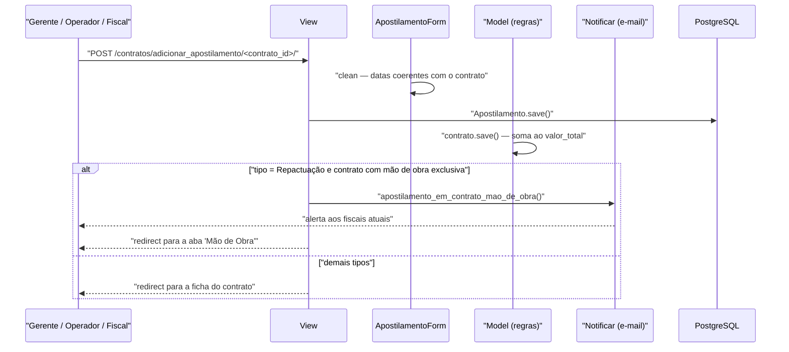

# Fluxo: Apostilar contrato

> Registra uma alteração que dispensa termo aditivo — reajuste, repactuação ou mudança de dotação orçamentária.

- **Ator(es):** Gerente de Contrato, Operador de Contrato, Fiscal de Contrato (todos têm `pode_aditivar_contrato`) — ver [README → Atores e papéis](../README.md#atores-e-papéis)
- **Gatilho:** `POST /contratos/adicionar_apostilamento/<contrato_id>/`
- **Pré-condições:** contrato cadastrado; documento do apostilamento disponível (arquivo obrigatório); data inicial não anterior à do contrato
- **Pós-condições:** `Apostilamento` criado e `Contrato.valor_total` recalculado (o valor do apostilamento é somado); em repactuação de contrato com mão de obra exclusiva, os fiscais são notificados para atualizar as remunerações
- **Depende de:** [cadastrar-contrato.md](cadastrar-contrato.md)
- **Habilita:** [gerenciar-mao-de-obra.md](gerenciar-mao-de-obra.md) — a repactuação obriga revisar os valores dos postos
- **Entrada no código:** `views.adicionar_apostilamento`, `views.editar_apostilamento`, `views.excluir_apostilamento` — `@permission_required('contratos.pode_aditivar_contrato')`

## Sequência

## Observações

- **Tipos:** Repactuação, Reajuste, Dotação Orçamentária e Outros (padrão). O tipo não altera o cálculo — todos somam ao `valor_total` — mas a **repactuação** dispara o desvio de fluxo descrito abaixo.
- **Repactuação leva à mão de obra:** ao registrar uma repactuação, a mensagem orienta atualizar as remunerações dos funcionários e o usuário é redirecionado direto para a aba "Mão de Obra". Se o contrato tem `mao_obra_exclusiva`, `Notificar.apostilamento_em_contrato_mao_de_obra()` envia alerta aos fiscais atuais pedindo a atualização dos valores dos postos conforme o instrumento aprovado.
- **Efeito no valor:** `Contrato.get_valor_apostilado()` soma todos os apostilamentos com valor preenchido; junto com os aditivos de valor, compõe `valor_total = valor + aditivado + apostilado`. Não há distinção de sinal — apostilamento redutor precisaria de valor negativo. ⚠️ REVISAR: não há supressão modelada, ao contrário do aditivo.
- **Datas:** `ApostilamentoForm.clean()` valida que a data final não seja anterior à inicial e que a data inicial não anteceda o início do contrato; ambas são opcionais.
- **Arquivo:** armazenado em `FileFieldPlus` (caminho `contratos/contrato/<id>/apostilamento/`), diferente do padrão `comum.Arquivo` usado por contrato, aditivo e publicações.
- **Propagação:** `Apostilamento.save()` e `delete()` chamam `contrato.save()`, mantendo o `valor_total` coerente.
- **Impacto no saldo:** por elevar o `valor_total`, o apostilamento amplia o saldo disponível — habilitando novas parcelas e medições sem necessidade de aditivo.

---
_Gerado/atualizado via subagent `documentador` em 2026-08-11._
