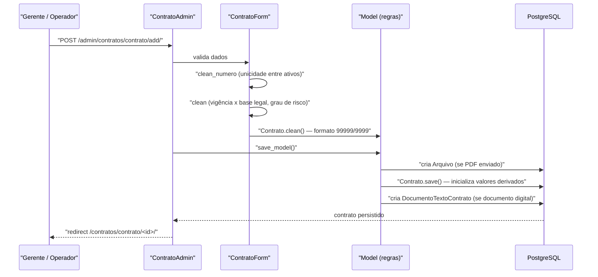

# Fluxo: Cadastrar contrato

> Registra no SUAP um contrato administrativo já publicado, com sua classificação, vigência, valor, contratada e documento.

- **Ator(es):** Gerente de Contrato, Operador de Contrato — ver [README → Atores e papéis](../README.md#atores-e-papéis)
- **Gatilho:** `POST /admin/contratos/contrato/add/` (formulário do admin)
- **Pré-condições:** tabelas acessórias cadastradas (tipo e subtipo de contrato, tipo de licitação, base legal); processo já existente no `protocolo`; contratada cadastrada como `Vinculo` (pessoa jurídica, pessoa externa ou prestador de serviço); documento digital do contrato **ou** arquivo em PDF disponível
- **Pós-condições:** `Contrato` criado com `valor_total = valor`, `valor_executado = 0`, `valor_previsto_parcela = 0` e `data_vencimento = data_fim`; se informado, o documento eletrônico é vinculado via `DocumentoTextoContrato`; se enviado, o PDF vira um `comum.Arquivo`; usuário é redirecionado para a ficha `/contratos/contrato/<id>/`
- **Depende de:** _nenhum_ — opcionalmente [importar-contrato-comprasgov.md](importar-contrato-comprasgov.md), que pré-preenche este mesmo formulário
- **Habilita:** [designar-fiscal.md](designar-fiscal.md), [definir-cronograma-e-parcelas.md](definir-cronograma-e-parcelas.md), [consultar-contratos-publico.md](consultar-contratos-publico.md), [notificacoes-automaticas.md](notificacoes-automaticas.md)
- **Entrada no código:** `admin.ContratoAdmin` (`form = ContratoForm`, `save_model`, `response_change`) — o cadastro é feito pelo admin, não por view própria

## Sequência

## Observações

- **Numeração:** `Contrato.clean_numero()` exige o formato `99999/9999` e normaliza com zeros à esquerda. A unicidade é verificada em `ContratoForm.clean_numero()` apenas entre contratos **ativos** — global ou por campus gerenciador, conforme a configuração `habilitar_numeracao_por_campi_gerenciador`.
- **Vigência limitada pela base legal:** a data final não pode exceder `data_inicio + (vigencia + prorrogacao)` meses da base legal; sem base legal o teto é 5 anos. Contratos com continuidade "Indeterminado" não podem ter data final.
- **Grau de risco:** obrigatório (1, 2 ou 3) quando `mao_obra_exclusiva` for "Sim" — é ele que define o percentual do submódulo 4.1 na conta vinculada.
- **Documento obrigatório na criação:** em contrato novo, o form exige o documento digital **ou** o upload do arquivo do contrato.
- **Restrição por unidade:** com `restringir_por_unidade` ligada, o formulário fixa `campi` e `campus_gerenciador` na unidade do usuário e torna `setores_gerenciadores` obrigatório; o queryset do admin também é filtrado. Superusuário, Auditor e Supervisor de Contratos são isentos.
- **Edição:** `ContratoAdmin.has_change_permission()` delega a `Contrato.pode_gerenciar(user)`, que combina grupo, campus gerenciador e setores gerenciadores.
- ⚠️ REVISAR: as validações de "empenho obrigatório para despesa" e "processo obrigatório para receita" comparam `cleaned_data['tipo']` (instância de `TipoContrato`) com as strings `'Despesa'`/`'Receita'` — nunca disparam (há `# TODO` no código).
- ⚠️ REVISAR: coexistem dois campos de arquivo do contrato (`arquivo`, um `comum.Arquivo` usado no cálculo de pendências, e `arquivo_contrato`, um `PrivateFileField`); qual é o canônico não está explícito.

---
_Gerado/atualizado via subagent `documentador` em 2026-08-11._
