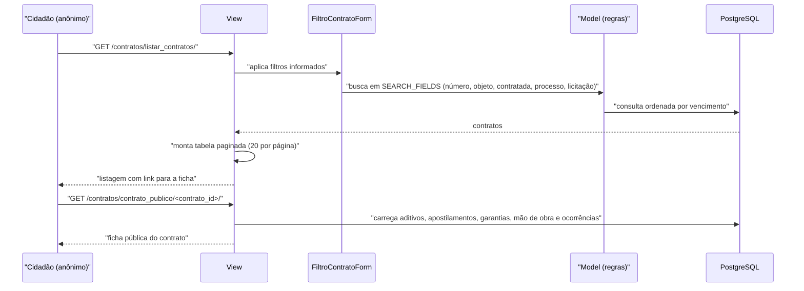

# Fluxo: Consultar contratos (consulta pública)

> Permite a qualquer cidadão, sem autenticação, pesquisar os contratos da instituição e ver a ficha pública de cada um.

- **Ator(es):** Cidadão / usuário anônimo; também servidores autenticados — ver [README → Atores e papéis](../README.md#atores-e-papéis)
- **Gatilho:** `GET /contratos/listar_contratos/` (busca) e `GET /contratos/contrato_publico/<contrato_id>/` (ficha)
- **Pré-condições:** nenhuma — as rotas não exigem login. Basta haver contratos cadastrados
- **Pós-condições:** nenhuma alteração de estado; apenas leitura
- **Depende de:** [cadastrar-contrato.md](cadastrar-contrato.md)
- **Habilita:** _nenhum_
- **Entrada no código:** `views.listar_contratos`, `views.contrato_publico` e `views.servicos_anonimos` (`@layout.servicos_anonimos()`)

## Sequência

## Observações

- **Serviço anônimo:** `views.servicos_anonimos` registra "Contratos" na categoria "Consultas gerais" da tela pública do SUAP, apontando para `/contratos/listar_contratos/`.
- **Filtros disponíveis:** busca textual livre (usa `Contrato.SEARCH_FIELDS`: id, número, objeto, pregão, número do processo físico/eletrônico e os campos de busca da contratada), contratada, tipo e subtipo, continuidade, natureza, base legal, tipo de licitação, dedicação exclusiva de mão de obra, concluído, cancelado, campi e faixas de data de início e de vencimento.
- **Colunas da listagem:** número (link para a ficha), processo, licitação, tipo de licitação, campi, contratada, concluído, cancelado, data de início e de vencimento — via `djtools.tables.get_table`, 20 por página, sem exportação.
- **Ficha pública:** mostra vigência (com alerta de vencimento nos próximos 90 dias), aditivos, apostilamentos, garantias, mão de obra e ocorrências. É uma visão reduzida em relação à ficha interna (`/contratos/contrato/<id>/`), que tem 16 abas e exige login.
- **Exposição de dados:** a ficha pública lista a **mão de obra terceirizada** do contrato (nome do prestador). ⚠️ REVISAR: verificar se a exposição de dados pessoais de terceirizados em página pública é intencional e compatível com a LGPD — os relatórios internos oferecem mascaramento de CPF, mas esta tela não tem controle equivalente.
- ⚠️ REVISAR: no filtro, `cancelado` é aplicado como `contratos.filter(concluido=cancelado)` (campo errado) e `continuidade` só é aplicada quando `subtipo_contrato` foi informado — dois bugs de filtro em `views.listar_contratos`.
- **Dados abertos:** a mesma informação é publicada como API por `dados_abertos/endpoints/contrato.py` e `engenharia.py`, que consomem `Contrato` diretamente — ver [FRONTEIRA.md](../FRONTEIRA.md).

---
_Gerado/atualizado via subagent `documentador` em 2026-08-11._
