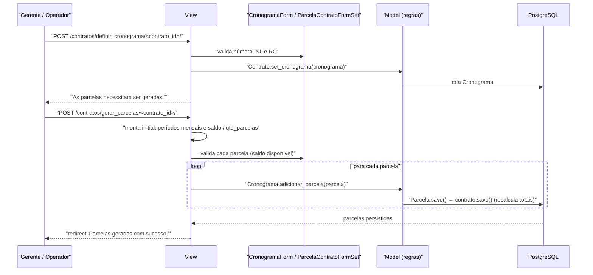

# Fluxo: Definir cronograma e parcelas

> Cria o cronograma físico-financeiro do contrato e distribui o valor em parcelas mensais previstas.

- **Ator(es):** Gerente de Contrato, Operador de Contrato — ver [README → Atores e papéis](../README.md#atores-e-papéis)
- **Gatilho:** `POST /contratos/definir_cronograma/<contrato_id>/` e, em seguida, `POST /contratos/gerar_parcelas/<contrato_id>/`
- **Pré-condições:** contrato cadastrado com valor e datas; número do cronograma (e opcionalmente NL e RC do SIAFI) disponível
- **Pós-condições:** `Cronograma` vinculado ao contrato e N `Parcela` criadas com período e valor previstos; `Contrato.valor_previsto_parcela` recalculado; as parcelas passam a aparecer na aba "Cronograma" prontas para medição
- **Depende de:** [cadastrar-contrato.md](cadastrar-contrato.md)
- **Habilita:** [efetuar-medicao.md](efetuar-medicao.md)
- **Entrada no código:** `views.definir_cronograma`, `views.gerar_parcelas`, `views.adicionar_parcela`, `views.atualizar_parcela`, `views.excluir_parcela` — todas com `@permission_required('contratos.pode_gerar_cronograma')`

## Sequência

## Observações

- **Cronograma vigente:** um contrato pode acumular vários cronogramas; `Contrato.get_cronograma()` sempre devolve o de **maior id**. Não há campo de "cronograma ativo". ⚠️ REVISAR: cronogramas antigos permanecem com suas parcelas e medições.
- **Pré-cálculo das parcelas:** `gerar_parcelas` monta o *initial* com períodos mensais consecutivos (`proximo_mes` e `somar_dias(vencimento, -1)`) a partir da data de início do contrato (ou de `?data=dd/mm/aaaa`) e divide `get_saldo_atual()` pela quantidade de parcelas (`?parcelas=N`, padrão `contrato.qtd_parcelas`). O usuário pode ajustar cada linha antes de salvar.
- **Trava de saldo:** `ParcelaForm.clean()` recusa parcela cujo valor previsto exceda `saldo_atual + valor_previsto_original`, exibindo o detalhamento (saldo, valor original, total disponível) em formato monetário brasileiro.
- **Parcela já medida é imutável no valor:** se a parcela tem medições, o campo `valor_previsto` é removido do formulário (`ParcelaForm.__init__`) e a exclusão é bloqueada (`views.excluir_parcela` e `Parcela.pode_ser_excluida()`).
- **Parcela sem medição:** `views.sem_medicao` alterna o booleano `Parcela.sem_medicao`, usado para dispensar formalmente a medição de um período — parcelas assim marcadas não entram no cálculo de `valor_previsto_parcela`.
- **Pré-requisito implícito:** `adicionar_parcela` e `gerar_parcelas` abortam com mensagem se o contrato ainda não tiver cronograma definido.
- **Propagação de totais:** cada `Parcela.save()`/`delete()` dispara `contrato.save()`. Na geração em lote isso significa uma gravação do contrato por parcela criada. ⚠️ REVISAR: custo desnecessário em contratos com muitas parcelas.
- Aditivos de valor ou prazo alteram o saldo e a vigência; após um aditivo é comum voltar a este fluxo para acrescentar parcelas — ver [aditivar-contrato.md](aditivar-contrato.md).

---
_Gerado/atualizado via subagent `documentador` em 2026-08-11._
