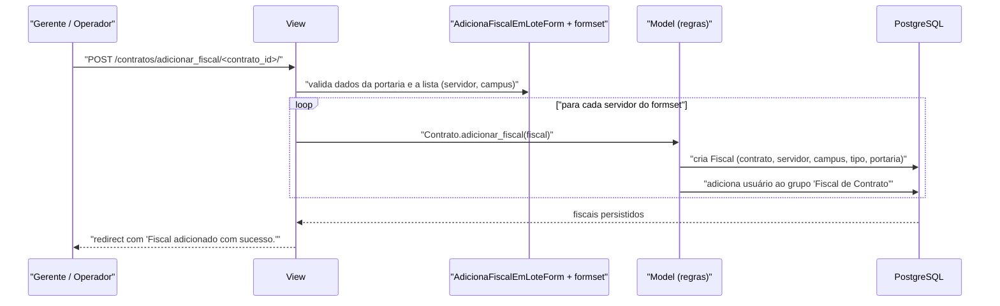

# Fluxo: Designar fiscal

> Vincula ao contrato um ou mais servidores designados por portaria para fiscalizar sua execução.

- **Ator(es):** Gerente de Contrato, Operador de Contrato — ver [README → Atores e papéis](../README.md#atores-e-papéis)
- **Gatilho:** `POST /contratos/adicionar_fiscal/<contrato_id>/`
- **Pré-condições:** contrato cadastrado; portaria de designação emitida (o número é obrigatório); servidores ativos no `rh`; `TipoFiscal` cadastrado
- **Pós-condições:** um registro `Fiscal` por servidor selecionado, com tipo, portaria, campus e vigência; **o usuário do servidor é adicionado ao grupo `Fiscal de Contrato`** se ainda não pertencer; o contrato deixa de ter a pendência "Contrato sem fiscal definido"
- **Depende de:** [cadastrar-contrato.md](cadastrar-contrato.md)
- **Habilita:** [efetuar-medicao.md](efetuar-medicao.md), [registrar-ocorrencia.md](registrar-ocorrencia.md), [agendar-e-registrar-fiscalizacao.md](agendar-e-registrar-fiscalizacao.md), [gerenciar-mao-de-obra.md](gerenciar-mao-de-obra.md)
- **Entrada no código:** `views.adicionar_fiscal` (`@permission_required('contratos.pode_adicionar_fiscal')`), com `AdicionaFiscalEmLoteForm` + o inline formset `servidor_campus`

## Sequência

## Observações

- **Cadastro em lote:** os dados da portaria (tipo, número, datas de nomeação e vigência) são únicos no formulário principal e replicados para cada par `(servidor, campus)` informado no formset — por isso a view zera `form.instance.id` a cada iteração.
- **Concessão automática de grupo:** `Contrato.adicionar_fiscal()` chama `in_group(...)` e, se necessário, adiciona o usuário ao grupo `Fiscal de Contrato`. É um efeito colateral relevante: designar alguém concede permissões globais do perfil, não apenas naquele contrato.
- **Tipo do fiscal muda o que ele pode fazer:** `TipoFiscal.eh_gestor_contrato` habilita conduzir o recebimento definitivo e gerar o termo; `TipoFiscal.pode_gerenciar_todas_medicoes_contrato` permite alterar/excluir medições e IMRs registrados por outros fiscais.
- **Fiscal ativo** é aquele com `data_exclusao` nula **e** `inativo=False` (`Contrato.get_fiscais_atuais()`) — é essa lista que recebe todas as notificações do módulo.
- **Exclusão é lógica:** remover um fiscal (`?excluir_fiscal=<id>` na ficha do contrato) apenas marca `inativo=True` e preenche `data_exclusao`; exige `pode_excluir_fiscal`, permissão que o Operador de Contrato **não** possui.
- **Ativação/desativação em lote:** `views.alterar_situacao_fiscal` (`/contratos/contrato/<id>/alterar_situacao_fiscal/<situacao>/`) alterna `inativo` para os ids marcados, com `situacao=1` ativando e `situacao=0` desativando.
- **Fiscal por aditivo:** `views.adicionar_fiscal_aditivo` cria o `Fiscal` já com `termo_aditivo` preenchido, para os casos de aditivo de fiscal.
- **Duplicidade:** `FiscalForm.clean()` impede adicionar o mesmo servidor duas vezes como fiscal ativo do contrato — mas a validação só ocorre quando o form recebe o `contrato`, o que não acontece no cadastro em lote. ⚠️ REVISAR.
- Documentos de apoio ao processo de designação são gerados por `solicitacao_fiscal`, `gerar_despacho_fiscal` e `solicitacao_publicacao_portaria_fiscal`, que criam `DocumentoTexto` e vinculam ao contrato.

---
_Gerado/atualizado via subagent `documentador` em 2026-08-11._
