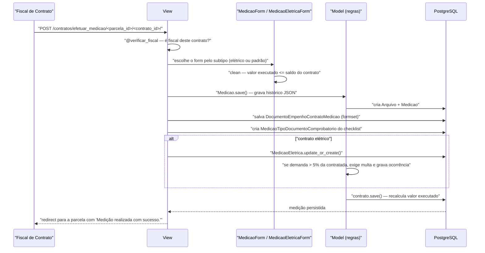

# Fluxo: Efetuar medição da parcela

> O fiscal registra o que foi efetivamente executado em uma parcela do cronograma, com nota fiscal, valor e empenhos consumidos.

- **Ator(es):** Fiscal de Contrato (designado **naquele** contrato) — ver [README → Atores e papéis](../README.md#atores-e-papéis)
- **Gatilho:** `POST /contratos/efetuar_medicao/<parcela_id>/<contrato_id>/` (ou `.../<imr_id>/` quando houver IMR a vincular)
- **Pré-condições:** contrato com cronograma e parcelas; usuário é fiscal ativo do contrato (`@verificar_fiscal()`); nota/documento fiscal e arquivo PDF disponíveis; se o contrato não permite medição sem empenho, ao menos uma nota de empenho vinculada com saldo
- **Pós-condições:** `Medicao` criada com `historico_medicao` inicial em JSON; arquivo armazenado como `comum.Arquivo`; consumo por empenho gravado em `DocumentoEmpenhoContratoMedicao`; itens do checklist criados como `MedicaoTipoDocumentoComprobatorio`; `Contrato.valor_executado` e `valor_previsto_parcela` recalculados; em contrato elétrico, `MedicaoEletrica` criada/atualizada
- **Depende de:** [definir-cronograma-e-parcelas.md](definir-cronograma-e-parcelas.md), [designar-fiscal.md](designar-fiscal.md)
- **Habilita:** [emitir-recebimento-provisorio.md](emitir-recebimento-provisorio.md), [encerrar-contrato.md](encerrar-contrato.md)
- **Entrada no código:** `views.efetuar_medicao` — `@rtr()` + `@permission_required('contratos.pode_efetuar_medicao')` + `@verificar_fiscal()` + `@atomic()`

## Sequência

## Observações

- **Autorização em duas camadas:** a permissão `pode_efetuar_medicao` é do grupo, mas o decorator `verificar_fiscal` (em `utils.py`) barra quem não for fiscal **daquele** contrato, redirecionando com "Você não é fiscal desse contrato."
- **Trava de saldo:** `MedicaoForm.clean()` recusa valor executado maior que `Contrato.get_saldo_atual()` (somando de volta o valor da própria medição, na edição) e rejeita `NaN`/infinito.
- **Empenho obrigatório por padrão:** se `permite_medicao_sem_empenho` for falso, o formset exige ao menos uma nota (`min_num=1`), impede empenho repetido e recusa valor acima do saldo restante da nota (`DocumentoEmpenhoContratoMedicaoInlineFormSet.clean`). Nesse caso o campo `valor_executado` fica *readonly* — é derivado dos empenhos. A flag só pode ser ligada em contratos com arrecadação de receita.
- **Contrato elétrico:** o subtipo configurado em `tipo_contrato_energia_eletrica` troca o formulário para `MedicaoEletricaForm`, que pede consumo de ponta/fora de ponta, demanda contratada/medida e mês/ano de referência. Ultrapassagem superior a 5% da demanda contratada torna a multa obrigatória e o sistema grava automaticamente uma ocorrência no campo `ocorrencia` da medição.
- **Checklist de documentos:** para cada `ContratoTipoDocumentoComprobatorio` do contrato, o formulário ganha um campo dinâmico `field_name_<id>` e a view cria o `MedicaoTipoDocumentoComprobatorio` correspondente (padrão "Não se aplica" quando não informado). Itens já marcados como "Recebido" pelo gestor ficam *readonly*.
- **IMR:** quando a parcela tem IMRs pendentes (`Parcela.get_imrs_pendentes()`), o campo aparece no formulário; caso contrário é removido. A relação é `OneToOne` — um IMR só pode ser consumido por uma medição.
- **Histórico versionado:** `Medicao.save()` compara o objeto no banco com o novo (`compare_model_objects`) e empilha o diff em `historico_medicao` (JSON), com data/hora e fiscal. Consultável em `/contratos/historico_medicao/<medicao_id>/`.
- **Edição e exclusão restritas ao autor:** `atualizar_medicao`, `excluir_medicao` e `adicionar_ocorrencia_medicao` só permitem ao fiscal que registrou a medição, salvo se seu `TipoFiscal.pode_gerenciar_todas_medicoes_contrato` for verdadeiro. Excluir uma medição gera estorno automático na conta vinculada.
- ⚠️ REVISAR: na criação, o `formset.is_valid()` é avaliado **depois** de a medição já ter sido salva; formset inválido resulta em medição sem empenhos vinculados (a transação só reverte se houver exceção).

---
_Gerado/atualizado via subagent `documentador` em 2026-08-11._
