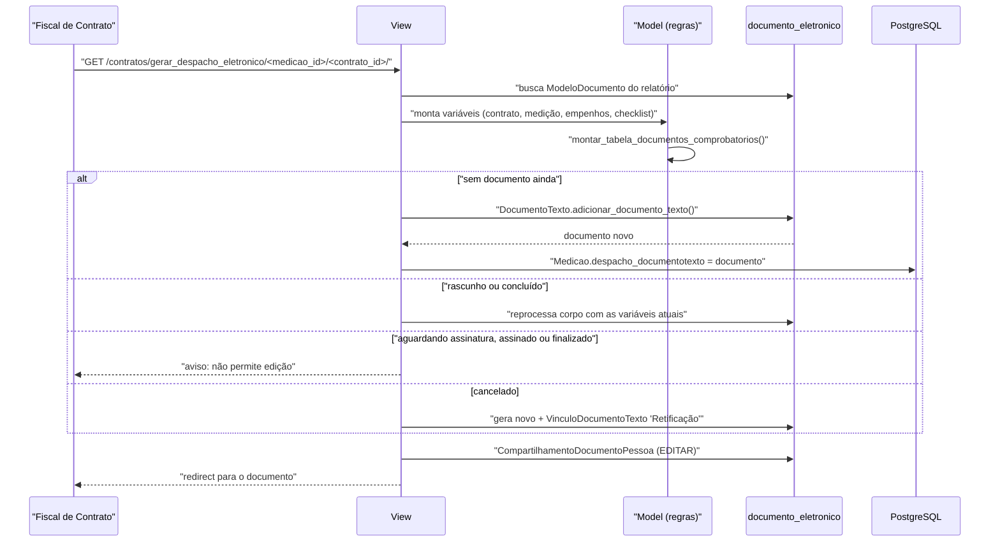

# Fluxo: Emitir recebimento provisório

> O fiscal gera o Relatório Circunstanciado de Recebimento Provisório da medição como documento eletrônico nato-digital.

- **Ator(es):** Fiscal de Contrato (designado **naquele** contrato) — ver [README → Atores e papéis](../README.md#atores-e-papéis)
- **Gatilho:** `GET /contratos/gerar_despacho_eletronico/<medicao_id>/<contrato_id>/`
- **Pré-condições:** medição registrada; existir o `ModeloDocumento` de nome "Relatório Circustanciado de Recebimento Provisório"; usuário no grupo `Fiscal de Contrato` e fiscal do contrato; app `documento_eletronico` instalado
- **Pós-condições:** `DocumentoTexto` criado (ou atualizado/substituído) e referenciado em `Medicao.despacho_documentotexto`; o autor recebe permissão de edição via `CompartilhamentoDocumentoPessoa`; ao ser assinado ou finalizado, o documento passa a caracterizar o recebimento provisório emitido
- **Depende de:** [efetuar-medicao.md](efetuar-medicao.md)
- **Habilita:** [receber-definitivamente-medicao.md](receber-definitivamente-medicao.md)
- **Entrada no código:** `views.gerar_despacho_documentotexto` — `@group_required('Fiscal de Contrato')` + `@verificar_fiscal()`

## Sequência

## Observações

- **Máquina de estados do documento** (não do módulo `contratos`): sem documento → gera; em rascunho/concluído → **regenera o corpo** com as variáveis atuais (reabrindo para edição se concluído); aguardando assinatura/assinado/finalizado → **bloqueia** e orienta cancelar ou excluir a solicitação de assinatura; cancelado → gera um novo e registra vínculo de **Retificação** com o antigo.
- **Variáveis do modelo** incluem cidade do campus, número do processo, dados do contrato e da medição, nome e CNPJ da contratada, valor por extenso (`utils.por_extenso`), nome e matrícula do fiscal, ocorrências, providências, a tabela do checklist e a lista de empenhos com o total. Quando `permite_medicao_sem_empenho` está ligado, o bloco de empenhos é substituído por "Não se aplica, pois contrato possui arrecadação de receita."
- **Base legal no documento:** usa `BaseLegal.conformidade_base_legal` quando preenchida; caso contrário, o texto padrão "Art. 73 da Lei nº 8.666/93".
- **O que conta como "emitido":** `Medicao.recebimento_provisorio_emitido()` só retorna verdadeiro quando o documento está **assinado ou finalizado** — gerar o rascunho não basta para liberar o recebimento definitivo.
- ⚠️ REVISAR: o nome do modelo de documento é buscado por **string literal** com o typo "Circustanciado"; renomear o modelo no `documento_eletronico` quebra o fluxo (a view apenas exibe erro e redireciona).
- ⚠️ REVISAR: `HipoteseLegal.objects.filter(pk=6)` — hipótese legal fixada por id numérico, sem FK nem configuração.
- A view legada `views.despacho_medicao` (que renderizava o despacho em HTML) permanece roteada, mas o próprio código a marca como substituída por este fluxo (TODO da demanda 850).

---
_Gerado/atualizado via subagent `documentador` em 2026-08-11._
