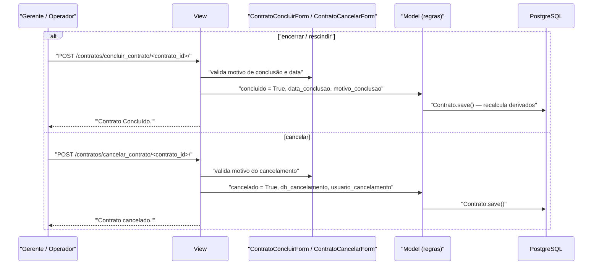

# Fluxo: Encerrar ou cancelar contrato

> Conclui (encerra/rescinde) um contrato ao fim de sua execução ou o cancela, registrando o motivo em ambos os casos.

- **Ator(es):** Gerente de Contrato e Operador de Contrato (conclusão); **apenas** Gerente de Contrato (cancelamento) — ver [README → Atores e papéis](../README.md#atores-e-papéis)
- **Gatilho:** `POST /contratos/concluir_contrato/<contrato_id>/` ou `POST /contratos/cancelar_contrato/<contrato_id>/`
- **Pré-condições:** contrato cadastrado; para conclusão, um `MotivoConclusaoContrato` cadastrado e a data de conclusão; para cancelamento, o texto do motivo
- **Pós-condições:** **conclusão** → `concluido=True`, `data_conclusao` e `motivo_conclusao` preenchidos; **cancelamento** → `cancelado=True`, `motivo_cancelamento`, `dh_cancelamento` e `usuario_cancelamento` registrados. Em ambos, o contrato sai das listagens de ativos e deixa de gerar notificações
- **Depende de:** [efetuar-medicao.md](efetuar-medicao.md) — na prática, encerra-se após a execução; o modelo não exige medições
- **Habilita:** _nenhum_ — é o fim do ciclo de vida no módulo
- **Entrada no código:** `views.concluir_contrato` e `views.desfazer_conclusao_contrato` (`@permission_required('contratos.pode_encerrar_contrato')`); `views.cancelar_contrato` (`@permission_required('contratos.pode_cancelar_contrato')`)

## Sequência

## Observações

- **Conclusão x cancelamento:** conclusão é o encerramento **normal ou por rescisão** (a tela se chama "Encerrar/Rescindir Contrato") e exige um motivo do catálogo `MotivoConclusaoContrato`; cancelamento é a invalidação do registro, com motivo em texto livre e rastro de quem e quando.
- **Efeito nas listagens:** `ContratoQueryset.ativos()` filtra `concluido=False, cancelado=False` — encerrar ou cancelar remove o contrato dos quadros do dashboard, das abas de "a vencer"/"vigência expirada" e dos relatórios de pendências.
- **Efeito nas notificações:** os comandos diários de expiração, garantia e mão de obra filtram `concluido=False` (e o de expiração também `cancelado=False`), então o encerramento interrompe as cobranças automáticas.
- **Cancelamento congela as operações:** praticamente todos os `Contrato.pode_gerenciar_*` (empenho, conta, ocorrência, penalidade, mão de obra, agenda, recebimento definitivo) retornam falso quando `cancelado=True`, bloqueando as abas correspondentes. A conclusão, por si só, **não** aplica esse bloqueio. ⚠️ REVISAR: assimetria intencional?
- **Reversível:** `desfazer_conclusao_contrato` limpa `concluido`, `data_conclusao` e `motivo_conclusao`, devolvendo o contrato à operação. Não há equivalente para o cancelamento.
- **Validação paralela no admin:** `ContratoForm` também permite marcar a conclusão, exigindo coerência entre `concluido` e `motivo_conclusao` (um obriga o outro) e que a data de conclusão não seja anterior ao início.
- **Exclusão é outra coisa:** `Contrato.delete()` remove publicações, anexos, aditivos e os `Arquivo` associados. A view `views.excluir` existe mas está vazia (`pass`) — a exclusão real ocorre pelo admin. ⚠️ REVISAR: rota/permissão `contratos.can_delete` sem implementação.

---
_Gerado/atualizado via subagent `documentador` em 2026-08-11._
