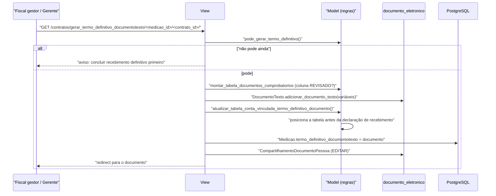

# Fluxo: Gerar termo de recebimento definitivo

> Emite o Termo Circunstanciado de Recebimento Definitivo da medição, já com a tabela da retenção da conta vinculada embutida.

- **Ator(es):** Fiscal gestor do contrato, Gerente de Contrato, Coordenador de Contrato Sistêmico — ver [README → Atores e papéis](../README.md#atores-e-papéis)
- **Gatilho:** `GET /contratos/gerar_termo_definitivo_documentotexto/<medicao_id>/<contrato_id>/`
- **Pré-condições:** recebimento provisório emitido; recebimento definitivo concluído pelo gestor (sem itens pendentes, quando há checklist); termo ainda editável (`termo_definitivo_permite_atualizacao`); existir o `ModeloDocumento` "Termo Circunstanciado de Recebimento Definitivo"
- **Pós-condições:** `DocumentoTexto` criado/atualizado/substituído e referenciado em `Medicao.termo_definitivo_documentotexto`; corpo do documento contém a tabela do checklist revisado e a tabela da conta vinculada; autor recebe permissão de edição
- **Depende de:** [receber-definitivamente-medicao.md](receber-definitivamente-medicao.md)
- **Habilita:** _nenhum_ — é o encerramento documental do ciclo da medição; o pagamento segue fora do módulo
- **Entrada no código:** `views.gerar_termo_definitivo_documentotexto` — `@group_required('Fiscal de Contrato, Gerente de Contrato')` + `Contrato.pode_gerenciar_recebimento_definitivo(request)`

## Sequência

## Observações

- **Porta de entrada:** `Medicao.pode_gerar_termo_definitivo()` exige recebimento provisório emitido e, no fluxo com checklist, que a medição tenha sido efetivamente recebida (`foi_recebida_definitivamente()` — nenhum item pendente ou sem revisão). No fluxo simplificado basta o provisório e o termo estar editável.
- **Tabela do checklist:** a mesma função do recebimento provisório (`Medicao.montar_tabela_documentos_comprobatorios`) é reutilizada, agora com a coluna "REVISADO?" mostrando a revisão do gestor (ou, na ausência, a confirmação do fiscal).
- **Tabela da conta vinculada:** montada a partir do **último** `ContaVinculadaCalculo` da medição (`tabela_conta_vinculada_termo_definitivo_html`, template `includes/conta_vinculada_termo_definitivo.html`) com os valores por trabalhador e a movimentação de depósito. Sem cálculo persistido, a tabela sai vazia.
- **Posicionamento no corpo do documento:** `posicionar_tabela_conta_vinculada_termo_definitivo()` remove a tabela anterior por regex e insere a nova imediatamente antes do bloco "DECLARAÇÃO DE RECEBIMENTO DEFINITIVO"; se não encontrar, insere após o quadro "VALOR FINAL DA NOTA APLICANDO O IMR"; em último caso, anexa ao fim.
- **Mesma máquina de estados do documento** do recebimento provisório: rascunho/concluído → regenera; assinado/finalizado → bloqueia com orientação de cancelar; cancelado → gera novo com vínculo de **Retificação**.
- **Efeito colateral relevante:** enquanto o termo estiver em rascunho ou concluído, ele pode ser regenerado — e é por isso que `termo_definitivo_permite_atualizacao()` **impede** reabrir o recebimento definitivo depois que o termo foi enviado para assinatura.
- ⚠️ REVISAR: o corpo do documento é manipulado por expressões regulares sobre HTML (`_indice_texto_visivel_html`, `_inicio_bloco_html`, `_fim_bloco_html`); mudanças no modelo de documento (títulos, estrutura de tabelas) podem deslocar a inserção silenciosamente.
- ⚠️ REVISAR: nome do modelo e `HipoteseLegal` id 6 novamente fixados no código, como no recebimento provisório.

---
_Gerado/atualizado via subagent `documentador` em 2026-08-11._
