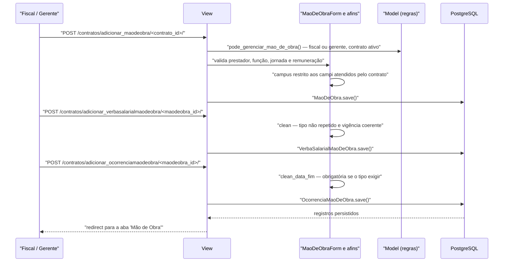

# Fluxo: Gerenciar mão de obra terceirizada

> Mantém o cadastro dos trabalhadores terceirizados alocados ao contrato, com função, remuneração, verbas, ocorrências e documentos.

- **Ator(es):** Fiscal de Contrato (do contrato), Gerente de Contrato, Coordenador de Contrato Sistêmico — ver [README → Atores e papéis](../README.md#atores-e-papéis)
- **Gatilho:** `POST /contratos/adicionar_maodeobra/<contrato_id>/` (e as rotas de anexo, ocorrência e verba salarial)
- **Pré-condições:** contrato não cancelado; usuário é fiscal do contrato ou gerente/coordenador (`Contrato.pode_gerenciar_mao_de_obra`); prestador de serviço já cadastrado e ativo em `comum.PrestadorServico`
- **Pós-condições:** `MaoDeObra` criada/atualizada com função, jornada, horários e remuneração; anexos, ocorrências e verbas salariais associados; o contrato deixa de ser alvo da notificação "contrato de mão de obra sem registro"; a base de cálculo da conta vinculada passa a existir
- **Depende de:** [cadastrar-contrato.md](cadastrar-contrato.md) (com `mao_obra_exclusiva`), [designar-fiscal.md](designar-fiscal.md); revisões podem ser disparadas por [apostilar-contrato.md](apostilar-contrato.md)
- **Habilita:** [receber-definitivamente-medicao.md](receber-definitivamente-medicao.md) e [movimentar-conta-vinculada.md](movimentar-conta-vinculada.md) — o cálculo da retenção é por trabalhador
- **Entrada no código:** `views.adicionar_maodeobra`, `editar_maodeobra`, `excluir_maodeobra`, `adicionar_anexomaodeobra`, `remover_anexomaodeobra`, `adicionar_ocorrenciamaodeobra`, `editar_ocorrenciamaodeobra`, `adicionar_verbasalarial`, `editar_verbasalarial`, `copiar_maodeobra`, `exportar_maodeobra`

## Sequência

## Observações

- **Autorização:** `Contrato.pode_gerenciar_mao_de_obra()` exige ser fiscal do contrato **ou** Gerente de Contrato do mesmo campus / Coordenador de Contrato Sistêmico, e que o contrato não esteja cancelado. As views checam explicitamente e levantam `PermissionDenied`.
- **Campus restrito:** o formulário limita o campus do trabalhador aos campi atendidos pelo contrato.
- **Desligamento em vez de exclusão:** preencher `desligamento` move o trabalhador para a lista de inativos (`maosdeobra_inativas` na tela). A exclusão física existe, mas os `PROTECT` de ocorrências e verbas a impedem quando há histórico.
- **Verbas salariais:** não pode haver duas verbas do mesmo tipo para o mesmo trabalhador (validação apenas no formulário, sem constraint no banco); a data final é obrigatória quando o `TipoVerbaSalarial` assim exigir e deve ser maior que a inicial.
- **Ocorrências:** a data final é obrigatória quando o `TipoOcorrencia` marcar `obrigatorio_informar_data_fim`; aceita anexo em PDF, JPEG, JPG ou PNG (até 5 MB).
- **Base de cálculo da retenção:** o cálculo da conta vinculada usa `salario_bruto` do trabalhador ou, na ausência, `valor_total_das_verbas` (soma das verbas). ⚠️ REVISAR: duas fontes possíveis para a mesma grandeza, que podem divergir.
- **Cópia entre contratos:** `copiar_maodeobra` clona os trabalhadores selecionados para outro contrato (zerando o id). Anexos, ocorrências e verbas **não** são copiados. ⚠️ REVISAR: cópia parcial; além disso, a mensagem de sucesso redireciona para a aba "itens", não para "maodeobra".
- **Auditoria:** a edição registra um `LogEntry` do admin com o diff campo a campo (`utils.add_log_entry`), comparando `model_to_dict` antes e depois.
- **Exportações:** `exportar_maodeobra` gera XLS por contrato (com ocorrências e verbas aninhadas, síncrono); o relatório institucional de terceirizados é assíncrono (`tasks.relatorio_terceirizados_xls`) e permite mascarar CPFs.
- **Notificação de ausência:** contratos com mão de obra exclusiva e **nenhum** registro após 30 dias do início geram alerta diário aos fiscais — ver [notificacoes-automaticas.md](notificacoes-automaticas.md).

---
_Gerado/atualizado via subagent `documentador` em 2026-08-11._
