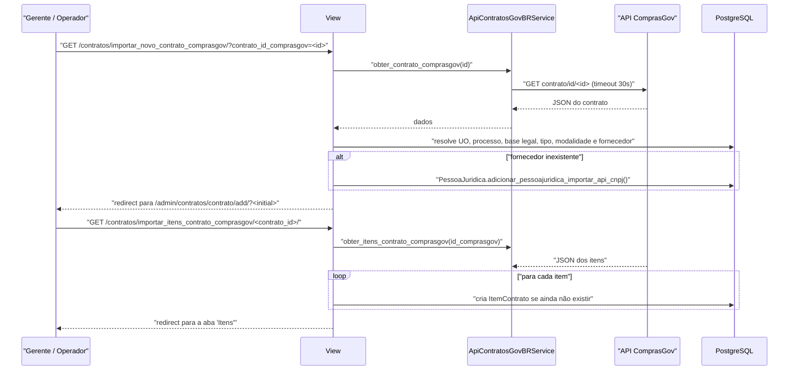

# Fluxo: Importar contrato do ComprasGov

> Busca um contrato (e depois seus itens) na API do ComprasGov e pré-preenche o cadastro no SUAP, evitando digitação manual.

- **Ator(es):** Gerente de Contrato, Operador de Contrato — ver [README → Atores e papéis](../README.md#atores-e-papéis)
- **Gatilho:** `GET /contratos/importar_novo_contrato_comprasgov/?contrato_id_comprasgov=<id>`; itens por `GET /contratos/importar_itens_contrato_comprasgov/<contrato_id>/`
- **Pré-condições:** `comum.APIExterna.CONTRATOSGOVBR` cadastrada e **ativa**; identificador do contrato no ComprasGov em mãos; existir `UnidadeOrganizacional` com o `codigo_ug` retornado; para os itens, o contrato precisa ter `id_comprasgov` preenchido
- **Pós-condições:** o usuário é redirecionado ao formulário de cadastro do admin com os campos pré-preenchidos via querystring (nada é gravado ainda); na importação de itens, `ItemContrato` criados para os que ainda não existem
- **Depende de:** _nenhum_
- **Habilita:** [cadastrar-contrato.md](cadastrar-contrato.md) — este fluxo termina exatamente no formulário daquele
- **Entrada no código:** `views.importar_novo_contrato_comprasgov` (`@permission_required('contratos.add_contrato')`), `views.importar_itens_contrato_comprasgov` (`@permission_required('contratos.change_contrato')`), `forms.BuscarContratoComprasGovForm`, `services.ApiContratosGovBRService`

## Sequência

## Observações

- **Nada é gravado na importação do contrato:** a view apenas monta o dicionário `initial` e redireciona para o formulário do admin com os valores na querystring — o cadastro só se efetiva quando o usuário revisa e salva (mensagem: "Altere as informações necessárias e clique em Salvar").
- **Mapeamentos automáticos:** identificador, número, objeto, vigência, quantidade/valor de parcelas, valor global, número da licitação e natureza (receita/despesa) vêm diretos do JSON. Campus atendido e gerenciador são resolvidos por `codigo_ug`; processo por `numero_protocolo_fisico`; base legal por `titulo__icontains` do fundamento legal; tipo de contrato por `descricao__icontains` da categoria; modalidade por `descricao__icontains`.
- **Fornecedor:** busca `PessoaJuridica` pelo CNPJ e, se não existir, tenta criá-la consultando a API de CNPJ (`adicionar_pessoajuridica_importar_api_cnpj`); o vínculo resultante alimenta `vinculo_contratado`.
- **Guarda de UO:** se não houver `UnidadeOrganizacional` com o `unidade_codigo` retornado, a importação é abortada com mensagem explicativa — evita criar contrato órfão.
- **Itens são idempotentes:** cada `ItemContrato` só é criado se ainda não existir a combinação `(contrato, id_comprasgov)`, reforçada por `UniqueConstraint` no banco. Reimportar não duplica; a view informa quantos itens foram adicionados.
- **Autorização dos itens:** além de `change_contrato`, exige ser fiscal **e** gestor do contrato, ou Coordenador de Contrato Sistêmico. ⚠️ REVISAR: a condição usa `not eh_fiscal or not eh_gestor_contrato`, o que exige acumular os dois papéis — provavelmente a intenção era `ou`.
- **Erros da API:** `Timeout` e `RequestException` viram `ValidationError` com mensagem amigável ("A API do ComprasGov está com instabilidade…"). A view de contrato relança a exceção quando `settings.DEBUG` está ligado.
- **Integração desligável:** se `APIExterna.CONTRATOSGOVBR.ativo` for falso, a busca falha imediatamente e a importação de itens orienta contatar o suporte.
- O ponto de entrada na interface é o botão "Importar do ComprasGov" adicionado à barra de ações do `ContratoAdmin` para quem tem `add_contrato`.

---
_Gerado/atualizado via subagent `documentador` em 2026-08-11._
