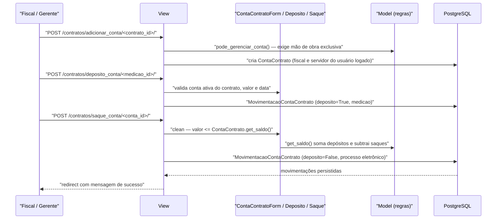

# Fluxo: Movimentar conta vinculada

> Cadastra a conta vinculada do contrato e registra depósitos (retenções) e saques (liberações) das provisões trabalhistas.

- **Ator(es):** Fiscal de Contrato (que possa efetuar medição), Gerente de Contrato, Coordenador de Contrato Sistêmico — ver [README → Atores e papéis](../README.md#atores-e-papéis)
- **Gatilho:** `POST /contratos/adicionar_conta/<contrato_id>/`, `POST /contratos/deposito_conta/<medicao_id>/`, `POST /contratos/saque_conta/<conta_id>/`
- **Pré-condições:** contrato com `mao_obra_exclusiva=True` e **não cancelado** (`Contrato.pode_gerenciar_conta`); para depósito, medição existente; para saque, saldo suficiente
- **Pós-condições:** `ContaContrato` criada/atualizada e/ou `MovimentacaoContaContrato` registrada (depósito ou saque), atualizando o saldo calculado da conta
- **Depende de:** [receber-definitivamente-medicao.md](receber-definitivamente-medicao.md) (que lança o depósito automaticamente) e [gerenciar-mao-de-obra.md](gerenciar-mao-de-obra.md)
- **Habilita:** _nenhum_ — é um fluxo de controle financeiro paralelo ao ciclo da medição
- **Entrada no código:** `views.adicionar_conta`, `views.editar_conta`, `views.deposito_conta`, `views.saque_conta`, `views.editar_movimentacao` — todas `@login_required` + `Contrato.pode_gerenciar_conta(request)`

## Sequência

## Observações

- **Pré-requisito de negócio:** a aba "Contas Vinculadas" e todas essas views só existem para contratos com dedicação exclusiva de mão de obra; contratos cancelados bloqueiam a operação.
- **Depósito é atrelado à medição:** `deposito_conta` recebe o `medicao_id` na URL e grava a movimentação já vinculada a ela — é o mesmo caminho que o recebimento definitivo automatiza. A tela exibe os percentuais vigentes (13º, férias, FGTS, submódulo) para conferência.
- **Saque valida saldo:** `SaqueContaContratoForm.clean()` recusa valor maior que `ContaContrato.get_saldo()`; na edição, `EditarMovimentacaoContaContratoForm.clean()` soma de volta o valor original antes de comparar. O saque aceita o vínculo com um processo eletrônico que o justifique.
- **Saldo é calculado, não armazenado:** `get_saldo()` percorre todas as movimentações somando depósitos e subtraindo saques, convertendo cada valor de texto para `Decimal`.
- **Conta inativa:** `ContaContrato.ativa` (editável em `editar_conta`) retira a conta das opções de depósito e da escolha automática no recebimento definitivo, sem apagar o histórico.
- **Lançamento automático:** ao concluir o recebimento definitivo sem pendências, a movimentação de depósito é criada por `update_or_create` na conta escolhida — reprocessar o recebimento **atualiza** o mesmo lançamento em vez de duplicá-lo, e depósitos da mesma medição em outras contas são apagados.
- **Estorno por exclusão de medição:** excluir uma medição cria movimentações inversas (`registrar_estorno_conta_vinculada_por_exclusao`), com `medicao=None` e observação automática citando a medição e o período. O histórico é preservado; nada é apagado.
- ⚠️ REVISAR: `MovimentacaoContaContrato.valor` é um campo de **texto** (`CharFieldPlus`), não decimal — impede agregação em SQL, ordenação numérica e validação no banco, além de exigir conversão via `float` a cada leitura do saldo.

---
_Gerado/atualizado via subagent `documentador` em 2026-08-11._
