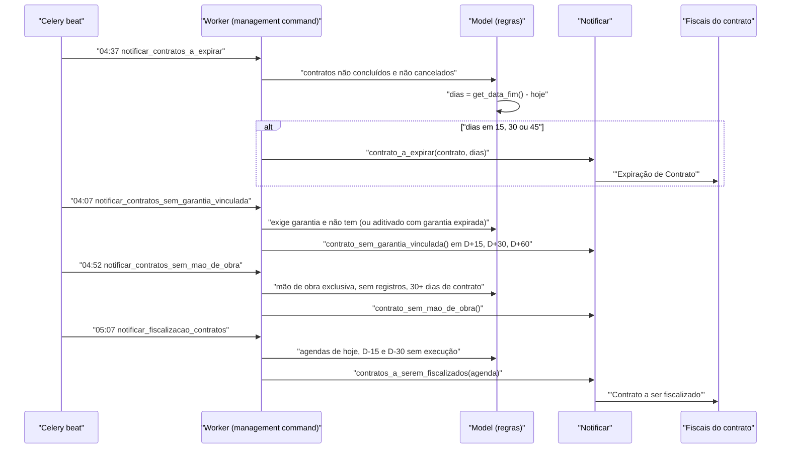

# Fluxo: Notificações automáticas de acompanhamento

> Varreduras diárias que cobram dos fiscais as pendências do contrato: expiração próxima, garantia ausente, mão de obra não cadastrada e fiscalização programada.

- **Ator(es):** Sistema (Celery beat) — os destinatários são os **fiscais atuais** de cada contrato. Ver [README → Atores e papéis](../README.md#atores-e-papéis)
- **Gatilho:** agendamento diário declarado em `contratos/beat.py` (04:07, 04:37, 04:52 e 05:07)
- **Pré-condições:** Celery beat ativo; contratos com fiscais designados (sem fiscal atual não há destinatário); `settings.SITE_URL` e `DEFAULT_FROM_EMAIL` configurados
- **Pós-condições:** e-mails/notificações enviados aos fiscais; nenhum dado de domínio é alterado — exceto o registro de `NotificacaoSistema` usado como trava pelo comando de garantia
- **Depende de:** [cadastrar-contrato.md](cadastrar-contrato.md), [designar-fiscal.md](designar-fiscal.md), [agendar-e-registrar-fiscalizacao.md](agendar-e-registrar-fiscalizacao.md)
- **Habilita:** _nenhum_ — realimenta os fluxos de [aditivar-contrato.md](aditivar-contrato.md), [gerenciar-mao-de-obra.md](gerenciar-mao-de-obra.md) e o registro da fiscalização
- **Entrada no código:** `contratos/beat.py` → `management/commands/notificar_contratos_a_expirar.py`, `notificar_contratos_sem_garantia_vinculada.py`, `notificar_contratos_sem_mao_de_obra.py`, `notificar_fiscalizacao_contratos.py`; mensagens em `contratos/utils.py` (`Notificar`)

## Sequência

## Observações

- **Expiração (04:37):** percorre contratos não concluídos e não cancelados e notifica quando faltam **exatamente** 15, 30 ou 45 dias para `get_data_fim()` (que já considera aditivos de prazo). Como a comparação é por igualdade, uma falha na execução do dia faz a janela ser perdida.
- **Garantia ausente (04:07):** une dois conjuntos — contratos que exigem garantia e não têm nenhuma, e contratos aditivados cuja garantia já expirou. Notifica em D+15, D+30 e D+60 do início (ou do início do último aditivo) e, **após** D+60, passa a notificar continuamente até que exista registro em `NotificacaoSistema` com o assunto correspondente. É o único comando com trava de reenvio.
- **Mão de obra ausente (04:52):** contratos com `mao_obra_exclusiva=True`, não concluídos, iniciados há 30 dias ou mais e **sem nenhum** registro de mão de obra. ⚠️ REVISAR: não há trava — o alerta se repete todo dia enquanto a pendência existir.
- **Agenda de fiscalização (05:07):** agendas com `data_prevista` em hoje, D-15 ou D-30 e `data_execucao` nula; notifica os fiscais da agenda ou, na ausência, todos os fiscais atuais do contrato.
- **Destinatários e canal:** `Notificar.contrato_a_expirar`, `contrato_sem_garantia_vinculada`, `contrato_sem_mao_de_obra` e `contratos_a_serem_fiscalizados` usam `send_notification` (notificação interna + e-mail) para os vínculos dos fiscais atuais, com `categoria` que agrupa as mensagens. As mensagens incluem link direto para a aba relevante do contrato.
- ⚠️ REVISAR: os três primeiros comandos envolvem o corpo do laço em `try/except Exception: continue` — um contrato com dados inconsistentes é silenciosamente pulado, sem log do erro.
- **Notificação sob demanda:** a tela `/contratos/pendencias/` permite ao gerente/operador disparar manualmente notificações de vencimento de contrato e de parcela atrasada (via `comum.Notificador`, modelos 1 e 2), complementando estas rotinas.
- **Não confundir com as tasks Celery do módulo:** as seis `@task` de `tasks.py` são exportações XLS acionadas por usuário; estas notificações são `management commands` agendados no beat.

---
_Gerado/atualizado via subagent `documentador` em 2026-08-11._
