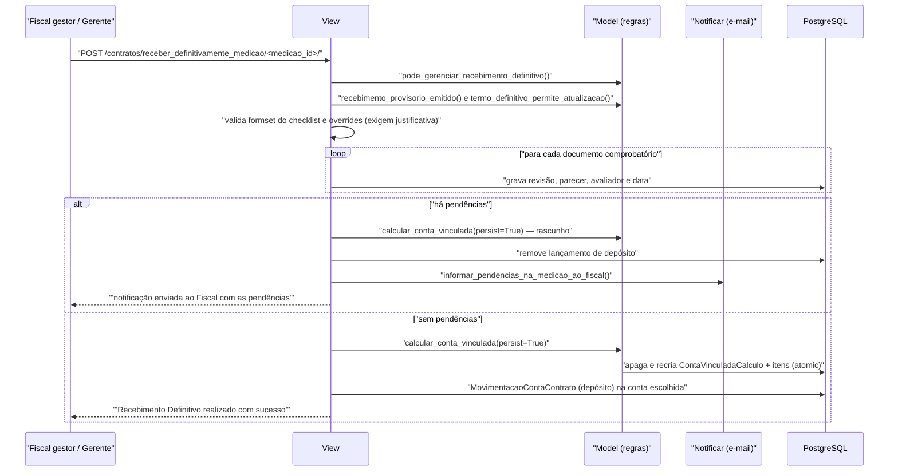

# Fluxo: Receber definitivamente a medição

> O gestor confere os documentos comprobatórios da medição, aponta pendências ou conclui o aceite, calculando e lançando a retenção da conta vinculada.

- **Ator(es):** Fiscal gestor do contrato (`TipoFiscal.eh_gestor_contrato`), Gerente de Contrato, Coordenador de Contrato Sistêmico — ver [README → Atores e papéis](../README.md#atores-e-papéis)
- **Gatilho:** `POST /contratos/receber_definitivamente_medicao/<medicao_id>/`
- **Pré-condições:** recebimento provisório emitido (documento assinado ou finalizado); termo definitivo ainda editável; contrato não cancelado; se o contrato usa checklist, a medição precisa ter documentos comprobatórios
- **Pós-condições:** cada `MedicaoTipoDocumentoComprobatorio` recebe `recebido_gerente`, `parecer_gerente`, `avaliador_gerente` e `data_avaliacao`; **sem pendências** → `ContaVinculadaCalculo` persistido e depósito lançado na conta vinculada escolhida; **com pendências** → cálculo salvo como rascunho, lançamento removido e o fiscal notificado por e-mail
- **Depende de:** [emitir-recebimento-provisorio.md](emitir-recebimento-provisorio.md), [gerenciar-mao-de-obra.md](gerenciar-mao-de-obra.md) (base de cálculo da retenção)
- **Habilita:** [gerar-termo-recebimento-definitivo.md](gerar-termo-recebimento-definitivo.md), [movimentar-conta-vinculada.md](movimentar-conta-vinculada.md)
- **Entrada no código:** `views.receber_definitivamente_medicao` — `@group_required('Fiscal de Contrato, Gerente de Contrato')` + `Contrato.pode_gerenciar_recebimento_definitivo(request)`

## Sequência

## Observações

- **Quem pode:** `Contrato.pode_gerenciar_recebimento_definitivo()` exige ser **fiscal gestor** do contrato (`tipo.eh_gestor_contrato`) ou Coordenador de Contrato Sistêmico / Gerente de Contrato do mesmo campus, e que o contrato não esteja cancelado.
- **Dois fluxos possíveis:** `Medicao.usa_fluxo_recebimento_definitivo_com_documentos()` decide entre o fluxo **com checklist** (quando o contrato tem `ContratoTipoDocumentoComprobatorio` ou a medição já tem documentos) e o **simplificado**, que apenas confirma o recebimento. No fluxo com checklist, `sincronizar_documentos_comprobatorios_com_contrato()` cria na medição os tipos adicionados ao contrato depois dela.
- **O gestor reconfirma tudo:** mesmo os itens marcados pelo fiscal como "Não se aplica" precisam de revisão do gestor (`get_documentos_comprobatorios_para_recebimento_definitivo`). A medição só é considerada recebida quando **nenhum** item está sem revisão ou como "Pendente" (`Medicao.foi_recebida_definitivamente`).
- **Pendência exige descrição:** `MedicaoTipoDocumentoComprobatorioForm.clean_parecer_gerente()` obriga preencher a descrição quando a revisão for "Pendente"; nesse caso o fiscal recebe e-mail listando documento e pendência.
- **Cálculo da retenção:** os *overrides* por trabalhador chegam como JSON no POST (`overrides`) e a seleção de trabalhadores como lista de ids (`maos`). Qualquer alteração de valor **exige justificativa** — a view bloqueia e devolve erro caso contrário. Modos suportados: automático, ajuste da base (`modo=base`, recalcula os componentes), valores manuais, valor total manual (rateado proporcionalmente) e isento (zera tudo).
- **Mês sem recolhimento:** enviar a lista de trabalhadores vazia marca a medição como mês sem retenção — o cálculo é persistido com justificativa própria e o lançamento de depósito é removido.
- **Escolha da conta:** com uma única conta ativa ela é usada automaticamente; com várias, o `EscolhaContaVinculadaRetencaoForm` (ou o campo `conta_vinculada_id` no POST) define o destino. Depósitos anteriores da mesma medição em outras contas são apagados antes do `update_or_create`.
- **Pré-visualização:** `POST /contratos/calcular_conta_vinculada/<medicao_id>/` (`calcular_conta_vinculada_ajax`) devolve o cálculo em JSON sem persistir, para a tela simular os valores.
- ⚠️ REVISAR: todo o bloco de cálculo/lançamento está envolto em `try/except Exception` que devolve **mensagem de sucesso** ao usuário mesmo quando a persistência falha ("Erro ao tentar persistir cálculo da conta vinculada"), sem log nem rollback do restante.
- ⚠️ REVISAR: a gravação dos documentos comprobatórios e o lançamento na conta não compartilham uma transação — uma falha no meio deixa o checklist revisado sem a retenção correspondente.

---
_Gerado/atualizado via subagent `documentador` em 2026-08-11._
