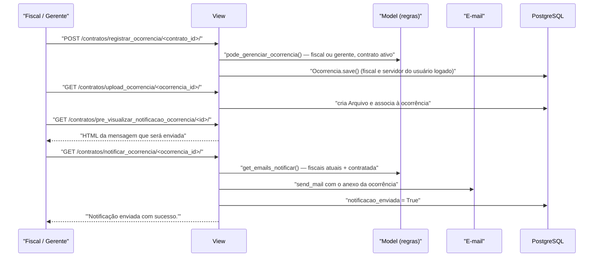

# Fluxo: Registrar e notificar ocorrência

> Registra um fato relevante da execução contratual, com prazo de resolução, e notifica a contratada e os fiscais.

- **Ator(es):** Fiscal de Contrato (do contrato), Gerente de Contrato, Coordenador de Contrato Sistêmico — ver [README → Atores e papéis](../README.md#atores-e-papéis)
- **Gatilho:** `POST /contratos/registrar_ocorrencia/<contrato_id>/`; a notificação por `GET /contratos/notificar_ocorrencia/<ocorrencia_id>/`
- **Pré-condições:** contrato não cancelado; usuário é fiscal do contrato ou gerente/coordenador (`Contrato.pode_gerenciar_ocorrencia`); para notificar, a contratada precisa ter e-mail de notificação cadastrado no vínculo
- **Pós-condições:** `Ocorrencia` registrada com descrição, prazo de resolução, situação e campus; ao notificar, e-mail enviado aos fiscais atuais e à contratada (com o anexo, se houver) e `notificacao_enviada = True`
- **Depende de:** [designar-fiscal.md](designar-fiscal.md)
- **Habilita:** _nenhum_ — alimenta o indicador "contratos com ocorrências expiradas" e pode embasar [encerrar-contrato.md](encerrar-contrato.md) ou a aplicação de penalidade
- **Entrada no código:** `views.registrar_ocorrencia`, `editar_ocorrencia`, `upload_ocorrencia`, `upload_ocorrencia_resposta`, `pre_visualizar_notificacao_ocorrencia`, `notificar_ocorrencia`

## Sequência

## Observações

- **Ocorrência do contrato ≠ ocorrência de mão de obra:** esta entidade (`Ocorrencia`) não tem tipo e trata da execução contratual; eventos do trabalhador terceirizado são `OcorrenciaMaoDeObra`, com tipo e vigência — ver [gerenciar-mao-de-obra.md](gerenciar-mao-de-obra.md).
- **Prazo e situação:** `prazo_resolucao` é obrigatório no formulário e a situação é Pendente ou Resolvida. Contratos com ocorrência pendente e prazo vencido entram em `ContratoQueryset.com_ocorrencias_expiradas()`, alimentando o quadro do dashboard e a aba correspondente do admin.
- **Destinatários:** `Ocorrencia.get_emails_notificar()` reúne os e-mails institucionais dos fiscais atuais e o e-mail de notificação do vínculo da contratada. Sem e-mail da contratada, a view aborta com mensagem de erro.
- **Pré-visualização:** há rota dedicada que renderiza o HTML do e-mail (`html_email_template`) antes do envio.
- **Anexos:** o upload é feito em duas rotas distintas — o arquivo da ocorrência vira um `comum.Arquivo`; o **anexo de resposta** da contratada é gravado direto em `FileFieldPlus` (`anexo_resposta`).
- **Exclusão restrita ao autor:** na ficha do contrato (`?excluir_ocorrencia=<id>`), além de `pode_gerenciar_ocorrencia`, a view compara `ocorrencia.fiscal` com o fiscal do usuário logado — quem não registrou a ocorrência não pode excluí-la.
- ⚠️ REVISAR: `notificar_ocorrencia`, `pre_visualizar_notificacao_ocorrencia` e `__upload_arquivo_ocorrencia` fazem `return PermissionDenied` (retornam a **classe** da exceção em vez de levantá-la), de modo que a execução **continua** e a ação é concluída mesmo sem permissão.
- ⚠️ REVISAR: essas mesmas rotas exigem a permissão `contratos.pode_submeter_medicao`, que não corresponde semanticamente à ação de notificar/anexar ocorrência.
- ⚠️ REVISAR: `Ocorrencia.data` usa `auto_now`, portanto reflete a **última atualização**, não a data do registro — embora seja usada como data da ocorrência na ordenação da tela.

---
_Gerado/atualizado via subagent `documentador` em 2026-08-11._
