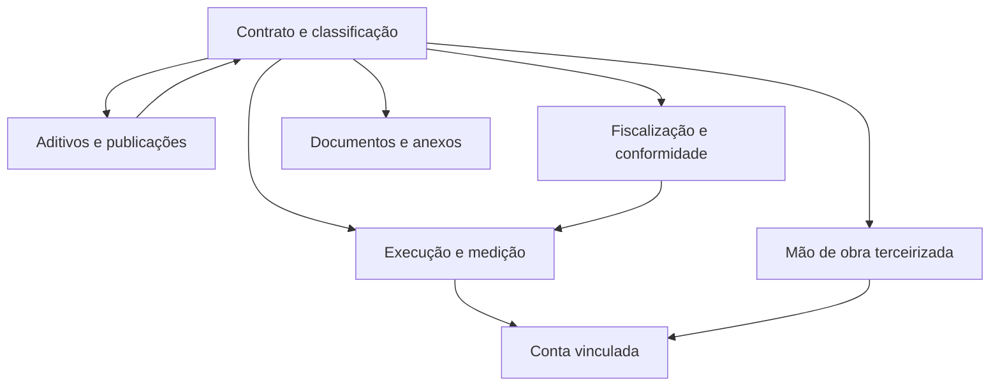

# Modelo de dados — Contratos

> Módulo grande (**44 models** em um `models.py` único): o modelo está particionado por
> **subdomínio**. Como o app não usa pacote `models/`, o agrupamento foi inferido a partir
> de clusters de nome/relação (FKs para `Contrato`, `Medicao`, `MaoDeObra`) e do agrupamento
> das abas da tela do contrato e do `admin.py`.
>
> ⚠️ REVISAR: agrupamento inferido (sem pacote `models/`) — os limites entre "Execução e medição"
> e "Conta vinculada" são especialmente discutíveis, já que `MovimentacaoContaContrato` e
> `ContaVinculadaCalculo` apontam para `Medicao`.
>
> Cada sub-área tem seu próprio ERD; este índice dá a visão macro e como as áreas se conectam.
> Todos os models herdam `ModelPlus` de `djtools.db`. Termos: ver [../GLOSSARIO.md](../GLOSSARIO.md).

## Subdomínios

| Subdomínio | Entidades principais | ERD |
|---|---|---|
| Contrato e classificação | `Contrato`, `TipoContrato`, `SubtipoContrato`, `TipoLicitacao`, `BaseLegal`, `MotivoConclusaoContrato`, `ItemContrato` | [contrato-nucleo.md](contrato-nucleo.md) |
| Aditivos e publicações | `Aditivo`, `Apostilamento`, `TipoPublicacao`, `PublicacaoContrato`, `PublicacaoAditivo` | [aditivos-publicacoes.md](aditivos-publicacoes.md) |
| Fiscalização e conformidade | `Fiscal`, `TipoFiscal`, `Ocorrencia`, `Garantia`, `Penalidade`, `Agenda`, `PreConfiguracaoAgenda`, `AnexoAgenda` | [fiscalizacao.md](fiscalizacao.md) |
| Execução e medição | `Cronograma`, `Parcela`, `Medicao`, `MedicaoEletrica`, `IMR`, `TipoDocumentoComprobatorio`, `ContratoTipoDocumentoComprobatorio`, `MedicaoTipoDocumentoComprobatorio`, `DocumentoEmpenhoContrato`, `DocumentoEmpenhoContratoMedicao`, `ArrecadacaoReceita` | [execucao-medicao.md](execucao-medicao.md) |
| Mão de obra terceirizada | `MaoDeObra`, `AnexoMaoDeObra`, `OcorrenciaMaoDeObra`, `TipoOcorrencia`, `VerbaSalarialMaoDeObra`, `TipoVerbaSalarial` | [mao-de-obra.md](mao-de-obra.md) |
| Conta vinculada | `ContaContrato`, `MovimentacaoContaContrato`, `ContaVinculadaCalculo`, `ContaVinculadaCalculoItem` | [conta-vinculada.md](conta-vinculada.md) |
| Documentos e anexos | `AnexoContrato`, `TipoAnexo`, `DocumentoTextoContrato` | [documentos-anexos.md](documentos-anexos.md) |

**Cobertura:** 7 + 5 + 8 + 11 + 6 + 4 + 3 = **44 models** — todo model do app aparece em
exatamente um ERD.

## Como as áreas se conectam

- `Contrato` é a raiz de agregação: praticamente todas as demais entidades têm FK direta ou
  indireta para ele (`related_name`: `aditivos`, `apostilamentos`, `fiscais`, `cronogramas`,
  `maosdeobra`, `garantias`, `penalidades`, `ocorrencias`, `anexos`, `publicacoes`, `contas`,
  `agendas`, `arrecadacao_receitas`, `documentos_texto`, `documentos_empenho_contrato`).
- **Fiscalização → Execução:** `Medicao.fiscal` e `IMR.fiscal` apontam para `Fiscal`, e não para
  `Servidor` — a medição é sempre atribuída à designação, não à pessoa.
- **Execução → Conta vinculada:** `MovimentacaoContaContrato.medicao` e
  `ContaVinculadaCalculo.medicao` ligam a retenção à medição que a originou.
- **Mão de obra → Conta vinculada:** `ContaVinculadaCalculoItem.maodeobra` guarda o valor retido
  por trabalhador (com `on_delete=SET_NULL`, preservando a memória de cálculo).
- **Aditivos → Fiscalização:** `Fiscal.termo_aditivo` permite registrar fiscais nomeados por um
  aditivo de fiscal.

---
_Gerado/atualizado via subagent `documentador` em 2026-08-11._
