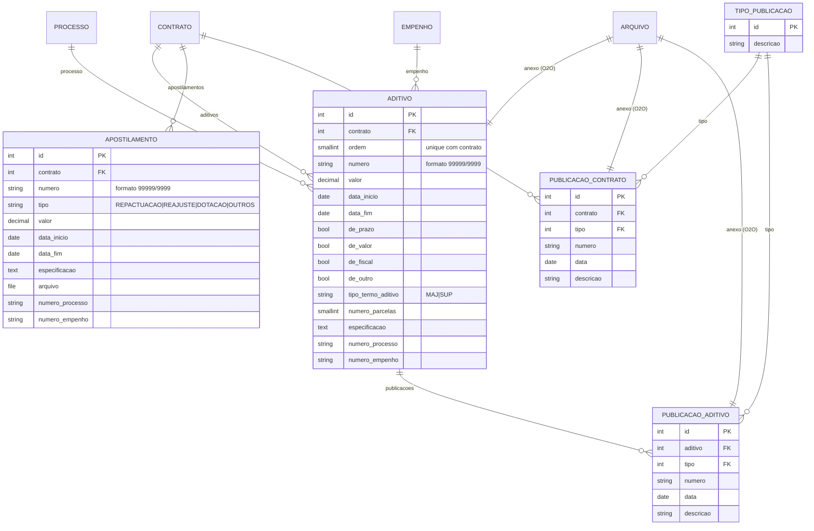

# Modelo de dados — Aditivos e publicações

> ERD das entidades da sub-área **alterações contratuais e publicidade** (models herdam
> `ModelPlus` de `djtools.db`). FKs para entidades de outras áreas aparecem como **externas**.
> Termos: ver [../GLOSSARIO.md](../GLOSSARIO.md). Índice: [_indice.md](_indice.md).

## Entidades

| Entidade | Descrição | Relações-chave |
|---|---|---|
| `Aditivo` | Termo aditivo do contrato; as flags `de_prazo`/`de_valor`/`de_fiscal`/`de_outro` são combináveis e definem o efeito. Aditivo de prazo empurra `Contrato.data_vencimento`; de valor soma (majoração) ou subtrai (supressão) no `valor_total`. A `ordem` é atribuída automaticamente em `save()` via `Contrato.get_proxima_ordem()` | FK `contrato` (`related_name='aditivos'`), `processo`, `empenho`; O2O `arquivo`; `unique_together (contrato, ordem)` |
| `Apostilamento` | Alteração sem termo aditivo (reajuste, repactuação, dotação orçamentária ou outros); soma ao `valor_total` do contrato. Apostilamento do tipo repactuação em contrato com mão de obra exclusiva dispara notificação aos fiscais | FK `contrato` (`related_name='apostilamentos'`); arquivo em `FileFieldPlus` (caminho `contratos/contrato/<id>/apostilamento/`) |
| `PublicacaoContrato` | Publicação do contrato na imprensa oficial, com anexo | FK `contrato` (`related_name='publicacoes'`), `tipo`; O2O `arquivo` |
| `PublicacaoAditivo` | Publicação de um termo aditivo. Ao ser criada pela view, uma `PublicacaoContrato` equivalente é criada por espelhamento (`get_or_create`) | FK `aditivo` (`related_name='publicacoes'`), `tipo`; O2O `arquivo` |
| `TipoPublicacao` | Tabela acessória com os tipos de publicação | Referenciada pelas duas publicações |

## Observações de modelagem

- `Aditivo.save()`, `delete()` e `Apostilamento.save()`, `delete()` chamam `contrato.save()` para
  propagar a recomposição de `valor_total` e `data_vencimento`.
- `Aditivo.delete()` remove antes suas `PublicacaoAditivo` e, depois, o `Arquivo` associado —
  mesma estratégia usada por `Contrato.delete()`.
- Tanto `Aditivo` quanto `Apostilamento` mantêm os campos textuais legados `numero_processo` e
  `numero_empenho` (strings livres) além das FKs estruturadas. ⚠️ REVISAR: redundância com
  `processo`/`empenho`; nos formulários esses campos textuais ficam excluídos.

## Entidades externas referenciadas

| Entidade | Módulo/área de origem |
|---|---|
| `Contrato` | `contratos` — subdomínio [contrato-nucleo.md](contrato-nucleo.md) |
| `Arquivo` | `comum` |
| `Processo` | `protocolo` |
| `Empenho` | `almoxarifado` |

---
_Gerado/atualizado via subagent `documentador` em 2026-08-11._
