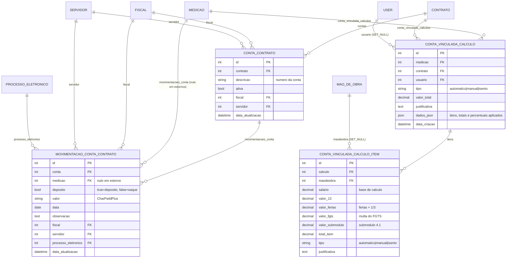

# Modelo de dados — Conta vinculada

> ERD das entidades da sub-área **conta vinculada e retenção de provisões trabalhistas**
> (models herdam `ModelPlus` de `djtools.db`). FKs para entidades de outras áreas aparecem
> como **externas**. Termos: ver [../GLOSSARIO.md](../GLOSSARIO.md). Índice: [_indice.md](_indice.md).

## Entidades

| Entidade | Descrição | Relações-chave |
|---|---|---|
| `ContaContrato` | Conta bancária vinculada ao contrato, onde ficam retidas as provisões trabalhistas dos terceirizados. O campo `descricao` guarda o **número** da conta; `ativa` controla se ela pode receber novos lançamentos | FK `contrato` (`related_name='contas'`), `fiscal`, `servidor` |
| `MovimentacaoContaContrato` | Lançamento na conta: depósito (retenção) ou saque (liberação). Quando originado do recebimento definitivo, aponta para a `Medicao`; estornos são lançamentos inversos com `medicao=None` | FK `conta` (`related_name='movimentacoes_conta'`), `medicao` (`related_name='movimentacoes_conta'`), `fiscal`, `servidor`, `processo_eletronico` |
| `ContaVinculadaCalculo` | Memória de cálculo da retenção de uma medição: total, tipo, justificativa e o `dados_json` com itens, totais e os percentuais efetivamente aplicados. **Não é lançamento** — o lançamento é a movimentação de depósito | FK `medicao` e `contrato` (ambos `related_name='conta_vinculada_calculos'`), `usuario` (`comum.User`, `SET_NULL`) |
| `ContaVinculadaCalculoItem` | Valor retido por trabalhador, decomposto em 13º, férias + 1/3, multa do FGTS e submódulo 4.1, com o tipo do tratamento (automático, manual ou isento) e a justificativa quando houve ajuste | FK `calculo` (`related_name='itens'`), `maodeobra` (`SET_NULL`) |

## Regras e percentuais

Os percentuais vêm de `comum.Configuracao` (app `contratos`), com fallback para
`ContaVinculadaCalculo.PERCENTUAIS_PADRAO`:

| Chave | Padrão | Observação |
|---|---|---|
| `conta_vinculada.perc_13` | 8,333333% | 13º salário |
| `conta_vinculada.perc_ferias` | 12,100000% | Férias + 1/3 |
| `conta_vinculada.perc_fgts` | 4,0% | Multa do FGTS |
| `conta_vinculada.perc_submodulo_grau1` | 7,39% | Aplicado quando `Contrato.grau_risco = 1` |
| `conta_vinculada.perc_submodulo_grau2` | 7,60% | `grau_risco = 2` |
| `conta_vinculada.perc_submodulo_grau3` | 7,82% | `grau_risco = 3` |

`obter_percentuais_para_contrato()` normaliza valores maiores que 1 dividindo por 100 (aceita tanto
`8.333333` quanto `0.08333333`) e assume grau 1 quando `grau_risco` é nulo.

## Observações de modelagem

- ⚠️ REVISAR: **`MovimentacaoContaContrato.valor` é `CharFieldPlus` (texto), não decimal.**
  `ContaContrato.get_saldo()` converte com `Decimal(f'{float(mov.valor):.2f}')` a cada leitura.
  Isso impede agregação em SQL, ordenação numérica e validação de tipo no banco.
- A persistência do cálculo é **destrutiva por medição**: `_persistir_calculo_conta_vinculada()`
  apaga todos os `ContaVinculadaCalculo` da medição e recria dentro de `transaction.atomic()`.
  Só o último cálculo sobrevive — o histórico anterior não é preservado.
- `ContaVinculadaCalculo` pode apontar para `medicao` **e** `contrato` (ambos anuláveis); na
  prática as views sempre gravam os dois.
- `ContaVinculadaCalculoItem.maodeobra` usa `SET_NULL` justamente para preservar a memória de
  cálculo quando o trabalhador é removido; o nome legível fica congelado em `dados_json`
  (`maodeobra_str`).
- **Estorno é lançamento novo, não exclusão:** `Medicao.registrar_estorno_conta_vinculada_por_exclusao()`
  cria movimentações inversas (depósito ↔ saque) com observação automática citando a medição
  excluída, preservando a trilha.
- `SaqueContaContratoForm.clean()` impede saque maior que o saldo; a validação usa
  `ContaContrato.get_saldo()`, que percorre todas as movimentações em Python.
- Só contratos com `mao_obra_exclusiva=True` e não cancelados habilitam esta área
  (`Contrato.pode_gerenciar_conta`).

## Entidades externas referenciadas

| Entidade | Módulo/área de origem |
|---|---|
| `Contrato` | `contratos` — subdomínio [contrato-nucleo.md](contrato-nucleo.md) |
| `Medicao` | `contratos` — subdomínio [execucao-medicao.md](execucao-medicao.md) |
| `Fiscal` | `contratos` — subdomínio [fiscalizacao.md](fiscalizacao.md) |
| `MaoDeObra` | `contratos` — subdomínio [mao-de-obra.md](mao-de-obra.md) |
| `User` | `comum` |
| `Servidor` | `rh` |
| `Processo` | `processo_eletronico` |

---
_Gerado/atualizado via subagent `documentador` em 2026-08-11._
