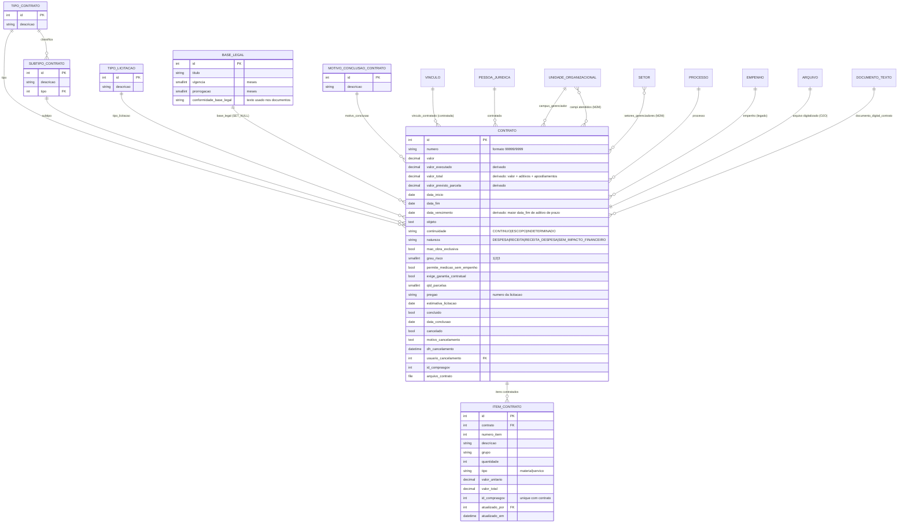

# Modelo de dados — Contrato e classificação

> ERD das entidades da sub-área **núcleo do contrato** (models herdam `ModelPlus` de
> `djtools.db`). FKs para entidades de outras áreas aparecem como **externas**.
> Termos: ver [../GLOSSARIO.md](../GLOSSARIO.md). Índice: [_indice.md](_indice.md).

## Entidades

| Entidade | Descrição | Relações-chave |
|---|---|---|
| `Contrato` | Raiz do agregado. Guarda identificação, vigência, valores (com três campos derivados recalculados no `save()`), classificação, dados da licitação, conclusão e cancelamento | FK `tipo`, `subtipo`, `base_legal`, `motivo_conclusao`, `tipo_licitacao`, `processo`, `empenho`, `campus_gerenciador`, `vinculo_contratado`, `contratada`, `usuario_cancelamento`, `documento_digital_contrato`; O2O `arquivo`; M2M `campi`, `setores_gerenciadores`, `documentos_empenho` |
| `TipoContrato` | Tipo do contrato (tabela acessória) | Referenciado por `SubtipoContrato` e `Contrato` |
| `SubtipoContrato` | Subtipo, sempre subordinado a um tipo. O subtipo configurado em `tipo_contrato_energia_eletrica` aciona o fluxo de medição elétrica | FK `tipo` |
| `TipoLicitacao` | Modalidade da licitação que originou o contrato | Referenciado por `Contrato` |
| `BaseLegal` | Fundamento legal com vigência e prorrogação máximas (meses) e o texto de conformidade usado nos documentos | Referenciado por `Contrato` (`on_delete=SET_NULL`) |
| `MotivoConclusaoContrato` | Motivo do encerramento/rescisão | Referenciado por `Contrato` |
| `ItemContrato` | Item (material ou serviço) contratado; importável do ComprasGov | FK `contrato`, `atualizado_por` (`comum.Vinculo`); `UniqueConstraint(contrato, id_comprasgov)` |

## Entidades externas referenciadas

| Entidade | Módulo/área de origem |
|---|---|
| `Vinculo` | `comum` (contratada e `atualizado_por`) |
| `User` | `comum` (usuário do cancelamento) |
| `Arquivo` | `comum` (arquivo digitalizado do contrato) |
| `PessoaJuridica` | `rh` (campo `contratada`) |
| `UnidadeOrganizacional` | `rh` (campus gerenciador e campi atendidos) |
| `Setor` | `rh` (setores gerenciadores) |
| `Processo` | `protocolo` |
| `Empenho` | `almoxarifado` (vínculo legado, mantido além de `DocumentoEmpenhoContrato`) |
| `DocumentoEmpenho` | `tesouro_gerencial` (M2M `documentos_empenho`, via `DocumentoEmpenhoContrato`) |
| `DocumentoTexto` | `documento_eletronico` (documento digital do contrato) |

---
_Gerado/atualizado via subagent `documentador` em 2026-08-11._
