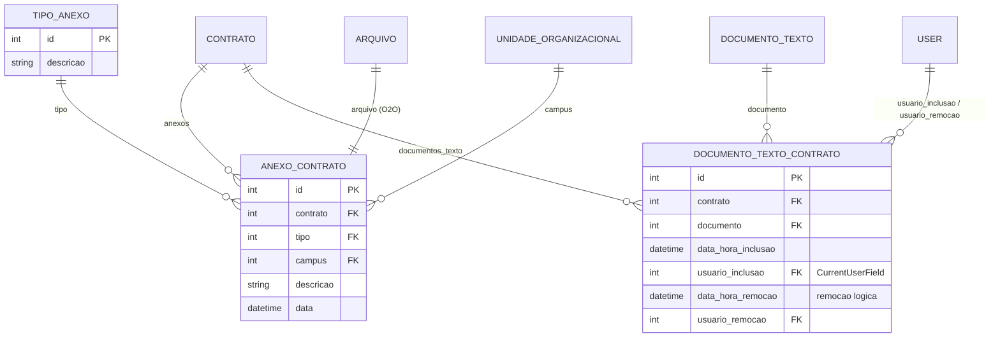

# Modelo de dados — Documentos e anexos

> ERD das entidades da sub-área **documentos relacionados ao contrato** (models herdam
> `ModelPlus` de `djtools.db`). FKs para entidades de outras áreas aparecem como **externas**.
> Termos: ver [../GLOSSARIO.md](../GLOSSARIO.md). Índice: [_indice.md](_indice.md).

## Entidades

| Entidade | Descrição | Relações-chave |
|---|---|---|
| `AnexoContrato` | Arquivo avulso anexado ao contrato (fora dos anexos específicos de aditivo, publicação, garantia etc.), classificado por tipo e opcionalmente por campus | FK `contrato` (`related_name='anexos'`), `tipo`, `campus`; O2O `arquivo` (`comum.Arquivo`) |
| `TipoAnexo` | Catálogo dos tipos de anexo (tabela acessória mantida pelo Coordenador de Contrato Sistêmico) | Referenciado por `AnexoContrato` |
| `DocumentoTextoContrato` | Vínculo entre o contrato e um documento eletrônico nato-digital, com rastro de quem incluiu e de quem removeu. A remoção é **lógica** | FK `contrato` (`related_name='documentos_texto'`), `documento` (`documento_eletronico.DocumentoTexto`), `usuario_inclusao`, `usuario_remocao` |

## Observações de modelagem

- A aba "Documentos Relacionados" da tela do contrato soma as duas entidades:
  `Contrato.get_qtd_documentos_relacionados()` = anexos + documentos de texto vinculados.
- `AnexoContrato.delete()` remove também o `Arquivo` associado; a exclusão em massa disparada por
  `Contrato.delete()` percorre os anexos justamente para acionar esse comportamento.
- `DocumentoTextoContrato` é criado por várias vias: manualmente (`vincular_documento_contrato`,
  restrita a documentos **finalizados** e não sigilosos), automaticamente ao gerar ofícios e
  despachos (`solicitacao_fiscal`, `gerar_despacho_fiscal`,
  `solicitacao_publicacao_portaria_fiscal`) e pelo admin, ao informar o
  `documento_digital_contrato` (`ContratoAdmin.save_model`).
- ⚠️ REVISAR: apesar do `data_hora_remocao` prever remoção lógica, a view que desvincula o
  documento chama `documento_contrato.delete()` — exclusão **física** (há um `# Todo` no código
  questionando exatamente isso).
- `Contrato.documentos_texto_tipo_contato_relacionados()` filtra os vínculos ativos cujo modelo de
  documento é do tipo "Contrato" e cujo documento não está cancelado — é assim que a tela
  identifica qual documento eletrônico representa o contrato em si.
- ⚠️ REVISAR: o método acima busca `TipoDocumento.objects.filter(nome='Contrato')` por **nome
  literal**, enquanto o formulário usa a configuração `tipo_documento_contrato` (IDs). Duas fontes
  de verdade para o mesmo conceito.

## Entidades externas referenciadas

| Entidade | Módulo/área de origem |
|---|---|
| `Contrato` | `contratos` — subdomínio [contrato-nucleo.md](contrato-nucleo.md) |
| `Arquivo`, `User` | `comum` |
| `UnidadeOrganizacional` | `rh` |
| `DocumentoTexto`, `TipoDocumento`, `DocumentoStatus` | `documento_eletronico` |

---
_Gerado/atualizado via subagent `documentador` em 2026-08-11._
