# Modelo de dados — Execução e medição

> ERD das entidades da sub-área **cronograma, medição, recebimento e empenhos** (models herdam
> `ModelPlus` de `djtools.db`). FKs para entidades de outras áreas aparecem como **externas**.
> Termos: ver [../GLOSSARIO.md](../GLOSSARIO.md). Índice: [_indice.md](_indice.md).

```mermaid
erDiagram
    CONTRATO ||--o{ CRONOGRAMA : "cronogramas"
    CRONOGRAMA ||--o{ PARCELA : "parcelas"
    PARCELA ||--o{ MEDICAO : "medicoes"
    PARCELA ||--o{ IMR : "imrs"
    IMR ||--|| MEDICAO : "imr (O2O, SET_NULL)"
    MEDICAO ||--|| MEDICAO_ELETRICA : "medicaoeletrica (O2O)"
    FISCAL ||--o{ MEDICAO : "fiscal"
    FISCAL ||--o{ IMR : "fiscal (SET_NULL)"
    MEDICAO ||--o{ MEDICAO_TIPO_DOCUMENTO_COMPROBATORIO : "documentos_comprobatorios"
    TIPO_DOCUMENTO_COMPROBATORIO ||--o{ MEDICAO_TIPO_DOCUMENTO_COMPROBATORIO : "tipo"
    TIPO_DOCUMENTO_COMPROBATORIO ||--o{ CONTRATO_TIPO_DOCUMENTO_COMPROBATORIO : "tipo"
    CONTRATO ||--o{ CONTRATO_TIPO_DOCUMENTO_COMPROBATORIO : "checklist configurado"
    CONTRATO ||--o{ DOCUMENTO_EMPENHO_CONTRATO : "documentos_empenho_contrato"
    DOCUMENTO_EMPENHO_CONTRATO ||--o{ DOCUMENTO_EMPENHO_CONTRATO_MEDICAO : "consumo por medicao"
    MEDICAO ||--o{ DOCUMENTO_EMPENHO_CONTRATO_MEDICAO : "documentos_empenho_medicao"
    DOCUMENTO_EMPENHO ||--o{ DOCUMENTO_EMPENHO_CONTRATO : "empenho"
    CONTRATO ||--o{ ARRECADACAO_RECEITA : "arrecadacao_receitas"
    ARQUIVO ||--|| MEDICAO : "arquivo (O2O)"
    PROCESSO ||--o{ MEDICAO : "processo (PROTECT)"
    DOCUMENTO_TEXTO ||--o{ MEDICAO : "despacho e termo definitivo (PROTECT)"
    UNIDADE_ORGANIZACIONAL ||--o{ MEDICAO : "campus"

    CRONOGRAMA {
        int id PK
        int contrato FK
        string numero
        string nl "Nota de Lancamento"
        string rc "Registro de Contrato"
    }
    PARCELA {
        int id PK
        int cronograma FK
        date data_prevista_inicio
        date data_prevista_fim
        decimal valor_previsto
        bool sem_medicao
    }
    MEDICAO {
        int id PK
        int parcela FK
        int fiscal FK
        date data_inicio "efetiva"
        date data_fim "efetiva"
        date data_medicao
        string numero_documento "nota fiscal"
        decimal valor_executado
        text ocorrencia
        text providencia
        int processo FK
        string numero_processo
        int campus FK
        int despacho_documentotexto FK "recebimento provisorio"
        int termo_definitivo_documentotexto FK "recebimento definitivo"
        int imr FK
        text historico_medicao "JSON versionado, nao editavel"
    }
    MEDICAO_ELETRICA {
        int id PK
        int medicao FK "O2O unique"
        int mes_referencia
        int ano_referencia
        decimal consumo_ponta "kWh"
        decimal consumo_fora_ponta "kWh"
        decimal demanda_contratada "kW"
        decimal demanda_medida "kW"
        decimal valor_multa_excedente
    }
    IMR {
        int id PK
        int parcela FK
        int campus FK
        int fiscal FK
        int percentual "0 a 100"
        file arquivo
    }
    TIPO_DOCUMENTO_COMPROBATORIO {
        int id PK
        string descricao
        bool ativo
    }
    CONTRATO_TIPO_DOCUMENTO_COMPROBATORIO {
        int id PK
        int contrato FK
        int tipo_documento_comprobatorio FK "PROTECT"
    }
    MEDICAO_TIPO_DOCUMENTO_COMPROBATORIO {
        int id PK
        int medicao FK
        int tipo_documento_comprobatorio FK
        int confirmacao_fiscal "1=Sim, 2=Nao se aplica"
        string recebido_gerente "Recebido|Pendente|NA"
        string parecer_gerente "descricao da pendencia"
        datetime data_avaliacao
        int avaliador_gerente FK
        bool confirmado
    }
    DOCUMENTO_EMPENHO_CONTRATO {
        int id PK
        int contrato FK
        int empenho FK
        text descricao
    }
    DOCUMENTO_EMPENHO_CONTRATO_MEDICAO {
        int id PK
        int documento_empenho_contrato FK
        int medicao FK
        decimal valor
    }
    ARRECADACAO_RECEITA {
        int id PK
        int contrato FK
        decimal valor
        date data "Data da Concessao"
        int mes_referencia
        int ano_referencia
    }
```

## Entidades

| Entidade | Descrição | Relações-chave |
|---|---|---|
| `Cronograma` | Cronograma físico-financeiro do contrato, com número, NL e RC. Um contrato pode ter vários; vale o de maior id (`Contrato.get_cronograma`) | FK `contrato` (`related_name='cronogramas'`) |
| `Parcela` | Fatia prevista do cronograma (período + valor). `sem_medicao` marca parcelas dispensadas de medição; parcelas com medição não podem ser excluídas | FK `cronograma` (`related_name='parcelas'`) |
| `Medicao` | Execução efetivamente aferida de uma parcela em um período. Concentra a máquina de estados do recebimento (provisório → definitivo) e mantém `historico_medicao` como JSON versionado com o diff de cada alteração | FK `parcela` (`related_name='medicoes'`), `fiscal`, `processo`, `campus`, `despacho_documentotexto`, `termo_definitivo_documentotexto`; O2O `arquivo`, `imr` |
| `MedicaoEletrica` | Dados de consumo/demanda para contratos de energia elétrica. Se a demanda medida exceder em >5% a contratada, a multa passa a ser obrigatória | O2O `medicao` |
| `IMR` | Instrumento de Medição de Resultado: percentual (0–100) de qualidade por campus, com documento anexo; consumido por no máximo uma medição | FK `parcela` (`related_name='imrs'`), `campus`, `fiscal` |
| `TipoDocumentoComprobatorio` | Catálogo de documentos que a contratada deve apresentar (tabela acessória) | Referenciado pelas duas tabelas de ligação |
| `ContratoTipoDocumentoComprobatorio` | Checklist configurado **por contrato**; sua existência é o que ativa o fluxo de recebimento definitivo com documentos | FK `contrato`, `tipo_documento_comprobatorio` (`PROTECT`) |
| `MedicaoTipoDocumentoComprobatorio` | Item do checklist **na medição**: confirmação do fiscal, revisão do gestor, parecer/pendência e rastro da avaliação | FK `medicao` (`related_name='documentos_comprobatorios'`), `tipo_documento_comprobatorio`, `avaliador_gerente` (`comum.User`) |
| `DocumentoEmpenhoContrato` | Vínculo entre o contrato e uma nota de empenho do `tesouro_gerencial` | FK `contrato` (`related_name='documentos_empenho_contrato'`), `empenho` |
| `DocumentoEmpenhoContratoMedicao` | Quanto de cada nota de empenho foi consumido em uma medição | FK `documento_empenho_contrato`, `medicao` (`related_name='documentos_empenho_medicao'`) |
| `ArrecadacaoReceita` | Valor de concessão arrecadado (contratos de natureza receita), por mês/ano de referência | FK `contrato` (`related_name='arrecadacao_receitas'`) |

## Observações de modelagem

- `Parcela.save()/delete()` e `Medicao.save()/delete()` chamam `contrato.save()` (via
  `parcela.cronograma.contrato`) para recompor `valor_executado` e `valor_previsto_parcela`.
- `Medicao.processo`, `despacho_documentotexto` e `termo_definitivo_documentotexto` usam
  `on_delete=PROTECT`: um documento eletrônico vinculado a medição não pode ser apagado.
- O campo `MedicaoTipoDocumentoComprobatorio.confirmado` (booleano) coexiste com
  `confirmacao_fiscal` (inteiro com choices) e não é usado nas views. ⚠️ REVISAR: campo aparentemente morto.
- `Medicao.documentos_empenho_contrato` é um M2M declarado com `through='DocumentoEmpenhoContratoMedicao'`,
  mas o acesso no código é sempre pelo `related_name='documentos_empenho_medicao'` da tabela intermediária.
- `Contrato.get_valor_executado()` percorre parcelas e medições em Python (sem agregação SQL);
  como é chamado em todo `save()`, tende a dominar o custo de gravação em contratos longos.
  ⚠️ REVISAR: candidato natural a `aggregate`.

## Entidades externas referenciadas

| Entidade | Módulo/área de origem |
|---|---|
| `Contrato` | `contratos` — subdomínio [contrato-nucleo.md](contrato-nucleo.md) |
| `Fiscal` | `contratos` — subdomínio [fiscalizacao.md](fiscalizacao.md) |
| `Arquivo`, `User` | `comum` |
| `UnidadeOrganizacional` | `rh` |
| `Processo` | `protocolo` |
| `DocumentoTexto` | `documento_eletronico` |
| `DocumentoEmpenho` | `tesouro_gerencial` |

---
_Gerado/atualizado via subagent `documentador` em 2026-08-11._
