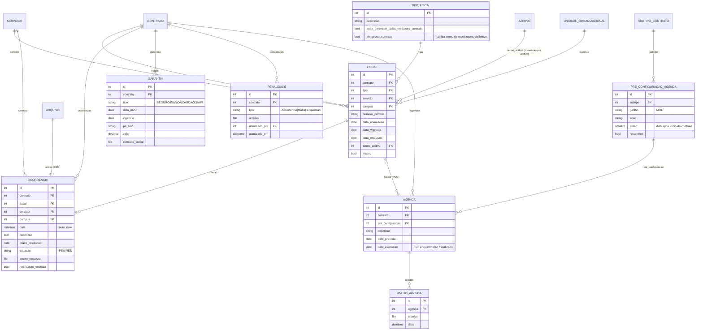

# Modelo de dados — Fiscalização e conformidade

> ERD das entidades da sub-área **fiscalização, garantias, penalidades e agenda** (models herdam
> `ModelPlus` de `djtools.db`). FKs para entidades de outras áreas aparecem como **externas**.
> Termos: ver [../GLOSSARIO.md](../GLOSSARIO.md). Índice: [_indice.md](_indice.md).

## Entidades

| Entidade | Descrição | Relações-chave |
|---|---|---|
| `Fiscal` | Designação de um servidor como fiscal de um contrato, com portaria, campus e período de atuação. Ativo = `data_exclusao` nula **e** `inativo=False` (`Contrato.get_fiscais_atuais`) | FK `contrato` (`related_name='fiscais'`), `servidor` (rh), `tipo`, `campus`, `termo_aditivo` |
| `TipoFiscal` | Papel do fiscal no contrato. Dois booleanos alteram o comportamento do sistema: `eh_gestor_contrato` (pode gerar o termo de recebimento definitivo) e `pode_gerenciar_todas_medicoes_contrato` (pode alterar/excluir medições e IMRs de outros fiscais) | Referenciado por `Fiscal` |
| `Ocorrencia` | Fato registrado na execução do contrato, com prazo de resolução, situação e possibilidade de notificar a contratada e os fiscais por e-mail | FK `contrato` (`related_name='ocorrencias'`), `fiscal`, `servidor`, `campus`; O2O `arquivo` |
| `Garantia` | Garantia contratual apresentada pela contratada (seguro-garantia, fiança, caução ou registro no SIAFI), com vigência, valor e anexo | FK `contrato` (`related_name='garantias'`) |
| `Penalidade` | Sanção aplicada à contratada (advertência, multa ou suspensão), com arquivo comprobatório e rastro de quem atualizou | FK `contrato` (`related_name='penalidades'`), `atualizado_por` (`comum.Vinculo`) |
| `Agenda` | Ação de fiscalização programada para uma data; ao ser executada recebe `data_execucao` e anexos. Pode ser criada manualmente ou a partir de uma pré-configuração | FK `contrato` (`related_name='agendas'`), `pre_configuracao`; M2M `fiscais` |
| `PreConfiguracaoAgenda` | Catálogo de ações padrão de fiscalização, com o prazo em dias após o início do contrato e um gatilho (hoje só "possui dedicação de mão de obra exclusiva") | FK `subtipo` (`SubtipoContrato`) |
| `AnexoAgenda` | Arquivo anexado ao registro da fiscalização executada | FK `agenda` (`related_name='anexos'`) |

## Observações de modelagem

- A exclusão de fiscal é **lógica**: a view marca `inativo=True` e preenche `data_exclusao`
  (`views.contrato`, `alterar_situacao_fiscal`); o `FiscalInline` do admin tem `can_delete=False`.
- `Ocorrencia.data` usa `auto_now` (e não `auto_now_add`), de modo que representa a **última
  atualização**, não a data de criação. ⚠️ REVISAR: o rótulo na tela sugere data do registro.
- A `Ocorrencia` do contrato **não** tem tipo — `TipoOcorrencia` pertence à mão de obra.
- `Agenda` sem fiscais explícitos notifica todos os fiscais atuais do contrato
  (`utils.Notificar.contratos_a_serem_fiscalizados`).
- `PreConfiguracaoAgenda.recorrente` está modelado mas não há, no módulo, rotina que recrie a
  agenda periodicamente. ⚠️ REVISAR: campo aparentemente sem consumidor.

## Entidades externas referenciadas

| Entidade | Módulo/área de origem |
|---|---|
| `Contrato`, `Aditivo`, `SubtipoContrato` | `contratos` — subdomínios [contrato-nucleo.md](contrato-nucleo.md) e [aditivos-publicacoes.md](aditivos-publicacoes.md) |
| `Servidor` | `rh` |
| `UnidadeOrganizacional` | `rh` |
| `Arquivo`, `Vinculo` | `comum` |

---
_Gerado/atualizado via subagent `documentador` em 2026-08-11._
