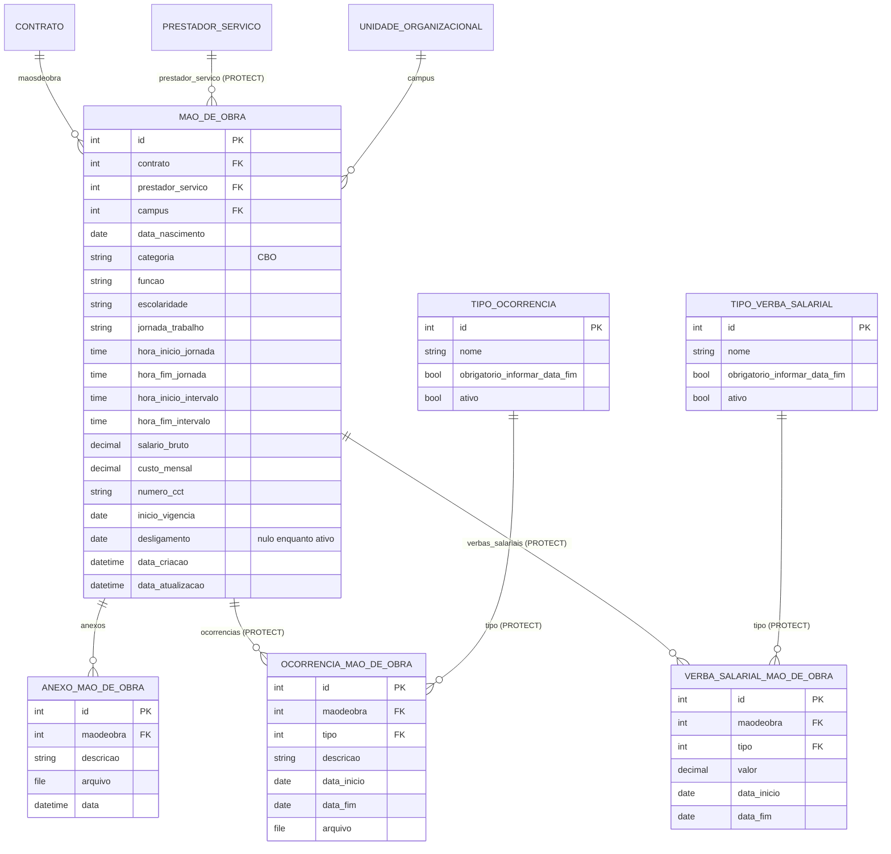

# Modelo de dados — Mão de obra terceirizada

> ERD das entidades da sub-área **mão de obra terceirizada** (models herdam `ModelPlus` de
> `djtools.db`). FKs para entidades de outras áreas aparecem como **externas**.
> Termos: ver [../GLOSSARIO.md](../GLOSSARIO.md). Índice: [_indice.md](_indice.md).

## Entidades

| Entidade | Descrição | Relações-chave |
|---|---|---|
| `MaoDeObra` | Trabalhador terceirizado alocado ao contrato: função, CBO, escolaridade, jornada (com horários de entrada/saída e intervalo), remuneração e campus de atuação. Ativo enquanto `desligamento` for nulo | FK `contrato` (`related_name='maosdeobra'`), `prestador_servico` (`comum.PrestadorServico`, `PROTECT`), `campus` |
| `AnexoMaoDeObra` | Documento do trabalhador anexado ao registro (contracheques, documentos pessoais etc.) | FK `maodeobra` (`related_name='anexos'`) |
| `OcorrenciaMaoDeObra` | Evento relativo ao trabalhador (afastamento, substituição etc.), por tipo e período de vigência, com anexo opcional | FK `maodeobra` (`related_name='ocorrencias'`, `PROTECT`), `tipo` (`PROTECT`) |
| `TipoOcorrencia` | Catálogo dos tipos de ocorrência de mão de obra; `obrigatorio_informar_data_fim` torna a data final obrigatória no formulário | Referenciado por `OcorrenciaMaoDeObra` |
| `VerbaSalarialMaoDeObra` | Componente da remuneração do trabalhador, por tipo, valor e vigência | FK `maodeobra` (`related_name='verbas_salariais'`, `PROTECT`), `tipo` (`PROTECT`) |
| `TipoVerbaSalarial` | Catálogo dos tipos de verba salarial; também controla a obrigatoriedade da data final | Referenciado por `VerbaSalarialMaoDeObra` |

## Observações de modelagem

- Esta sub-área só é relevante para contratos com `mao_obra_exclusiva=True`: a aba "Mão de Obra"
  e as permissões `pode_gerenciar_mao_de_obra` giram em torno dessa marca, e é dela que sai a
  base de cálculo da conta vinculada.
- **Duas fontes de remuneração convivem:** o campo `MaoDeObra.salario_bruto` e a soma das
  `VerbaSalarialMaoDeObra` (`MaoDeObra.valor_total_das_verbas`). O cálculo da conta vinculada usa
  `salario_bruto` **ou**, se ausente, o total das verbas
  (`Medicao._calcular_item_conta_vinculada`). ⚠️ REVISAR: qual é a fonte canônica não está
  explícito, e as duas podem divergir.
- `VerbaSalarialMaoDeObraForm.clean()` impede duas verbas do mesmo tipo para o mesmo trabalhador —
  regra que **não** existe como constraint no banco. ⚠️ REVISAR: unicidade apenas no formulário.
- Os `PROTECT` em ocorrências e verbas impedem apagar uma `MaoDeObra` que tenha histórico; a via
  normal de "desligar" é preencher `desligamento`, não excluir.
- `copiar_maodeobra` (view) clona registros para outro contrato zerando o `id` — o novo registro
  aponta para o mesmo `PrestadorServico`, sem copiar anexos, ocorrências nem verbas.
  ⚠️ REVISAR: cópia parcial, possivelmente intencional.
- `relatorio_terceirizados_xls` expõe o CPF do trabalhador, com opção de mascarar
  (`anonimizar_cpf`) — dado pessoal sensível trafegando em exportação.

## Entidades externas referenciadas

| Entidade | Módulo/área de origem |
|---|---|
| `Contrato` | `contratos` — subdomínio [contrato-nucleo.md](contrato-nucleo.md) |
| `PrestadorServico` | `comum` |
| `UnidadeOrganizacional` | `rh` |
| `ContaVinculadaCalculoItem` | `contratos` — subdomínio [conta-vinculada.md](conta-vinculada.md) (referencia `MaoDeObra` com `SET_NULL`) |

---
_Gerado/atualizado via subagent `documentador` em 2026-08-11._
