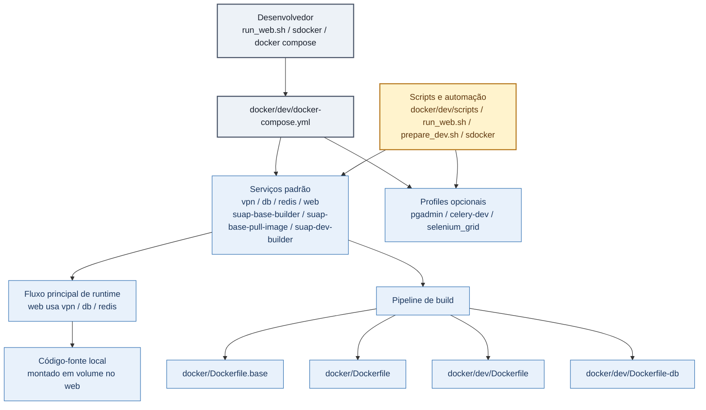
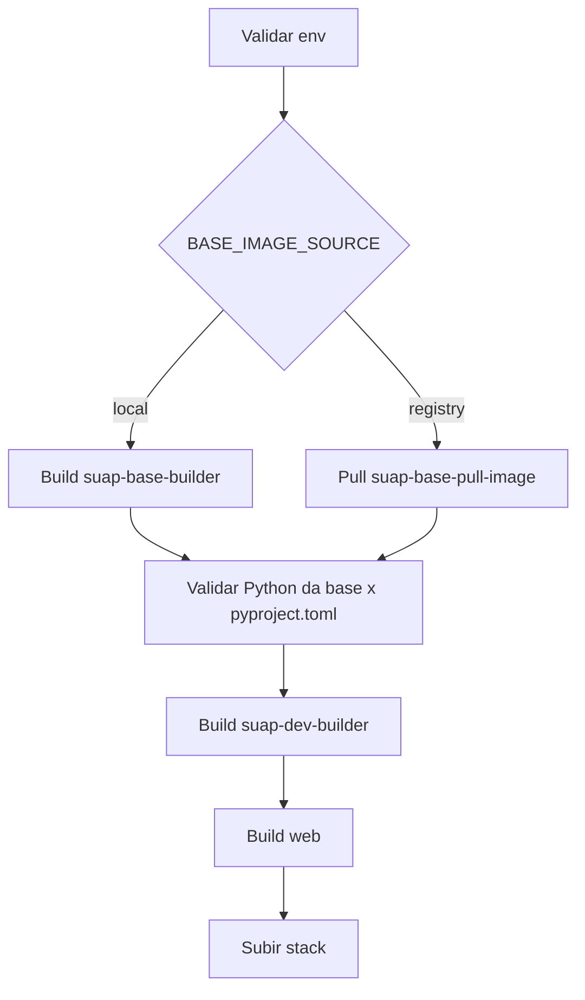

# Ambiente de Desenvolvimento com Docker (`docker/dev`)

## Objetivo
Este documento explica como a infraestrutura de desenvolvimento do SUAP foi organizada em containers para reduzir setup manual, padronizar o ambiente entre desenvolvedores e acelerar tarefas do dia a dia (subir app, restaurar banco, rodar testes e diagnosticar problemas).

Além da arquitetura técnica, ele detalha o valor prático de cada componente para o fluxo de desenvolvimento.

## Por que esta arquitetura existe

Antes desta estratégia, problemas comuns em times de desenvolvimento eram:

- Diferenças de ambiente entre máquinas;
- Setup inicial demorado;
- Dificuldade de reproduzir bugs de integração;
- Operações de banco e VPN feitas manualmente e com risco de erro.

A arquitetura em containers resolve isso com um ambiente reproduzível e automatizado.

Principais ganhos para o desenvolvedor:

- Onboarding mais rápido;
- Menor tempo para "subir tudo e começar a codar";
- Menos retrabalho com configuração local;
- Execução de testes e operações de banco com comandos padronizados;
- Troubleshooting mais objetivo com serviços isolados e logs por container.

## Escopo
Esta estratégia cobre:

- Aplicação Django SUAP (`web`),
- Banco PostgreSQL (`db`),
- Redis,
- VPN de acesso corporativo (serviço `vpn` externo),
- Ferramentas de apoio (`pgadmin`, `selenium_grid`, `celery-dev`),
- Stack opcional de busca/observabilidade (`elk-docker-compose.yml`, `opensearch-docker-compose.yml`).

## Arquitetura (visão rápida)

Esta arquitetura separa responsabilidades em serviços independentes (app, banco, cache, VPN, ferramentas de apoio), mas mantém o fluxo integrado por `docker compose`/`sdocker`.

Vantagem prática: você pode depurar ou reiniciar apenas o componente com problema sem derrubar todo o ambiente.



Como ler esse diagrama:

- O desenvolvedor entra no ambiente por `run_web.sh`, `sdocker` ou `docker compose`;
- Esses comandos convergem para o arquivo [`docker/dev/docker-compose.yml`](/home/jailton/workspace/ifrn/suap/docker/dev/docker-compose.yml), que define os serviços e dependências do ambiente;
- O bloco `Serviços padrão` reúne o que faz parte do fluxo principal sem exigir `profile`: `vpn`, `db`, `redis`, `web` e os builders;
- O bloco `Profiles opcionais` separa serviços ativados sob demanda:
  - `pgadmin` com profile `pgadmin`;
  - `celery-dev` com profile `celery`;
  - `selenium_grid` com profile `selenium`;
- O bloco `Fluxo principal de runtime` destaca a relação operacional mais importante: o container `web` depende de `vpn`, `db` e `redis` para rodar a aplicação no dia a dia;
- O bloco `Código-fonte local` mostra que o repositório é montado em volume no container `web`, permitindo editar no host e executar no ambiente Docker;
- O bloco `Pipeline de build` resume os artefatos usados para construir as imagens do ambiente:
  - [`docker/Dockerfile.base`](/home/jailton/workspace/ifrn/suap/docker/Dockerfile.base);
  - [`docker/Dockerfile`](/home/jailton/workspace/ifrn/suap/docker/Dockerfile);
  - [`docker/dev/Dockerfile`](/home/jailton/workspace/ifrn/suap/docker/dev/Dockerfile);
  - [`docker/dev/Dockerfile-db`](/home/jailton/workspace/ifrn/suap/docker/dev/Dockerfile-db);
- O bloco `Scripts e automação` mostra que scripts locais e comandos auxiliares apoiam tanto os serviços padrão quanto os profiles opcionais.

Em termos práticos, o fluxo do dia a dia fica assim:

1. Você sobe ou acessa a stack por `docker compose`, `sdocker` ou `run_web.sh`;
2. O compose ativa os serviços de suporte necessários;
3. A aplicação roda no host ou no container `web`, dependendo do fluxo escolhido;
4. Banco, Redis, VPN e ferramentas auxiliares ficam desacoplados, então podem ser reiniciados ou inspecionados isoladamente.

## Arquivos-chave

- Compose principal: [`docker/dev/docker-compose.yml`](./docker-compose.yml)
- Env de referência: [`docker/dev/.env.dev.sample`](./.env.dev.sample)
- Env mínimo de onboarding: [`docker/dev/.env.minimal.sample`](./.env.minimal.sample)
- Env local (não versionar credenciais reais): [`docker/dev/.env`](./.env)
- Dockerfiles:
  - [`docker/Dockerfile.base`](../Dockerfile.base)
  - [`docker/Dockerfile`](../Dockerfile)
  - [`docker/dev/Dockerfile`](./Dockerfile)
  - [`docker/dev/Dockerfile-db`](./Dockerfile-db)
- Scripts operacionais:
  - [`docker/dev/prepare_dev.sh`](./prepare_dev.sh)
  - [`docker/dev/build_images.sh`](./build_images.sh)
  - [`docker/dev/scripts/utils.sh`](./scripts/utils.sh)
  - [`docker/dev/scripts/init_database.sh`](./scripts/init_database.sh)
  - [`docker/dev/scripts/db_entrypoint.sh`](./scripts/db_entrypoint.sh)
- Arquivos correlatos:
  - [`docker/dev/sources.list`](./sources.list)
  - [`docker/dev/db_entrypoint_pg_stat_statements.sh`](./db_entrypoint_pg_stat_statements.sh)
  - [`docker/dev/custom_kibana.sh`](./custom_kibana.sh)
  - [`docker/dev/elk-docker-compose.yml`](./elk-docker-compose.yml)
  - [`docker/dev/opensearch-docker-compose.yml`](./opensearch-docker-compose.yml)

## Serviços do `docker/dev/docker-compose.yml`

Cada serviço foi separado para refletir um papel da infraestrutura de desenvolvimento:

- `vpn`: herdado de outro compose via `extends` (`$DOCKER_VPN_WORKDIR/docker-compose.yaml`).
- `suap-base-builder`: build da imagem base (`docker/Dockerfile.base`) com tag `${SUAP_IMAGE}:base`.
- `suap-base-pull-image`: utilitário one-shot para login no GitLab Registry e pull da imagem base.
- `suap-dev-builder`: build da imagem de desenvolvimento intermediária (`docker/Dockerfile`, target `suap-dev`).
- `web`: container principal de desenvolvimento (usa `docker/dev/Dockerfile`, roda `uv sync`, `collectstatic`, `migrate`, `runserver`).
- `celery-dev`: worker Celery opcional (perfil `celery`).
- `db`: PostgreSQL com entrypoint customizado e scripts de bootstrap/restore.
- `redis`: cache/fila local.
- `pgadmin`: administração gráfica do PostgreSQL (perfil `pgadmin`).
- `selenium_grid`: suporte a testes E2E/browser remoto (perfil `selenium`).

Vantagens da separação por serviço:

- Isolamento de falhas (ex.: problema no `db` não implica rebuild do `web`);
- Manutenção incremental (atualizar um componente sem afetar todos);
- Melhor uso de recursos locais (subir apenas o necessário para a tarefa atual).

## Container VPN

Contexto de produto:

No SUAP, parte dos recursos de desenvolvimento pode depender de rede interna institucional. O container VPN existe para encapsular essa conectividade e evitar configuração manual de rede no host de cada desenvolvedor.

O serviço `vpn` deste projeto **não** está definido localmente; ele é importado por `extends` a partir de:

- Projeto: `https://gitlab.ifrn.edu.br/cosinf-devops/suap-analytics`
- Caminho esperado: `<SUAP_ANALYTICS>/docker/vpn/docker-compose.yaml`

No `docker/dev/docker-compose.yml`, isso acontece via:

- `DOCKER_VPN_WORKDIR` + `docker-compose.yaml`
- `service: vpn`

### O que o container VPN faz

Com base no projeto `suap-analytics/docker/vpn`, o container VPN:

- Estabelece túnel de acesso à rede interna institucional;
- Oferece um ponto estável de conectividade para os demais containers (`host=vpn`);
- Permite roteamento/encaminhamento para recursos internos (por exemplo, PostgreSQL remoto);
- Centraliza configuração de conectividade em um único serviço da stack.

### Configurações necessárias para funcionar

No `.env` do `docker/dev`:

- `DOCKER_VPN_WORKDIR`: diretório absoluto do projeto `suap-analytics/docker/vpn`.
- `DOCKER_VPN_IP`: IP fixo do serviço na rede Docker.
- `DOCKER_IPAM_CONFIG_SUBNET` e `DOCKER_IPAM_CONFIG_GATEWAY_IP`: faixa/gateway da rede.
- `DATABASE_HOST=vpn` quando o banco remoto é acessado via túnel.
- `ETC_HOSTS` e `ROUTE_NETWORK` (cenários com rotas para rede interna).

Quando usar banco via VPN, o bloco de variáveis de banco normalmente fica assim (com valores de exemplo):

```env
DATABASE_DUMP_DIR=
DATABASE_NAME=seu_banco
DATABASE_USER=seu_usuario
DATABASE_PASSWORD=*** # não versionar senha real
DATABASE_HOST=vpn
DATABASE_PORT=25432
```

Observação de segurança:

- Nunca commitar senhas reais em `.env`;
- Use apenas placeholders em documentação e arquivos sample.

Exemplo genérico:

- `DOCKER_VPN_WORKDIR=$WORKSPACE_DIR/suap-analytics/docker/vpn`

E o arquivo obrigatório dentro desse diretório:

- `docker-compose.yaml`

### Como configurar `docker/vpn/config` (suap-analytics)

No projeto `suap-analytics`, a configuração da VPN fica em:

- `<SUAP_ANALYTICS>/docker/vpn/config/openconnect.conf`
- `<SUAP_ANALYTICS>/docker/vpn/config/ssh-tunnel-csv.conf`

Arquivos de modelo:

- `openconnect.conf.sample`
- `ssh-tunnel-csv.conf.sample`

#### 1) Criar os arquivos de configuração

```bash
cd "$WORKSPACE_DIR/suap-analytics/docker/vpn/config"
cp openconnect.conf.sample openconnect.conf
cp ssh-tunnel-csv.conf.sample ssh-tunnel-csv.conf
```

Sem `openconnect.conf`, o container aborta no início (`scripts/export-env.sh`).

#### 2) Preencher `openconnect.conf`

Campos obrigatórios:

- `OPENCONNECT_PROTOCOL` (ex.: `gp`)
- `OPENCONNECT_SERVER` (ex.: `vpn-dc.ifrn.edu.br`)
- `OPENCONNECT_USER` (matrícula/usuário VPN)
- `OPENCONNECT_PASSWORD` (senha VPN)

Exemplo:

```ini
OPENCONNECT_PROTOCOL=gp
OPENCONNECT_SERVER=vpn-dc.ifrn.edu.br
OPENCONNECT_USER=sua-matricula
OPENCONNECT_PASSWORD=sua-senha
```

Como é aplicado: o `entrypoint.sh` executa `scripts/export-env.sh` e exporta essas variáveis antes de chamar `openconnect`.

#### 3) Preencher `ssh-tunnel-csv.conf`

Formato esperado:

```csv
type,name,local_ip,local_port,server_ip,server_port,ssh_user,ssh_password
```

Tipos suportados:

- `ssh_tunnel`: processado por `scripts/ssh-tunnel-csv.sh`, cria SSH local forward.
- `iptable`: processado por `scripts/iptables-csv.sh`, cria DNAT/SNAT para redirecionamento TCP.

Regras práticas:

- `local_ip=0.0.0.0` expõe para outros containers da rede Docker.
- `local_ip=127.0.0.1` restringe ao container VPN.
- Portas devem estar entre `1-65535`.
- Em `iptable`, `ssh_user` e `ssh_password` podem ficar vazios.
- Comentários com `#` e linhas em branco são ignorados.
- Espaços em volta dos campos são removidos automaticamente.
- Não usar vírgula dentro de campo (parser é simples, sem suporte a aspas com vírgula interna).

Exemplo:

```csv
type,name,local_ip,local_port,server_ip,server_port,ssh_user,ssh_password
ssh_tunnel,ssh_superset_db,0.0.0.0,15432,10.22.1.250,5432,jailton,sua_senha_aqui
iptable,suap_grande,127.0.0.1,25432,10.22.1.244,5432,,
```

#### 4) Ordem de aplicação dentro do container VPN

O `entrypoint.sh` executa nesta sequência:

1. carrega variáveis de `openconnect.conf`;
2. conecta no OpenConnect e aguarda `tun0` operacional;
3. aplica regras `iptables` via CSV (`type=iptable`);
4. cria túneis SSH via CSV (`type=ssh_tunnel`);
5. executa teste de conectividade (`scripts/test-connections-csv.sh`).

#### 5) Fluxo mínimo de ativação e validação

1. Ajustar os arquivos em `suap-analytics/docker/vpn/config`.
2. Subir o serviço `vpn` (via `sdocker` ou `docker compose`).
3. Validar logs:
   - `sdocker vpn logs`
   - Ou no `suap-analytics`: `docker compose -f docker/vpn/docker-compose.yaml logs -f vpn`
4. Validar conectividade a partir do SUAP:
   - `sdocker db psql` (com `DATABASE_HOST=vpn`) ou
   - `docker compose exec db psql ...`

### Benefícios do uso de VPN em container

- Isola a complexidade de rede (VPN/rotas/túneis) fora do host do desenvolvedor;
- Padroniza o acesso para toda a equipe (mesmo endpoint lógico: `vpn`);
- Reduz diferenças de ambiente local entre máquinas;
- Simplifica troubleshooting (logs, restart e ciclo de vida controlados via compose/sdocker);
- Melhora segurança operacional ao evitar configuração manual repetitiva de rotas/túneis no host.

## Cadeia de build de imagens

Fluxo recomendado:



Como ler esse diagrama:

- O fluxo sempre começa pela validação do ambiente, para evitar build com paths ou variáveis incorretas.
- O losango `BASE_IMAGE_SOURCE` representa a decisão entre duas estratégias de origem da imagem base:
  - `local`: constrói a base localmente com `suap-base-builder`;
  - `registry`: faz pull da base previamente publicada com `suap-base-pull-image`.
- Independentemente da origem da base, o passo seguinte valida se a versão de Python da imagem está compatível com o `pyproject.toml`.
- Depois da base validada, o processo continua com o build de `suap-dev-builder`, que prepara a imagem intermediária de desenvolvimento.
- Em seguida, o build de `web` gera a imagem final usada no container principal da aplicação.
- O último passo, `Subir stack`, representa o momento em que as imagens já estão prontas para uso no `docker compose`.

Em termos práticos, o diagrama mostra que o time deve tratar o build como uma cadeia ordenada: primeiro resolver a base, depois validar compatibilidade, depois construir a imagem de desenvolvimento e só então subir a stack.

### Etapas operacionais

Objetivo deste fluxo: garantir previsibilidade de build e reduzir o tempo gasto com erros de imagem quebrada.

1. Validar variáveis e paths:

```bash
cd docker/dev
./check_env.sh
```

2. Executar cadeia de build completa:

```bash
./build_images.sh
```

Equivalente manual:

```bash
# estratégia local (recomendada)
docker compose build suap-base-builder

# estratégia registry (alternativa)
# docker compose up --abort-on-container-exit suap-base-pull-image

docker compose build suap-dev-builder
docker compose build web
```

3. Subir ambiente após build:

```bash
docker compose up -d web db redis vpn
```

### Quando usar cada estratégia

- Fluxo padrão (recomendado): `BASE_IMAGE_SOURCE=local` para construir base alinhada ao `requires-python` do `pyproject.toml`;
- Fluxo com registry: `BASE_IMAGE_SOURCE=registry` quando você precisa consumir uma base central já publicada e compatível;
- Fluxo rápido local: usar build manual apenas de `web` quando mudou somente código/ajustes leves e a imagem base já está válida localmente;
- Troubleshooting de build: executar as etapas manuais uma a uma para identificar em qual serviço a falha acontece.

Observação importante: `build_images.sh` detecta automaticamente incompatibilidade de Python entre a imagem existente e o `requires-python` do `pyproject.toml`. Se a imagem `${SUAP_IMAGE}:base` ou `DEV_IMAGE` tiver versão divergente, o rebuild é forçado sem perguntar, com aviso no terminal. Em outros casos, o script pergunta interativamente se deseja recompilar.

Observação importante 2: o script também valida o Python da `DEV_IMAGE` (ex.: `suap-local:dev`) após o build. Isso evita o cenário de imagem antiga (Python desatualizado) quebrar silenciosamente em `uv sync`/bootstrap do Django.

Benefício para o time: todos passam a trabalhar sobre uma base compatível, reduzindo "funciona na minha máquina".

## Dockerfiles utilizados

Nesta seção, cada Dockerfile é explicado em termos de responsabilidade técnica e impacto no fluxo do desenvolvedor.

### `docker/Dockerfile.base`
Responsável por imagem base do SUAP:

- Base `ghcr.io/astral-sh/uv:python3.14-trixie`,
- Pacotes de sistema para LDAP, Pillow, lxml, WeasyPrint e `libmagic`,
- `uv sync --locked --group prod --no-dev --no-install-project`,
- Preparação do usuário `www-data` e ambiente `/venv`.

### `docker/Dockerfile`
Define dois estágios principais:

- `suap-app`: runtime para aplicação (gunicorn, collectstatic, sync prod).
- `suap-dev`: imagem de desenvolvimento com dependências de Playwright (`playwright install chromium --with-deps`).

### `docker/dev/Dockerfile`
Camada final para desenvolvimento local:

- Parte de `DEV_IMAGE` (default `suap-local:dev`),
- Instala utilitários extras (`openssh`, `sudo`, libs gráficas),
- Cria usuário customizado com UID/GID do host,
- Define `UV_PROJECT_ENVIRONMENT=${WORK_DIR}/.venv` para manter o ambiente virtual de desenvolvimento dentro do diretório do projeto,
- Cria `${WORK_DIR}/.venv` e sincroniza dependências com `uv sync --dev`,
- Executa comandos Django no container via `uv run python manage.py ...`, usando explicitamente o interpretador da `.venv`,
- Mantém container vivo (`sleep infinity`) para workflows interativos.

Como interpretar esses pontos:

- `DEV_IMAGE`, `USER_NAME`, `USER_UID`, `USER_GID` e `WORK_DIR` são passados pelo `docker/dev/docker-compose.yml` como build args do serviço `web`;
- O ambiente virtual de desenvolvimento não reutiliza `/venv` da imagem base; no estágio final de dev ele passa a usar `${WORK_DIR}/.venv`;
- Isso evita conflitos de permissão no fluxo interativo de desenvolvimento, especialmente quando `uv sync --dev` roda com o usuário padrão do container.

### `docker/dev/Dockerfile-db`
Imagem PostgreSQL para dev:

- Parte de `POSTGRES_IMAGE` (default `postgres:16.3`),
- Instala ferramentas de restore/diagnóstico (`pv`, `pigz`, `tar`, `postgis`, `net-tools`, `iptables`).

Contexto:

- Essa imagem é a base do serviço `db` no compose de desenvolvimento;
- Ela atende dois cenários: banco local completo (`DATABASE_HOST=db`) e banco remoto via VPN/túnel.

Vantagens:

- Padroniza o ambiente de banco para toda a equipe (mesma base e mesmos utilitários);
- Reduz tempo de restore de dumps grandes com ferramentas de compressão/stream;
- Facilita diagnóstico de rede e conectividade em cenários com VPN;
- Evita depender de ferramentas instaladas no host do desenvolvedor.

## Scripts operacionais

Estes scripts existem para transformar tarefas manuais de infraestrutura em passos repetíveis e confiáveis.

### Preparação do Ambiente no Host ("prepare_dev.sh")
Prepara o ambiente de desenvolvimento local para rodar o SUAP **diretamente no host**, sem precisar do container `web`.

O que faz, em sequência:

1. Verifica se `uv` está instalado; se não, instala automaticamente via script oficial.
2. Lê a versão Python exigida em `pyproject.toml` (`requires-python`).
3. Tenta instalar o Python correto via `uv python install`. Se a versão não estiver disponível para download:
   - **Linux (Ubuntu/Debian)**: pergunta se quer instalar via deadsnakes PPA e executa automaticamente com confirmação.
   - **macOS**: pergunta se quer instalar via Homebrew e executa automaticamente com confirmação.
4. Sincroniza dependências com `uv sync --dev` (sem ativar venv manualmente).
5. Sobe os serviços de suporte via docker compose (`vpn`, `db`, `redis`) em background.
6. Executa `uv run python manage.py collectstatic --no-input`.
7. Executa `uv run python manage.py migrate`.

Todo o fluxo usa `uv run` — não é necessário ativar `.venv` manualmente.

Uso:

```bash
cd docker/dev
./prepare_dev.sh
```

Após o script, para rodar a aplicação:

```bash
uv run python manage.py runserver 0.0.0.0:8000
```

Outros comandos úteis no fluxo local:

```bash
uv run python manage.py shell_plus
uv run python manage.py test_behave <app>
uv run python manage.py migrate
```

Comando auxiliar de diagnóstico de banco:

```bash
uv run python manage.py check_db_access
```

Objetivo desse comando:

- Validar acesso ao banco configurado em `DATABASES['default']` antes de fluxos mais longos;
- Mostrar host, porta e nome do banco em uso no ambiente atual;
- Falhar cedo com mensagem objetiva quando houver timeout, host inválido ou credenciais inconsistentes.

### Launcher Interativo do Ambiente ("run_web.sh")
Launcher interativo para o ambiente de desenvolvimento. Ele centraliza, em um único menu, os fluxos de execução no host, no container `web` e de testes Behave.

O que faz:

1. Exibe um menu com operações de aplicação e infraestrutura.
2. Sobe os serviços de suporte `vpn`, `db` e `redis` antes dos fluxos principais.
3. Permite escolher entre:
   - Rodar a aplicação no host com `uv run`;
   - Subir a aplicação no container `web` com `docker compose`;
   - Executar `manage.py test_behave` no host ou no Docker.
4. Expõe operações auxiliares no mesmo menu:
   - Seguir logs;
   - Listar status dos containers;
   - Derrubar a stack;
   - Rebuildar imagens com `build_images.sh`.

Resumo das opções do menu principal:

- `[1] Host`: roda o Django no host com `uv run`, depois de preparar dependências e serviços de suporte.
- `[2] Docker`: sobe o serviço `web` com `docker compose up -d`.
- `[3] Testes`: abre um subfluxo para executar `manage.py test_behave` no host ou no Docker.
- `[4] Logs`: acompanha logs em tempo real com `docker compose logs -f`.
- `[5] Status`: mostra o estado atual dos containers com `docker compose ps`.
- `[6] Down`: derruba os containers do projeto com confirmação interativa.
- `[7] Build`: chama `build_images.sh` para rebuild das imagens.
- `[0] Sair`: encerra o launcher.

No fluxo de testes (`opção [3]`), o script também:

- Pergunta a app/label a executar (ex.: `avaliacao_integrada`);
- Valida se a app/label existe antes de continuar:
  - Label simples: exige `<app>/features/`;
  - Caminho relativo: exige que o path informado exista a partir da raiz do projeto;
  - Em caso de erro, sugere algumas apps/labels disponíveis encontradas no projeto;
- Oferece estratégias de banco:
  - `--keepdb-with-data`;
  - `--keepdb-initial-only`;
  - Execução padrão sem keepdb;
- Usa `--keepdb-with-data` como padrão quando o usuário apenas pressiona Enter;
- Permite ativar `--reuse-successful-scenarios` quando `--keepdb-with-data` foi escolhido;
- Usa `--reuse-successful-scenarios` como padrão quando o usuário apenas pressiona Enter nesse prompt;
- Permite forçar recriação com `--force-drop-test-db`;
- Mantém `--force-drop-test-db` desativado por padrão;
- Usa execução em Docker como padrão quando o usuário apenas pressiona Enter no prompt host/Docker;
- No modo Docker, executa `uv sync --dev` e depois `uv run python manage.py test_behave ...` no mesmo container, para usar a `.venv` correta;
- No modo host, executa preflight de acesso ao banco antes de chamar `python manage.py test_behave`;
- Executa sempre com `--behave_stop`.

No fluxo host (`opção [1]`), o script:

1. garante `uv` e a versão de Python compatível com `pyproject.toml`;
2. executa `uv sync --dev`;
3. executa preflight de acesso ao banco com `python manage.py check_db_access`;
4. roda `collectstatic`, `migrate` e `check`;
5. inicia `runserver`;
6. redireciona logs para `~/tmp/suap_run_web.log`.

Uso a partir da raiz do projeto:

```bash
./docker/dev/run_web.sh
```

Uso a partir do diretório `docker/dev`:

```bash
cd docker/dev
./run_web.sh
```

Quando usar este script:

- Quando você quer um ponto de entrada único para host, Docker e Behave;
- Quando prefere um fluxo guiado por prompts em vez de decorar comandos;
- Quando precisa alternar rápido entre subir a app, acompanhar logs e rerodar testes.

#### Vantagens em relação ao comando direto `python manage.py test_behave ...`

Usar `run_web.sh` no fluxo de testes traz algumas vantagens práticas em relação a executar `python manage.py test_behave ...` manualmente:

- Sobe automaticamente `vpn`, `db` e `redis` antes da execução;
- Permite escolher entre execução no host e no Docker sem remontar o comando;
- Guia a seleção das estratégias de banco (`keepdb`) por prompt;
- Oferece `--reuse-successful-scenarios` e `--force-drop-test-db` sem exigir memorização das flags;
- Valida a app/label antes de iniciar a execução e sugere labels válidos em caso de erro;
- Centraliza no mesmo menu operações complementares como logs, status, down e build.

Em contrapartida, o comando direto continua mais apropriado quando você precisa de controle fino da linha de comando, automação não interativa ou execução sem `--behave_stop`.

### Build Guiado das Imagens ("build_images.sh")
Script interativo de build para a cadeia de imagens:

1. Obtém `requires-python` do `pyproject.toml`.
2. Resolve a fonte da base com `BASE_IMAGE_SOURCE`:
   - `local` (default): `docker compose build suap-base-builder`
   - `registry`: `docker compose up --abort-on-container-exit suap-base-pull-image`
3. Valida Python da imagem `${SUAP_IMAGE}:base` contra o `pyproject.toml`.
4. Constrói `suap-dev-builder` — **se a imagem existente tiver Python incompatível, força rebuild automaticamente sem perguntar**.
5. Valida Python da `DEV_IMAGE` após o build.
6. Constrói `web` (visível quando `ENABLE_DEV_PROFILE=true`).

Outras características:
- Lê serviços disponíveis no compose (considerando perfil ativo),
- Pergunta interativamente antes de recompilar imagem existente compatível,
- Suporta `ENABLE_DEV_PROFILE=true` para incluir perfil `dev`.

### Scripts de Banco em `docker/dev/scripts`

Contexto:

- Esses scripts são montados no container `db` e executam a automação operacional de banco no dia a dia;
- Eles sustentam comandos do fluxo `sdocker db ...` e o startup do serviço no compose.

Vantagens gerais:

- Reduzem execução manual de passos repetitivos (restore, espera de disponibilidade, rotas);
- Diminuem risco de erro humano em operações de banco;
- Tornam o troubleshooting mais rápido com logs e validações padronizadas.

#### Inicialização e Orquestração do Banco ("db_entrypoint.sh")
Entry-point do serviço `db`:

- Prepara comandos utilitários,
- Processa hosts/rotas (`ETC_HOSTS`, `ROUTE_NETWORK`),
- Se `DATABASE_HOST=db`, inicia PostgreSQL local,
- Se remoto, monitora conexão e sessões ativas.

Vantagem prática: mantém o mesmo container `db` funcional tanto para banco local quanto para banco remoto via VPN, sem trocar compose.

#### Restauração Automatizada de Dumps ("init_database.sh")
Automação de restore:

- Detecta dump `.bkp.gz`, `.sql.gz`, `.tar.gz` ou `.sql`,
- Descompacta (`pigz/gzip`),
- Recria banco e extensão PostGIS,
- Restaura com `psql` ou `pg_restore` (com fallback automático),
- Grava log em `/dump/restore.log`.

Vantagem prática: padroniza restore de formatos diferentes de dump com rastreabilidade (log único), reduzindo tempo de recuperação do ambiente.

#### Biblioteca Utilitária Compartilhada ("utils.sh")
Biblioteca utilitária compartilhada:

- Logs com cores,
- Instalação de comandos,
- Helpers de array/dicionário em shell,
- Descoberta de host/porta do PostgreSQL,
- Manipulação de rota e `/etc/hosts`,
- Validação de status de comandos.

Vantagem prática: centraliza funções comuns e evita duplicação de lógica nos scripts, melhorando manutenção.

## Variáveis mínimas no `.env`
Use [`docker/dev/.env.dev.sample`](./.env.dev.sample) como base e ajuste no `.env`.
Para um início mais rápido, use [`docker/dev/.env.minimal.sample`](./.env.minimal.sample) e complete os campos obrigatórios de caminho/credencial.

Contexto: o `.env` é o contrato do ambiente. Quando ele está consistente, os comandos funcionam de forma previsível para todo o time.

Diferença importante entre execução no host e execução com Docker Compose:

- `docker compose` no diretório `docker/dev` usa o arquivo [`docker/dev/.env`](./.env) para interpolar variáveis do compose e configurar os containers;
- `python manage.py ...` executado na raiz do projeto usa o ambiente do shell e o arquivo `.env` da raiz do repositório, carregado pelo Django via `load_dotenv()`;
- Isso significa que alterar apenas `docker/dev/.env` não muda automaticamente o comportamento de `python manage.py test_behave ...` no host;
- Quando houver diferença entre a porta interna do banco no Docker e a porta publicada no host, o comando executado no host precisa enxergar os valores corretos de `DATABASE_HOST` e `DATABASE_PORT`;
- O `run_web.sh`, no modo host, já faz essa adaptação automaticamente ao detectar as portas expostas pelo `docker compose`.

Exemplo prático de diferença comum:

- No compose, o banco pode rodar internamente como `DATABASE_HOST=vpn` e `DATABASE_PORT=25432`;
- No host, o mesmo banco pode estar acessível como `localhost:5433` por causa do mapeamento `DATABASE_EXTERNAL_PORT`.

Vantagem prática dessa distinção: evita confundir configuração de container com configuração de execução local no host, especialmente em fluxos de `test_behave` com keepdb.

Validação automática do `.env`:

```bash
cd docker/dev
./check_env.sh
# ou
./check_env.sh /caminho/para/seu.env
```

Variáveis mínimas para o compose principal funcionar sem editar YAML:

| Variável | Obrigatória | Motivo |
|---|---:|---|
| `COMPOSE_PROJECT_NAME` | Sim | Prefixo dos recursos do compose |
| `DOCKER_VPN_WORKDIR` | Sim | `vpn` usa `extends` para compose externo |
| `DOCKER_VPN_IP` | Sim | IP fixo do serviço `vpn` |
| `DOCKER_IPAM_CONFIG_SUBNET` | Sim | Sub-rede da rede `suap-network` |
| `DOCKER_IPAM_CONFIG_GATEWAY_IP` | Sim | Gateway da rede `suap-network` |
| `BASE_IMAGE_SOURCE` | Recomendado | Fonte da base (`local` ou `registry`) |
| `SDOCKER_WORKDIR` | Sim | Volume com scripts usados pelo `db` |
| `DATABASE_NAME` | Sim | Banco padrão |
| `DATABASE_USER` | Sim | Usuário do banco |
| `DATABASE_PASSWORD` | Sim | Senha do banco |
| `DATABASE_HOST` | Sim | Host do banco (`db` ou `vpn`) |
| `DATABASE_PORT` | Sim | Porta do banco |
| `APP_PORT` | Sim | Porta da app web |
| `WORK_DIR` | Sim | Diretório de trabalho no container `web` |
| `SUAP_IMAGE` | Sim | Base para builder e imagens derivadas |
| `DEV_IMAGE` | Recomendado | Imagem final de desenvolvimento usada no `web` |
| `USER_NAME` | Sim | Bind mount de SSH e usuário no container |
| `USER_UID` | Sim | Permissões de arquivo coerentes host/container |
| `USER_GID` | Sim | Permissões de arquivo coerentes host/container |
| `USER_BASE_DIR_NAME` | Sim | Resolve path de SSH (`/${USER_BASE_DIR_NAME}/${USER_NAME}/.ssh`) |
| `LOCAL_DBUSER_PEM_PATH` | Sim | `entrypoint` executa `chmod 600 /tmp/dbuser.pem` |

Como interpretar esta tabela:

- A coluna `Variável` lista as chaves de configuração mais importantes do `.env`.
- A coluna `Obrigatória` indica se a ausência da variável tende a quebrar o bootstrap ou algum fluxo principal.
- A coluna `Motivo` explica por que a variável existe no ambiente e em que ponto ela impacta o uso diário.
- Na prática, esta tabela funciona como checklist mínimo para validar o `.env` antes de tentar subir a stack, rodar testes ou restaurar banco.

Validação prática do `.env` antes do primeiro `test_behave`:

- `DOCKER_VPN_WORKDIR` deve apontar para `<workspace>/ifrn/suap-analytics/docker/vpn` e conter `docker-compose.yaml`.
- `SDOCKER_WORKDIR` deve ser absoluto e conter `scripts/db_entrypoint.sh`.
- `USER_BASE_DIR_NAME` + `USER_NAME` precisam refletir seu host para o bind mount de SSH:
  - MacOS: `/Users/<usuario>/.ssh`
  - Linux: `/home/<usuario>/.ssh`
- `LOCAL_DBUSER_PEM_PATH` deve apontar para um arquivo existente (ex.: `<workspace>/ifrn/scripts/config/dbuser.pem`).

Variáveis operacionais importantes (dependem do fluxo):

- `GITLAB_USER`, `GITLAB_PASSWORD`: necessárias quando `BASE_IMAGE_SOURCE=registry`.
- `CELERY_QUEUE`: usada no `celery-dev`.
- `ETC_HOSTS`, `ROUTE_NETWORK`: necessárias quando há rotas para hosts internos via VPN.

## Bootstrap recomendado (docker compose puro)

Objetivo: sair de um clone limpo para ambiente funcional com o menor número de passos.

```bash
cd docker/dev
cp .env.dev.sample .env
# editar .env
./check_env.sh
./build_images.sh

docker compose up web
```

Subir com ferramentas opcionais:

```bash
# Com Celery
docker compose --profile celery up web celery-dev

# Com pgadmin
docker compose --profile pgadmin up web pgadmin

# Com Selenium
docker compose --profile selenium up web selenium_grid
```

## Bootstrap recomendado (aplicação no host, sem container web)

Objetivo: rodar o Django diretamente no host, usando apenas Docker para os serviços de suporte (VPN, banco, Redis).

```bash
cd docker/dev
cp .env.dev.sample .env
# editar .env
./check_env.sh
./prepare_dev.sh
```

O script `prepare_dev.sh` já sobe `vpn`, `db` e `redis` via docker compose e executa `collectstatic` e `migrate`. Ao final:

```bash
uv run python manage.py runserver 0.0.0.0:8000
```

Quando usar este fluxo:

- Desenvolvimento ativo com hot-reload mais rápido (sem overhead de container),
- Debug direto com breakpoints no IDE,
- Iteração rápida sem necessidade de rebuild de imagem a cada mudança.

## Bootstrap recomendado com `run_web.sh`

Objetivo: usar um fluxo interativo único para subir dependências, escolher host/Docker e executar testes Behave sem montar os comandos manualmente.

```bash
cd docker/dev
cp .env.dev.sample .env
# editar .env
./check_env.sh
./run_web.sh
```

Forma equivalente a partir da raiz do projeto:

```bash
cp docker/dev/.env.dev.sample docker/dev/.env
# editar docker/dev/.env
./docker/dev/check_env.sh
./docker/dev/run_web.sh
```

Escolhas principais no menu:

- `[1] Host`: sobe `vpn`, `db` e `redis`, sincroniza dependências e roda o Django no host.
- `[2] Docker`: sobe `web` com `docker compose`, com suporte a `pgadmin` e `celery`.
- `[3] Testes`: executa `manage.py test_behave` no host ou no Docker, com seleção interativa das flags de keepdb.

Quando preferir `run_web.sh` em vez de `prepare_dev.sh`:

- Quando você quer um fluxo guiado e interativo;
- Quando precisa alternar entre aplicação e testes no mesmo ponto de entrada;
- Quando quer acessar operações auxiliares de logs, status, down e build sem sair do menu.

Limitação importante do fluxo de testes:

- O menu de testes sempre adiciona `--behave_stop`, então a suíte para na primeira falha;
- Se você precisar rodar Behave sem `--behave_stop`, use `docker compose` ou `uv run` manualmente.

## Teste Behave no cenário de desenvolvimento

Forma mais guiada para executar Behave com reuso de banco e cenários já aprovados:

```bash
cd docker/dev
./run_web.sh
```

Forma equivalente a partir da raiz do projeto:

```bash
./docker/dev/run_web.sh
```

No menu:

1. escolha `[3] Testes`;
2. informe a app/label `avaliacao_integrada`;
3. escolha estratégia `keepdb [1] --keepdb-with-data` ou apenas pressione Enter;
4. responda `s` para `--reuse-successful-scenarios` ou apenas pressione Enter;
5. escolha host (`h`) ou Docker (`d`), ou apenas pressione Enter para usar Docker;
6. opcionalmente responda `s` para `--force-drop-test-db` se o banco estiver inválido por migrations.

Comportamento importante do script:

- Sempre ativa `--behave_stop`;
- Valida a app/label antes de seguir para a escolha de keepdb;
- Só oferece `--reuse-successful-scenarios` quando `--keepdb-with-data` foi escolhido;
- Assume `--keepdb-with-data` como padrão no prompt de estratégia;
- Assume `--reuse-successful-scenarios` como padrão quando esse prompt é exibido;
- Assume `--force-drop-test-db` desativado por padrão;
- Assume Docker como padrão no prompt de modo de execução;
- No modo Docker, sincroniza dependências com `uv sync --dev` antes de rodar `uv run python manage.py test_behave`;
- Sobe `vpn`, `db` e `redis` antes da execução;
- No modo host, reconfigura `DATABASE_HOST`, `DATABASE_PORT` e Redis para `localhost` usando as portas expostas pelo compose.

Forma direta com `docker compose` para execução de Behave com reuso e keepdb:

```bash
docker compose --env-file docker/dev/.env -f docker/dev/docker-compose.yml run --rm web python manage.py test_behave --keepdb-with-data --reuse-successful-scenarios avaliacao_integrada
```

Forma equivalente executando de dentro da pasta `docker/dev`:

```bash
cd docker/dev
docker compose run --rm web python manage.py test_behave --keepdb-with-data --reuse-successful-scenarios avaliacao_integrada
```

Observação importante sobre essa equivalência:

- Esta forma equivalente vale para o fluxo com `docker compose`, porque o `python manage.py` é executado dentro do container `web`;
- Ela não se aplica ao comando executado diretamente no host com `python manage.py ...`.

Para execução no host, `manage.py` deve ser resolvido a partir da raiz do projeto:

```bash
cd /home/jailton/workspace/ifrn/suap
python manage.py test_behave --keepdb-with-data --reuse-successful-scenarios --behave_stop avaliacao_integrada
```

Ou, se você já estiver em `docker/dev`:

```bash
python ../manage.py test_behave --keepdb-with-data --reuse-successful-scenarios --behave_stop avaliacao_integrada
```

Pré-requisitos nesse compose:

- Serviço `vpn` disponível quando `DATABASE_HOST=vpn`;
- `db` e `redis` ativos para cenários que dependem desses serviços.
- `.env` coerente com paths absolutos do host (sem necessidade de override no comando).

Vantagem prática do comando acima:

- `--keepdb-with-data`: evita recriação do banco de teste a cada execução;
- `--reuse-successful-scenarios`: retoma de onde parou em reexecuções;
- Menor tempo de feedback em suítes longas de BDD.

Quando preferir `run_web.sh` nesse cenário:

- Quando você quer selecionar as flags sem lembrar a sintaxe completa;
- Quando alterna entre execução host e Docker;
- Quando quer subir dependências e rodar Behave no mesmo fluxo.

Quando preferir o comando direto:

- Quando precisa controlar exatamente todas as flags;
- Quando não quer `--behave_stop`;
- Quando vai automatizar a execução fora de um fluxo interativo.

## Uso recomendado com `sdocker`
Projeto: <https://github.com/jailtoncarlos/sdocker>  
Caminho local esperado: `$SDOCKER_WORKDIR` (definido no `.env`)

`sdocker` é um orquestrador de desenvolvimento em shell que padroniza operações Docker/Compose por serviço e comando.

### Benefícios práticos do `sdocker`

- Reduz comandos longos de `docker compose` para comandos curtos e memoráveis;
- Aplica dependências de serviços automaticamente (`SERVICES_DEPENDENCIES`);
- Centraliza mapeamento de compose(s) por serviço (`COMPOSES_FILES`);
- Executa fallback inteligente entre `exec` e `run` quando o container não está ativo;
- Inclui validações de ambiente (arquivos esperados, variáveis, estrutura do projeto);
- Embute fluxo de banco para dev: esperar DB, dump, restore, cópia remota via `scp`;
- Integra fluxo de testes (`test_behave`) e qualidade (`pre-commit`) no mesmo comando.

### Como o `sdocker` funciona (resumo de arquitetura)

Com base no `service.sh` do projeto `sdocker`:

- Carrega bibliotecas de suporte (`scripts/utils.sh`, handlers, parser INI);
- Lê configurações do projeto via `.env` + `config*.ini`;
- Monta o comando compose final dinamicamente;
- Interpreta `sdocker [serviço] [comando] [opções]`;
- Despacha para funções específicas (`service_*`, `command_web_*`, `database_*`).

### Instalação e vínculo no projeto

1. Instalar o utilitário a partir do diretório do `sdocker`:

```bash
bash "$SDOCKER_WORKDIR/install.sh"
```

2. O `install.sh` adiciona alias `sdocker` e PATH no shell do usuário.
3. Recarregar o shell (`source ~/.zshrc` ou abrir novo terminal).
4. No projeto SUAP (`docker/dev/.env`), manter:
   - `SDOCKER_WORKDIR=/caminho/absoluto/para/sdocker`
5. Executar `sdocker` sempre na raiz do projeto SUAP.

Importante:

- Não execute comandos `sdocker ...` dentro de `$SDOCKER_WORKDIR`;
- No diretório do `sdocker`, use apenas o fluxo de instalação/manutenção do próprio utilitário.

### Principais comandos

#### Ciclo de vida dos serviços

```bash
sdocker all deploy
sdocker all status
sdocker all logs
sdocker all undeploy
sdocker all redeploy
```

#### Interação com containers

```bash
sdocker web up -d
sdocker web logs
sdocker web shell
sdocker web exec "python --version"
sdocker web run "python manage.py check"
```

#### Comandos Django (container web)

```bash
sdocker web manage migrate
sdocker web makemigrations
sdocker web shell_plus
sdocker web test_behave avaliacao_integrada
sdocker web pre-commit
```

#### Banco de dados (backup/restore/copy)

```bash
sdocker db wait
sdocker db psql
sdocker db dump
sdocker db restore
sdocker db copy
```

Comportamento real:

- `sdocker db dump`: gera `dump/<DATABASE_NAME>.sql.gz`;
- `sdocker db restore`: chama `init_database.sh` no container e restaura `.sql/.gz/.tar.gz` com logs em `dump/restore.log`;
- `sdocker db copy`: usa `scp` via SSH para copiar dump remoto para `/dump` no container (variáveis: `DOMAIN_NAME_USER`, `DOMAIN_NAME`, `DATABASE_REMOTE_DUMP_PATH`, `DBUSER_PEM_PATH`).

#### Interação com SSH

O `sdocker` não expõe um comando dedicado `ssh`, mas cobre o fluxo por:

- `sdocker db copy` (SCP remoto automatizado para trazer dump);
- `sdocker <serviço> shell` para abrir shell no container e executar `ssh/scp` manualmente quando necessário.

Exemplo:

```bash
sdocker db shell
# dentro do container:
ssh -i /tmp/dbuser.pem user@host
```

#### Recomendação para o SUAP

Para operação diária, preferir `sdocker` ao `docker compose` manual na maior parte dos casos, especialmente em:

- Bootstrap/redeploy de ambiente,
- Operações de banco (espera, backup, restauração, cópia remota),
- Execução recorrente de `manage.py`, `test_behave` e `pre-commit`.

#### Mapeamento comando -> função interna (`service.sh`)

Tabela útil para manutenção do `sdocker` no SUAP:

| Comando `sdocker` | Função interna principal |
|---|---|
| `all deploy` | `service_deploy()` |
| `all undeploy` | `service_undeploy()` |
| `all redeploy` | `service_redeploy()` |
| `all status` | `service_status()` |
| `all up` | `service_up()` |
| `all down` | `service_down()` |
| `all logs` | `service_logs()` |
| `<serviço> up` | `service_up()` |
| `<serviço> down` | `service_down()` |
| `<serviço> restart` | `service_restart()` |
| `<serviço> shell` | `service_shell()` |
| `<serviço> exec` | `service_exec()` |
| `<serviço> run` | `service_run()` |
| `<serviço> logs` | `service_logs()` |
| `web build` | `service_build()` |
| `web manage ...` | `command_web_django_manage()` |
| `web makemigrations` | `command_web_django_manage()` |
| `web migrate` | `command_web_django_manage()` |
| `web shell_plus` | `command_web_django_manage()` |
| `web test_behave ...` | `command_web_test_behave()` |
| `web debug [porta]` | `command_web_django_debug()` |
| `web pre-commit ...` | `command_pre_commit()` |
| `web git ...` | `command_git()` |
| `db psql` | `command_db_psql()` |
| `db wait` | `service_db_wait()` / `database_wait()` |
| `db dump` | `database_db_dump()` |
| `db restore` | `database_db_restore()` |
| `db copy` | `database_db_scp()` |
| `db create-role <nome>` | `database_create_role()` |

Como interpretar esta tabela:

- A coluna `Comando sdocker` mostra a sintaxe disponível para quem opera o ambiente pelo wrapper `sdocker`.
- A coluna `Função interna principal` aponta a função correspondente no `service.sh`, útil para manutenção e troubleshooting do próprio utilitário.
- O objetivo da tabela não é detalhar implementação completa, mas acelerar o entendimento de para onde cada comando é roteado internamente.

Observações:

- O roteamento final de comandos acontece em `process_command()`.
- Se o comando não tiver função explícita, o `sdocker` tenta fallback para execução direta no serviço (`service_exec`) ou no Docker CLI.

## Arquivos correlatos de observabilidade/busca

Essas stacks são opcionais e voltadas para cenários de análise, busca e observabilidade durante desenvolvimento/diagnóstico.

### `elk-docker-compose.yml`
Stack Elastic (setup de certificados, `es01`, `kibana`) para análise/local observability.

- Usa variáveis como `STACK_VERSION`, `ELASTIC_PASSWORD`, `KIBANA_PASSWORD`, `ES_PORT`, `KIBANA_PORT`.
- Script [`custom_kibana.sh`](./custom_kibana.sh) customiza branding/textos de UI.

### `opensearch-docker-compose.yml`
Alternativa com OpenSearch + OpenSearch Dashboards.

- Útil quando se quer stack de busca sem dependência do Elastic.

## Boas práticas operacionais

- Nunca commitar `.env` com credenciais reais.
- Manter `.env.dev.sample` como contrato mínimo de variáveis.
- Ao trocar migrations relevantes, preferir reset controlado de ambiente (`undeploy`/rebuild) para evitar estado inconsistente.
- Para restaurar dump grande, usar os scripts do `db` e acompanhar `/dump/restore.log`.
- Em erros de permissão de arquivos, revisar `USER_UID`, `USER_GID`, `USER_NAME` e bind mounts.

Resultado esperado ao seguir essas práticas: ambiente mais estável, menos tempo de recuperação e maior produtividade individual e do time.

## Troubleshooting rápido

- `vpn` não sobe: valide `DOCKER_VPN_WORKDIR` e existência de `docker-compose.yaml` externo.
  - Exemplo genérico: `$WORKSPACE_DIR/suap-analytics/docker/vpn`
  - Arquivo esperado dentro desse diretório: `docker-compose.yaml`
- `db` falha em `chmod /tmp/dbuser.pem`: ajuste `LOCAL_DBUSER_PEM_PATH` para um arquivo existente.
- `web` falha por Python incompatível na base: use `BASE_IMAGE_SOURCE=local` e reexecute `./build_images.sh` — o script detecta a divergência automaticamente e força rebuild.
- `web` falha por imagem de desenvolvimento antiga (`DEV_IMAGE`): reexecute `./build_images.sh`; se a versão Python divergir do `pyproject.toml`, o rebuild é forçado sem interação.
- `web` falha por base do registry: valide `GITLAB_USER`/`GITLAB_PASSWORD` e compatibilidade da imagem `${SUAP_IMAGE}:base`.
- `test_behave` falha em `failed to resolve host 'vpn'`: valide se `vpn` está ativo na stack `docker/dev/docker-compose.yml` e se `DATABASE_HOST=vpn` está correto para o cenário.
- `test_behave` falha com `Banco de teste desatualizado: hash de migrations divergente`: erro esperado ao reutilizar `keepdb` após mudança de migrations. Reexecute com `--force-drop-test-db`:
  - `docker compose --env-file docker/dev/.env -f docker/dev/docker-compose.yml run --rm web python manage.py test_behave --keepdb-with-data --reuse-successful-scenarios --force-drop-test-db avaliacao_integrada`
- Problema de rede/sub-rede: ajuste `DOCKER_IPAM_CONFIG_SUBNET` e `DOCKER_IPAM_CONFIG_GATEWAY_IP` para faixa livre.
- Playwright/testes de UI: confirme dependências da imagem `suap-dev` e disponibilidade do `selenium_grid` quando necessário.
