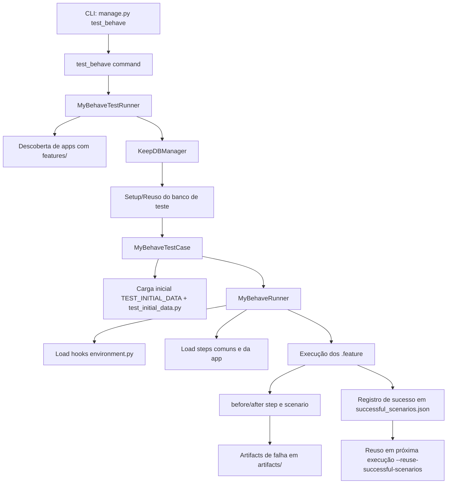
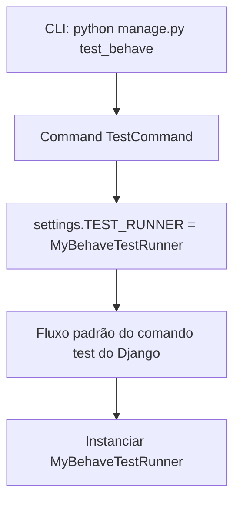
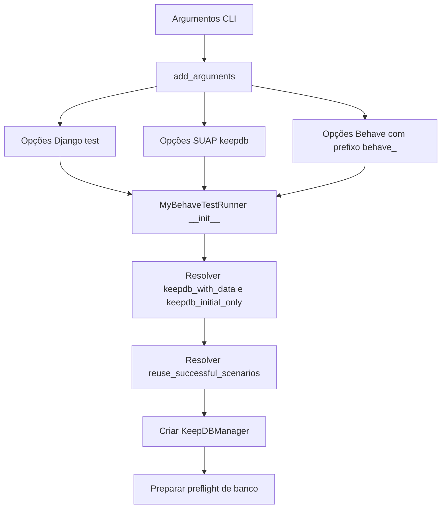
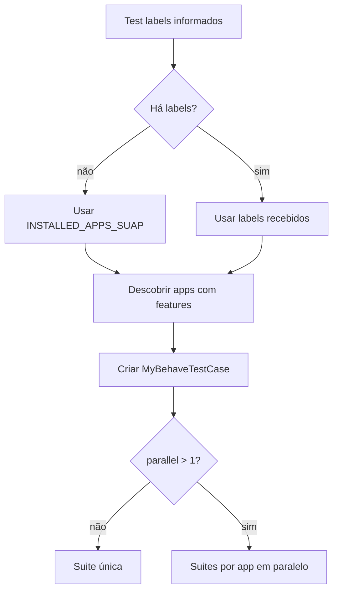
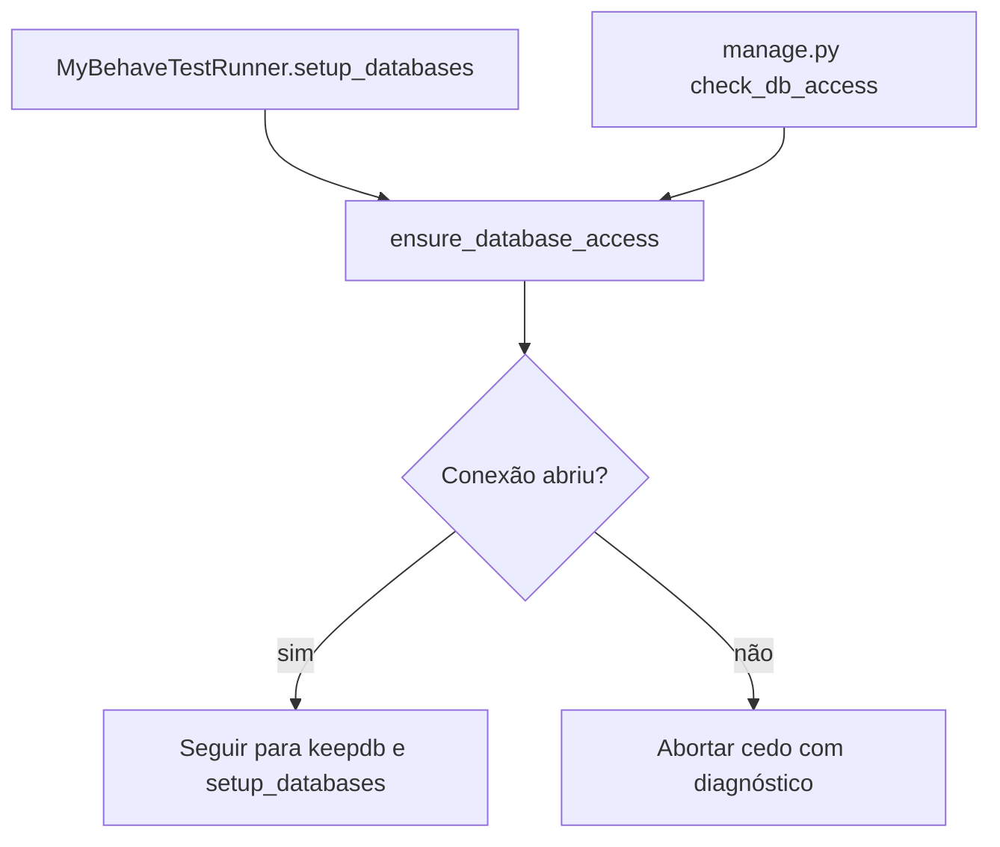
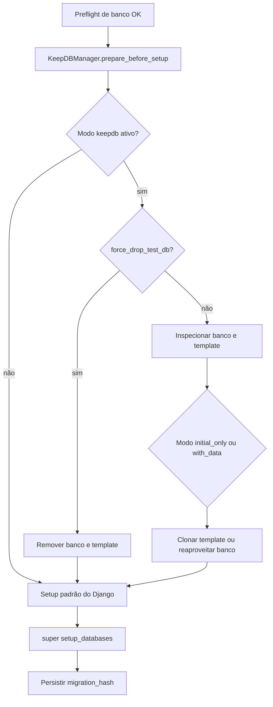
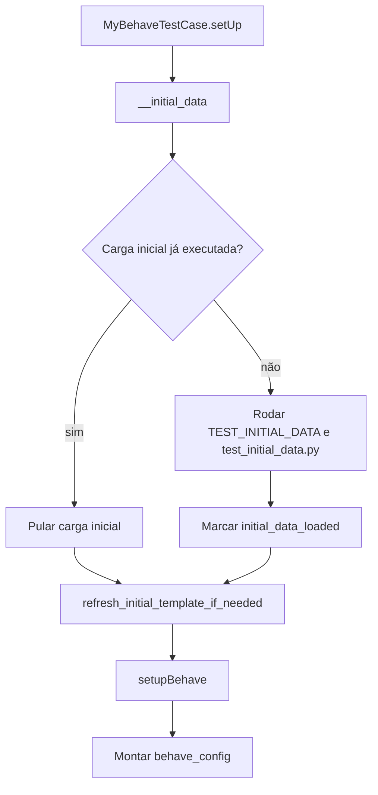
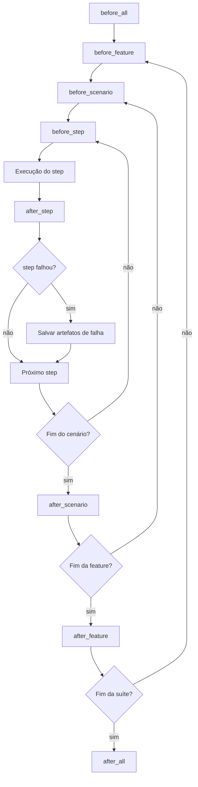
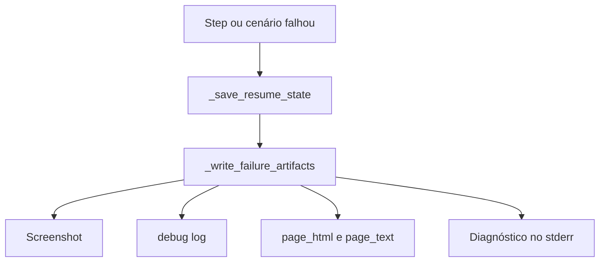
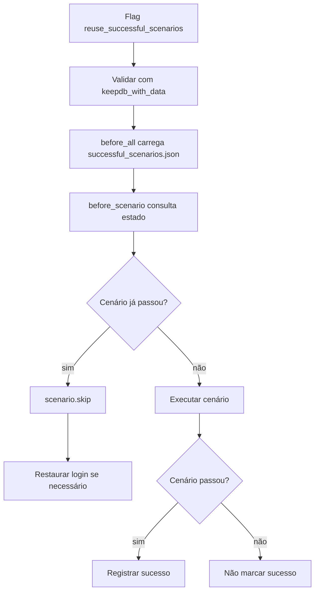

# Arquitetura de Testes Behave no SUAP

## Objetivo
Este documento explica a arquitetura de testes BDD com Behave no SUAP com foco em uso prático no dia a dia de desenvolvimento.

Ele cobre:

- como os testes se encaixam no monólito SUAP;
- como executar com feedback rápido (inclusive em Docker);
- como o keepdb e o reuso de cenários reduzem tempo de execução;
- quais decisões de arquitetura melhoram estabilidade e manutenção da suíte.

## Por que essa arquitetura de testes existe

Em projetos grandes, testes E2E/BDD costumam ficar lentos, frágeis e difíceis de manter.

A estratégia adotada no SUAP busca resolver isso com:

- infraestrutura centralizada de execução (`djtools.new_tests`);
- organização por domínio (cada app com suas `features/steps`);
- reuso inteligente de banco e cenários bem-sucedidos;
- geração de artefatos para depuração rápida em caso de falha.

Principais ganhos para o desenvolvedor:

- menor tempo entre alteração de código e validação;
- menos retrabalho com setup de banco de teste;
- melhor rastreabilidade de falhas;
- execução incremental para acelerar ciclos longos.

## Visão Geral da Arquitetura do SUAP
O SUAP é um monólito modular em Django:

- Núcleo técnico: app `djtools` + apps base (`comum`, `rh`, `edu` etc.).
- Domínios funcionais: dezenas de apps Django em `INSTALLED_APPS_SUAP`.
- Registro central de apps: `suap/settings_base.py` (`APPS_SUAP`).
- Inclusão de rotas por app: `suap/urls.py` inclui `/<app>/` dinamicamente quando existe `urls.py`.
- Dependências entre módulos: `module_dependencies.json`.

Implicação para testes Behave: cada app pode expor sua própria pasta `features/` com cenários e steps, enquanto a infraestrutura de execução é centralizada no `djtools.new_tests`.

Vantagem: equilíbrio entre padronização (infra comum) e autonomia por domínio (steps específicos por app).

## Ponto de Entrada dos Testes Behave
- Comando Django: `python manage.py test_behave ...`
- Arquivo: `djtools/management/commands/test_behave.py`
- Efeito: troca o `TEST_RUNNER` para `djtools.new_tests.runner.MyBehaveTestRunner`.

Ou seja, o comando mantém a experiência padrão de `manage.py test`, mas com um runner especializado para BDD.

Vantagem: adoção simples para o time, sem criar um fluxo paralelo de execução.

## Fluxograma da Arquitetura de Teste


## Componentes Principais

### 1) Runner (`djtools/new_tests/runner.py`)
- `MyBehaveTestRunner(DiscoverRunner)`:
  - Registra flags adicionais de banco/reuso:
    - `--keepdb-with-data`
    - `--keepdb-initial-only`
    - `--force-drop-test-db`
    - `--reuse-successful-scenarios`
  - Descobre apps com `features/` a partir de `INSTALLED_APPS_SUAP`.
  - Constrói uma suíte Django onde cada app vira um `MyBehaveTestCase`.
- `MyBehaveTestCase(StaticLiveServerTestCase, InitialDataMetaMixin)`:
  - Sobe live server para testes de UI.
  - Executa carga inicial (`TEST_INITIAL_DATA` + `features/test_initial_data.py` por app).
  - Controla flush/finalização do banco conforme modo keepdb.
- `MyBehaveRunner(BehaveRunner)`:
  - Carrega hooks (`environment.py`).
  - Carrega steps comuns (`settings.TEST_COMMON_STEPS`) e steps da app.
  - Faz parse e execução dos `.feature`.

Vantagens práticas:

- concentra regras críticas de execução em um único ponto;
- evita duplicação de lógica entre apps;
- facilita evolução da plataforma de testes sem alterar cada domínio.

### 2) Fluxo de Entrada do Comando (`djtools/management/commands/test_behave.py`)
O comando `test_behave` é uma especialização do comando Django `test`. Ele não executa a suíte diretamente: sua responsabilidade principal é apontar o `TEST_RUNNER` para `djtools.new_tests.runner.MyBehaveTestRunner`.

#### Fluxo do ponto de entrada


Como ler esse diagrama:

- O usuário entra pelo comando `python manage.py test_behave`.
- A classe `Command(TestCommand)` reaproveita o comportamento padrão do Django.
- A customização crítica é a troca de `TEST_RUNNER`.
- A partir daí, o controle segue para `MyBehaveTestRunner`, que concentra a arquitetura específica do SUAP.

Vantagem prática: o time continua usando uma interface familiar do Django, mas com uma implementação especializada para BDD.

### 3) Montagem do Runner e Resolução de Opções (`djtools/new_tests/runner.py`)
Esta fase resolve as flags disponíveis no comando e monta o runner com o comportamento final da execução.

#### Fluxo de configuração do runner


Como ler esse diagrama:

- O parser do comando agrega opções de três camadas: Django, SUAP e Behave.
- `MyBehaveTestRunner.add_arguments()` registra as flags extras do SUAP e expõe as opções do Behave com prefixo `--behave_*`.
- Em `__init__`, o runner decide o modo keepdb ativo e valida combinações inválidas.
- O reuso de cenários é resolvido nessa fase, antes da execução começar de fato.
- Por fim, o runner instancia o `KeepDBManager`, que será responsável pela estratégia de banco.
- O runner também deixa preparado o fluxo de preflight de banco, executado antes do `setup_databases()`.

Vantagem prática: toda a política de execução fica centralizada antes do primeiro teste rodar, reduzindo ambiguidade de comportamento.

### 4) Descoberta das Apps e Montagem da Suíte (`djtools/new_tests/runner.py`)
Depois de configurado, o runner decide quais apps com `features/` serão executadas e monta a suíte Django correspondente.

#### Fluxo de descoberta e suite


Como ler esse diagrama:

- O runner parte dos labels recebidos na CLI; se não houver labels, usa `INSTALLED_APPS_SUAP`.
- Para cada app, ele verifica se existe uma pasta `features/`.
- Cada app elegível vira um `MyBehaveTestCase`.
- Se `--parallel` estiver ativo, o runner monta suítes separadas por app; caso contrário, cria uma suíte única.

Vantagem prática: o comando aceita desde uma app específica até uma execução mais ampla, sem que cada domínio precise conhecer os detalhes da infraestrutura.

### 5) Preflight de Banco (`djtools/new_tests/db_preflight.py` e `manage.py check_db_access`)
Antes de preparar o banco de teste, o runner executa uma validação explícita de conectividade com o banco configurado em `DATABASES['default']`.

#### Fluxo de preflight de banco


Como ler esse diagrama:

- O mesmo núcleo de preflight é reutilizado em dois pontos:
  - internamente pelo `MyBehaveTestRunner`;
  - manualmente via `python manage.py check_db_access`.
- Se a conexão abrir, o fluxo segue normalmente para a preparação do banco de teste.
- Se falhar, o processo é interrompido antes de etapas mais lentas como keepdb, clone de template ou criação do banco de teste.

O diagnóstico inclui:

- alias da conexão (`default`);
- host, porta e nome do banco em uso;
- mensagem de erro da tentativa de conexão;
- dicas contextuais para host local ou `vpn`.

Vantagem prática: em vez de esperar timeouts longos dentro do keepdb, o desenvolvedor recebe erro antecipado e com contexto do destino de conexão.

### 6) Preparação do Banco de Teste (`djtools/new_tests/keepdb_manager.py`)
Esta fase cobre o ciclo de vida do banco antes da execução dos cenários. Ela não pertence aos hooks do Behave; acontece antes do `run()` do runner.

#### Fluxo de decisão do banco


Como ler esse diagrama:

- Esta fase começa somente depois que o preflight de banco validou a conectividade básica.
- `KeepDBManager.prepare_before_setup()` decide se o banco será recriado, reutilizado ou restaurado de template.
- O modo `--keepdb-initial-only` prioriza restaurar do template inicial.
- O modo `--keepdb-with-data` tenta reaproveitar o banco já existente com os dados dos cenários.
- Após a preparação, o Django executa seu `setup_databases()`.
- No fim, o runner persiste o `migration_hash` para validar compatibilidade em execuções futuras.

Vantagem prática: separar essa fase deixa claro que a política de banco é decidida antes do Behave abrir browser, carregar hooks ou executar steps.

### 7) Inicialização do TestCase e Carga Inicial (`djtools/new_tests/runner.py`)
Depois que o banco está pronto, cada `MyBehaveTestCase` prepara o live server, a carga inicial e a configuração do Behave.

#### Fluxo do testcase


Como ler esse diagrama:

- `setUp()` do testcase é a ponte entre o banco já pronto e a execução do Behave.
- A carga inicial combina `TEST_INITIAL_DATA` com arquivos `features/test_initial_data.py` das apps.
- Em modos keepdb, a carga inicial pode ser pulada se já tiver sido aplicada antes.
- `refresh_initial_template_if_needed()` atualiza o template inicial quando o runner marcou essa necessidade.
- `setupBehave()` monta o `behave_config` final, incluindo paths das features e opções do Behave.

Vantagem prática: esta etapa explica por que a infraestrutura de banco e a carga inicial não estão dentro dos hooks `before_all`.

### 8) Execução do Behave: Hooks e Steps (`djtools/new_tests/environment_base.py`)
`avaliacao_integrada/features/environment.py` importa tudo desse arquivo base. Esta fase representa apenas a execução do Behave em si, não o fluxo inteiro do comando.

#### Fluxograma dos hooks


Como ler esse diagrama:

- `before_all` prepara browser, diretório de artefatos, log e estado de reuso.
- `before_feature` inicializa o contexto da feature e limpa estados transitórios.
- `before_scenario` decide se o cenário será executado ou pulado por reuso.
- `before_step` e `after_step` cercam a execução de cada step.
- `after_scenario`, `after_feature` e `after_all` fazem limpeza, persistência e encerramento.

#### Passo a passo dos hooks
1. `before_all`
- Inicializa Playwright e contexto do browser.
- Cria pasta de artefatos (`<CI_PROJECT_DIR|/tmp>/artifacts`).
- Carrega estado de reuso (`successful_scenarios.json`).
- Reinicia o log base de debug (`deploy/logs/debug.log`).
- Opcional: prepara estrutura de auto documentação (`BEHAVE_AUTO_DOC`).

2. `before_feature`
- Prepara contexto da aplicação/feature atual.
- Limpa estado de login reaproveitado da feature anterior.
- Opcional: inicializa workflow/documentação da feature.

3. `before_scenario`
- Registra cenário atual no contexto.
- Verifica reuso: se cenário já passou, pode pular (`scenario.skip`).
- Se necessário, restaura login automaticamente quando cenário de login foi pulado.

4. `before_step`
- Atualiza metadados do passo atual (`step_text` e `step_description`).

5. `after_step`
- Se o step falhar/der erro: persiste checkpoint de retomada e gera artefatos de falha.

6. `after_scenario`
- Cenário `passed`: registra em `successful_scenarios.json`.
- Cenário com `failed/error/hook_error`: persiste retomada e artefatos.
- Reseta contexto de popups/xpath para evitar vazamento para o próximo cenário.

7. `after_feature`
- Executa logout para isolar autenticação entre features.
- Opcional: renderiza imagem de workflow quando auto-doc está ativa.

8. `after_all`
- Encerra browser/contexto.
- Imprime resumo de reuso.
- Opcional: gera `documentacao.json` por app (`BEHAVE_AUTO_DOC`).
- Opcional: gera dump `suap_mock.sql` (`BEHAVE_AUTO_MOCK`).

### 9) Tratamento de Falhas e Artefatos (`djtools/new_tests/environment_base.py`)
Os hooks chamam rotinas auxiliares específicas para checkpoint e coleta de diagnóstico quando algo falha.

#### Fluxo de falha


Como ler esse diagrama:

- Ao detectar falha, o sistema salva o ponto de retomada em `last_failed_step.json`.
- Em seguida, gera um conjunto padronizado de artefatos para depuração.
- O stderr também recebe diagnóstico textual com URL atual e leitura básica do estado da página.

#### Artefatos gerados no processo
Artefatos de execução contínua:
- `artifacts/successful_scenarios.json`: cenários aprovados para reuso.
- `deploy/logs/debug.log`: log base da execução atual.

Artefatos de erro (step/scenario com falha):
- `artifacts/last_failed_step.json`: referência para retomada (feature/cenário/step).
- `artifacts/screen<timestamp>.png`: screenshot full-page.
- `artifacts/debug<timestamp>.log`: cópia do log de debug.
- `artifacts/page_html<timestamp>.html`: HTML bruto da página no momento da falha.
- `artifacts/page_text<timestamp>.txt`: extração textual da página com URL.

Diagnóstico adicional no stderr em falha:
- URL atual no momento da quebra.
- Classificação da situação (`login`, `error_page`, `ok`).
- Bloco `[PAGE_MARKERS]` com alertas/status extraídos do HTML (quando encontrados).

Vantagem prática: a depuração deixa de depender apenas do log do terminal e passa a ter evidências reproduzíveis por arquivo.

### 10) Reuso de Cenários Bem-Sucedidos (`djtools/new_tests/reuse_successful_scenarios.py`)
O reuso é um fluxo próprio: ele começa na configuração do runner, é carregado em `before_all`, influencia `before_scenario` e é persistido em `after_scenario`.

#### Fluxo de reuso


Como ler esse diagrama:

- O reuso só é aceito se `--keepdb-with-data` também estiver ativo.
- No início da suíte, o estado anterior é carregado de `successful_scenarios.json`.
- Antes de cada cenário, o sistema decide se ele será pulado.
- Quando um cenário de login é pulado, o sistema pode restaurar a sessão automaticamente para evitar falhas em cascata.
- Cenários aprovados são gravados para a próxima execução.

Vantagem prática: o tempo de reexecução cai bastante em suítes longas, sem perder a continuidade do estado necessário.

### 11) Steps
- Steps comuns: `djtools/new_tests/common_steps/` (`given.py`, `when.py`, `then.py`).
- Steps específicos por app: `<app>/features/steps/`.
- Exemplo: `avaliacao_integrada/features/steps/given.py` concentra preparação de massa de dados complexa para o domínio da avaliação integrada.

Esse desenho evita duplicação de automações de UI (steps comuns) e preserva especialização por domínio (steps da app).

### 12) Estratégia de Banco de Teste (`djtools/new_tests/keepdb_manager.py`)
O SUAP usa um mecanismo avançado de keepdb com metadados e template PostgreSQL.

Modos:
- `--keepdb-with-data`: mantém banco com dados gerados pelos cenários.
- `--keepdb-initial-only`: mantém banco, mas restaura sempre para estado inicial.
- `--force-drop-test-db`: força recriação do banco/template.

Metadados persistidos na tabela `djtools_test_template_meta`:
- `initial_data_loaded`
- `data_origin` (`with_data` ou `initial_only`)
- `migration_hash`

Fluxo resumido:
1. Runner decide se reutiliza, clona template ou recria banco.
2. Após setup, grava `migration_hash`.
3. TestCase executa carga inicial quando necessário.
4. Se preciso, atualiza template inicial (`<test_db>_template_initial`).

Vantagem prática: reduz drasticamente custo de inicialização de suíte em execuções repetidas.

### 13) Reuso de Cenários Bem-Sucedidos (`djtools/new_tests/reuse_successful_scenarios.py`)
Quando `--reuse-successful-scenarios` está ativo:
- Cenários aprovados são registrados em `artifacts/successful_scenarios.json`.
- Na próxima execução, cenários já aprovados são pulados.
- Pré-requisito obrigatório: usar com `--keepdb-with-data`.

Detalhe importante:
- O reuso persiste credenciais de login para restaurar sessão quando um cenário de login foi pulado (evita cascata de falha por sessão anônima).

Vantagem prática: foco nos cenários que realmente mudaram ou ainda estão falhando.

## Fluxo de Execução (Resumo)
1. `manage.py test_behave` ativa o runner customizado.
2. Runner resolve opções, modo keepdb e política de reuso.
3. Runner executa preflight de acesso ao banco.
4. Runner descobre apps com `features/`.
5. Runner prepara banco com `KeepDBManager`.
6. TestCase inicia live server + carga inicial.
7. Behave executa features com hooks e steps (comuns + app).
8. Falhas geram artefatos em `artifacts/`.
9. Em keepdb, estado do banco e reuso ficam persistidos para próxima execução.

Leitura prática do fluxo:

- primeira execução: custo maior de setup;
- execuções seguintes com keepdb/reuso: tempo menor e feedback mais rápido.

## Convenções para Apps (ex.: `avaliacao_integrada`)
Estrutura mínima recomendada:
- `<app>/features/*.feature`
- `<app>/features/environment.py` (importando base comum)
- `<app>/features/steps/given.py|when.py|then.py`
- Opcional: `<app>/features/test_initial_data.py`

Boas práticas:
- Colocar setup de dados de domínio em `given.py` da própria app.
- Reaproveitar steps de UI comuns em `djtools/new_tests/common_steps`.
- Manter cenários independentes sempre que possível; quando houver dependência explícita, documentar no `.feature`.

Vantagem para manutenção: facilita onboarding e reduz acoplamento entre cenários de equipes diferentes.

## Comandos Úteis
Objetivo: escolher o modo de execução conforme a fase do trabalho (validação ampla, iteração rápida ou reset completo).

Execução padrão da app:
```bash
python manage.py test_behave avaliacao_integrada
```

Execução incremental (não limpa banco e retoma cenário):
```bash
python manage.py test_behave --keepdb-with-data --reuse-successful-scenarios avaliacao_integrada
```

Execução com baseline inicial estável:
```bash
python manage.py test_behave --keepdb-initial-only avaliacao_integrada
```

Forçar recriação completa do banco de teste:
```bash
python manage.py test_behave --keepdb-with-data --force-drop-test-db avaliacao_integrada
```

Execução no Docker Compose (cenário recomendado para ambiente local):
```bash
docker compose --env-file docker/dev/.env -f docker/dev/docker-compose.yml run --rm web python manage.py test_behave --keepdb-with-data --reuse-successful-scenarios avaliacao_integrada
```

Observações práticas para esse compose:

- o compose recomendado para esse fluxo é `docker/dev/docker-compose.yml`;
- se `DATABASE_HOST=vpn`, o serviço `vpn` precisa estar ativo para resolver host e rotear conexão de banco;
- para execução consistente, suba `vpn`, `db` e `redis` antes da suíte.
- os seguintes campos do `docker/dev/.env` precisam estar coerentes com o host:
  - `DOCKER_VPN_WORKDIR` (path absoluto para `suap-analytics/docker/vpn`);
  - `SDOCKER_WORKDIR` (path absoluto para o repositório `sdocker`);
  - `USER_BASE_DIR_NAME` e `USER_NAME` (resolução de `/<base>/<user>/.ssh`);
  - `LOCAL_DBUSER_PEM_PATH` (arquivo PEM existente para o container `db`).

Quando a execução depende de VPN, os parâmetros esperados de banco são:

```env
DATABASE_NAME=seu_banco
DATABASE_USER=seu_usuario
DATABASE_PASSWORD=*** # não expor credencial real
DATABASE_HOST=vpn
DATABASE_PORT=25432
```

Use somente placeholders em documentação e mantenha credenciais reais fora do versionamento.

Exemplo de configuração de host para evitar override manual no comando:

```env
# macOS
USER_BASE_DIR_NAME=Users
USER_NAME=seu_usuario

# Linux
# USER_BASE_DIR_NAME=home
# USER_NAME=seu_usuario
```

Recomendação prática de uso:

- durante desenvolvimento ativo: priorizar `--keepdb-with-data --reuse-successful-scenarios`;
- antes de validação final/merge: rodar sem reuso para conferir comportamento completo;
- após mudanças fortes de migração: usar `--force-drop-test-db`.

Erro previsto nesse fluxo (`keepdb` + reuso):

```text
RuntimeError: [test_behave] Banco de teste desatualizado: hash de migrations divergente. Use --force-drop-test-db para recriar.
```

Esse erro é esperado quando o banco de teste reaproveitado ficou incompatível com o estado atual das migrations.
Recuperação recomendada:

```bash
docker compose --env-file docker/dev/.env -f docker/dev/docker-compose.yml run --rm web python manage.py test_behave --keepdb-with-data --reuse-successful-scenarios --force-drop-test-db avaliacao_integrada
```

## Opções do Comando `test_behave`
As opções disponíveis vêm de camadas diferentes para manter compatibilidade com Django e Behave, sem perder customizações do SUAP.

Isso permite:

- manter padrão conhecido do ecossistema Django;
- adicionar recursos próprios de produtividade (`keepdb`, reuso de cenários);
- expor as capacidades do Behave sem quebrar o comando principal.

As opções vêm de 5 camadas:

### 1) Opções globais do Django `BaseCommand`
| Argumento | Descrição |
|---|---|
| `--verbosity` | Define nível de verbosidade da saída do comando. |
| `--settings` | Informa módulo de settings Django a ser usado. |
| `--pythonpath` | Adiciona caminho ao `PYTHONPATH` durante execução. |
| `--traceback` | Exibe traceback completo em caso de erro. |
| `--no-color` | Desativa cores na saída do terminal. |
| `--force-color` | Força cores na saída do terminal. |
| `--skip-checks` | Pula checks de sistema do Django antes de executar. |

### 2) Opções do comando Django `test`
| Argumento | Descrição |
|---|---|
| `test_label` (posicional) | Define app/módulo/feature alvo do teste. |
| `--noinput` / `--no-input` | Executa sem prompts interativos. |
| `--testrunner` | Sobrescreve o test runner a ser utilizado. |

### 3) Opções do `DiscoverRunner` (herdadas por `MyBehaveTestRunner`)
| Argumento | Descrição |
|---|---|
| `--failfast` | Interrompe na primeira falha encontrada. |
| `-t` / `--top-level-directory` | Define diretório raiz para descoberta de testes. |
| `-p` / `--pattern` | Filtra descoberta por padrão de arquivo. |
| `--keepdb` | Reaproveita banco de teste padrão do Django. |
| `--shuffle` | Embaralha ordem de execução dos testes. |
| `-r` / `--reverse` | Executa testes em ordem reversa. |
| `--debug-mode` | Liga modo de debug para execução dos testes. |
| `-d` / `--debug-sql` | Exibe SQL executado durante os testes. |
| `--parallel` | Executa testes em paralelo. |
| `--tag` | Inclui testes por tag. |
| `--exclude-tag` | Exclui testes por tag. |
| `--pdb` | Abre debugger (`pdb`) em falha. |
| `-b` / `--buffer` | Bufferiza stdout/stderr durante execução. |
| `--no-faulthandler` | Desativa `faulthandler` do Python. |
| `--timing` | Exibe métricas de tempo da execução. |
| `-k` | Filtra execução por nome/padrão de teste. |
| `--durations` | Mostra testes mais lentos (quando suportado). |

### 4) Opções específicas do SUAP (`MyBehaveTestRunner`)
| Argumento | Descrição |
|---|---|
| `--default-tablespace` | Define tablespace padrão para banco de teste. |
| `--keepdb-initial-only` | Mantém banco de teste apenas no estado inicial. |
| `--keepdb-with-data` | Mantém banco com dados gerados pelos cenários. |
| `--force-drop-test-db` | Força recriação completa do banco/template de teste. |
| `--reuse-successful-scenarios` | Pula cenários já aprovados em execução anterior. |

### 5) Opções do Behave expostas pelo SUAP (`--behave_*`)
| Argumento | Descrição |
|---|---|
| `--behave_no-color` | Desativa cores na saída do Behave. |
| `--behave_color` | Ativa cores na saída do Behave. |
| `--behave_dry-run` | Valida steps sem executar cenários. |
| `--behave_define` | Define variáveis customizadas para execução Behave. |
| `--behave_exclude` | Exclui paths/features por padrão. |
| `--behave_include` | Inclui paths/features por padrão. |
| `--behave_no-junit` | Desativa geração de relatório JUnit. |
| `--behave_junit` | Ativa geração de relatório JUnit. |
| `--behave_junit-directory` | Define diretório de saída do JUnit. |
| `--behave_jobs` | Define quantidade de jobs paralelos (quando suportado). |
| `--behave_format` | Define formatter(es) de saída do Behave. |
| `--behave_steps-catalog` | Exibe catálogo de steps disponíveis. |
| `--behave_no-skipped` | Oculta cenários/skips na saída. |
| `--behave_show-skipped` | Exibe cenários/skips na saída. |
| `--behave_no-snippets` | Oculta snippets de steps não implementados. |
| `--behave_snippets` | Exibe snippets de steps não implementados. |
| `--behave_no-multiline` | Desativa saída multiline formatada. |
| `--behave_multiline` | Ativa saída multiline formatada. |
| `--behave_name` | Filtra cenários por nome. |
| `--behave_capture` | Ativa captura de saída padrão. |
| `--behave_no-capture` | Desativa captura de saída padrão. |
| `--behave_capture-stdout` | Captura `stdout` dos steps. |
| `--behave_no-capture-stdout` | Não captura `stdout` dos steps. |
| `--behave_capture-stderr` | Captura `stderr` dos steps. |
| `--behave_no-capture-stderr` | Não captura `stderr` dos steps. |
| `--behave_capture-log` | Captura logs durante execução. |
| `--behave_no-capture-log` | Não captura logs durante execução. |
| `--behave_capture-hooks` | Captura saída dos hooks do Behave. |
| `--behave_no-capture-hooks` | Não captura saída dos hooks do Behave. |
| `--behave_logging-level` | Define nível de log do Behave. |
| `--behave_logging-format` | Define formato de log do Behave. |
| `--behave_logging-datefmt` | Define formato de data do log. |
| `--behave_logging-filter` | Aplica filtro de logger. |
| `--behave_logging-clear-handlers` | Limpa handlers de log antes da execução. |
| `--behave_no-logging-clear-handlers` | Mantém handlers de log existentes. |
| `--behave_no-summary` | Oculta resumo final do Behave. |
| `--behave_summary` | Exibe resumo final do Behave. |
| `--behave_outfile` | Redireciona saída para arquivo. |
| `--behave_quiet` | Reduz saída ao mínimo. |
| `--behave_runner` | Define classe runner customizada do Behave. |
| `--behave_no-source` | Oculta trechos de source na saída. |
| `--behave_show-source` | Exibe trechos de source na saída. |
| `--behave_stage` | Define estágio/ambiente para seleção de arquivos. |
| `--behave_stop` | Para na primeira falha. |
| `--behave_tags` | Filtra cenários/features por tags Behave. |
| `--behave_no-timings` | Oculta tempos de execução por etapa. |
| `--behave_show-timings` | Exibe tempos de execução por etapa. |
| `--behave_verbose` | Aumenta detalhamento da saída. |
| `--behave_wip` | Executa em modo WIP (work in progress). |
| `--behave_lang` | Define idioma dos keywords Gherkin. |
| `--behave_lang-list` | Lista idiomas Gherkin suportados. |
| `--behave_lang-help` | Exibe ajuda de idioma Gherkin. |
| `--behave_tags-help` | Exibe ajuda de sintaxe de tags. |
| `--behave_version` | Exibe versão do Behave e sai. |

Observações:
- O SUAP define as opções do Behave dinamicamente com base em `behave.configuration.OPTIONS`.
- As flags `--reuse-successful-scenarios` e `--keepdb-with-data` devem ser usadas juntas.
- O modo `--keepdb-initial-only` é mutuamente exclusivo com `--keepdb-with-data`.

## Riscos e Pontos de Atenção
- Reuso de cenários depende da consistência do estado do banco e do arquivo `successful_scenarios.json`.
- Mudanças de migration com keepdb podem invalidar banco/template (o sistema bloqueia com erro orientando `--force-drop-test-db`).
- Cenários com dependência forte entre si tendem a ficar mais frágeis; priorizar isolamento quando possível.
- Em execução Docker/local, o ambiente precisa de browser/driver e serviços de banco alinhados com as configurações do projeto.

## Resumo de Valor da Arquitetura

A arquitetura de testes Behave do SUAP foi desenhada para equilibrar três objetivos:

- velocidade de execução (keepdb + reuso);
- confiabilidade de resultado (runner centralizado + hooks padronizados);
- escalabilidade de manutenção (steps comuns + steps por domínio).

Na prática, isso reduz tempo de feedback, melhora a experiência de depuração e torna a evolução da suíte mais sustentável no longo prazo.
