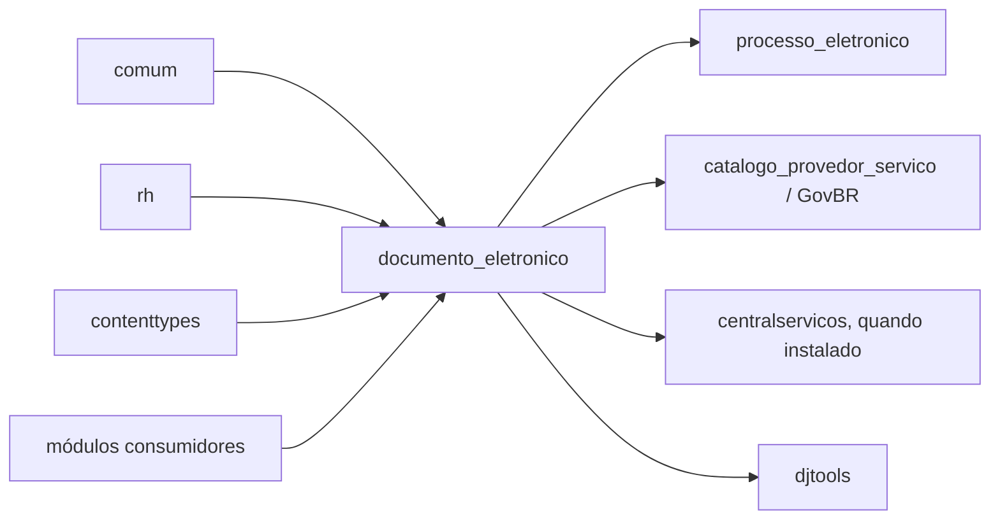

# Fronteira — Documento Eletrônico

> ⚠️ REVISAR: a fronteira combina `module_dependencies.json` com imports diretos encontrados no código; divergências entre as duas fontes estão marcadas.

## Mapa

## Dependências de entrada

### Módulos que dependem de `documento_eletronico`

Conforme `module_dependencies.json`:

| Módulo | Contrato consumido |
|---|---|
| `avaliacao_integrada` | criação/uso de documentos em avaliação |
| `boletim_servico` | emissão de documentos do boletim |
| `calculos_pagamentos` | geração/uso de documentos administrativos |
| `conectagov_pen` | processamento de documentos recebidos |
| `contratos` | documentos vinculados a contratos |
| `cursos` | documentos associados a cursos |
| `edu` | documentos acadêmicos |
| `estagios` | documentos de estágio |
| `pafc` | documentos do programa |
| `pgd2` | documentos do plano/programa |
| `plan_estrategico` | documentos do planejamento |
| `processo_eletronico` | documentos de processos, anexação, tramitação e assinatura |
| `professor_sv` | documentos acadêmicos/funcionais |
| `remanejamento` | documentos do remanejamento |
| `rh` | documentos e referências de pessoas/servidores |

### Imports diretos localizados

Também foram localizados imports em `ae`, `api`, `auditoria`, `comum`, `catalogo_provedor_servico`, `pesquisa`, `ppc`, `professor_titular`, `progressoes`, `projetos`, `rsc`, `rsc_tae` e outros arquivos dos módulos acima.

> ⚠️ REVISAR: a lista de imports diretos é mais ampla que a lista declarada em `module_dependencies.json`; sincronizar o inventário antes de alterar o grafo oficial de dependências.

## Dependências de saída

| Dependência | Contratos publicados/consumidos |
|---|---|
| `comum` | `Pessoa`, vínculos, `Configuracao`, notificações, autenticação e utilitários compartilhados |
| `rh` | `Servidor`, cargos, funções e `Setor` usados em proprietário, assinatura, restrição e identificação |
| `contenttypes` | relações genéricas e permissões por objeto |
| `djtools` | `ModelPlus`, FSM, segurança, PDF, tabelas, decorators e infraestrutura |
| `processo_eletronico` | processos, permissões, juntada, tramitação e documentos externos, por integração condicional |
| `catalogo_provedor_servico` | serviços e autenticação GovBR, por integração condicional |
| `centralservicos` | opção de integração configurada em formulário, quando instalado |

## Contratos publicados

- modelos Django para documentos textuais e digitalizados, catálogos, assinaturas, compartilhamentos e registros de ação;
- rotas web sob `/documento_eletronico/` e registros no admin;
- geração de PDF/PDF-A e hashes para integridade/autenticação;
- managers e métodos de domínio para verificar leitura, edição, compartilhamento, assinatura e finalização;
- sinais que sincronizam o estado do documento com solicitações de revisão e assinatura.

## Contratos externos esperados

- pessoas e vínculos devem fornecer identidade, CPF, papel e segredo/certificado quando exigidos;
- setores devem fornecer hierarquia e siglas usadas na identificação;
- `processo_eletronico` deve fornecer objetos e permissões esperados quando sua integração estiver habilitada;
- configurações devem estar presentes antes de habilitar lote, busca, auditoria pública ou GovBR.

> ⚠️ REVISAR: não há `api.py` próprio no módulo; os contratos HTTP observados são rotas Django e os endpoints GovBR/processuais são integrações condicionais.

Gerado/atualizado via subagent `documentador` em 2026-09-09.
