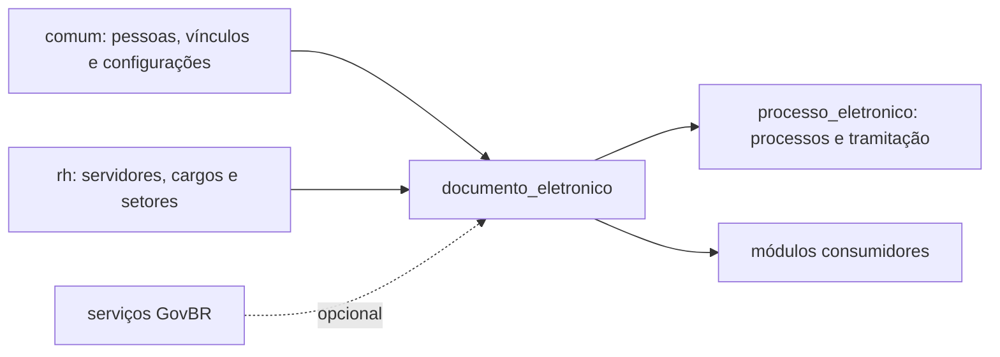
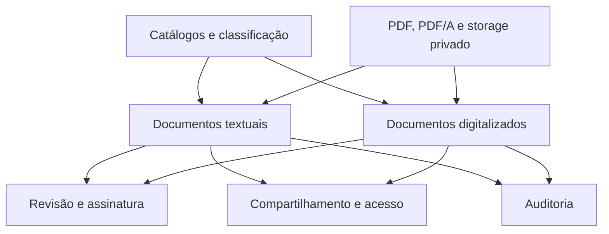

# HLA — Documento Eletrônico

> ⚠️ REVISAR: o desenho abaixo é uma síntese técnica do código atual; decisões institucionais e integrações opcionais requerem validação dos responsáveis.

## 1. Contexto e escopo

`documento_eletronico` é o núcleo de documentos do SUAP. Recebe identidade, vínculos, setores e configurações dos módulos compartilhados; publica documentos e serviços para módulos acadêmicos, administrativos e para `processo_eletronico`.



O módulo cobre documentos textuais e digitalizados, catálogos, classificação, permissões, revisão, assinatura, finalização, anexação, geração de arquivos e auditoria. Não é o dono do processo administrativo nem do cadastro de pessoas.

## 2. Estratégia arquitetural

| Decisão | Implementação observada |
|---|---|
| Domínio | modelos Django em `models.py`, com classes abstratas para documento, solicitação e auditoria |
| Estados | transições FSM no documento textual e nas solicitações |
| Apresentação | views Django, admin, formulários e tabelas |
| Persistência | PostgreSQL via `ModelPlus`, MPTT para `Classificacao` e relações intermediárias explícitas |
| Arquivos | armazenamento privado em `private-media/processo_eletronico/...` e geração PDF/PDF-A |
| Integração | importações diretas, chamadas condicionais e configuração persistida |
| Assinatura | HMAC/segredo para a assinatura por senha |

## 3. Blocos



| Bloco | Responsabilidade | Código principal |
|---|---|---|
| Catálogos e classificação | tipos, modelos, hipóteses legais, vínculos e árvore de classificação | `models.py`, `admin.py`, `forms.py` |
| Documentos textuais | corpo, cabeçalho/rodapé, estado, identificador, favoritos e interessados | `DocumentoTexto` |
| Documentos digitalizados | arquivo, tipo, conferência, proprietário, interessados e anexação | `DocumentoDigitalizado` |
| Revisão e assinatura | solicitações, dependências, assinaturas e transições | `Solicitacao*`, `Assinatura*`, `signals.py` |
| Acesso | permissões diretas, setoriais, níveis e solicitações | `Compartilhamento*`, `Documento.pode_ler/pode_editar` |
| Arquivos | renderização, hash, conversão e composição com anexos | `utils.py`, `tasks.py` |
| Auditoria | registro de ações por tipo de documento | `RegistroAcaoDocumento*` |

ERD particionado: [índice do modelo de dados](modelo-de-dados/_indice.md).

## 4. Fluxos

| Fluxo | Entrada | Saída |
|---|---|---|
| [Criar e concluir documento textual](fluxos/criar-e-concluir-documento-texto.md) | formulário de criação | documento textual concluído |
| [Solicitar revisão e revisar](fluxos/solicitar-e-realizar-revisao.md) | documento concluído | documento revisado ou solicitação indeferida |
| [Solicitar assinatura e finalizar](fluxos/assinar-e-finalizar-documento-texto.md) | documento concluído/revisado | documento assinado e, se aplicável, finalizado |
| [Compartilhar documento](fluxos/compartilhar-documento.md) | pessoa/setor e permissão | acesso compartilhado e ação registrada |
| [Anexar documentos](fluxos/anexar-documentos.md) | documento pai e anexos | relação de anexação e PDF composto |
| [Publicar e autenticar](fluxos/publicar-e-autenticar-documento.md) | consulta ou autenticação | resultado de acesso/hash/identidade |

```mermaid
flowchart LR
    Ator["autor ou operador"] --> Criar["criar documento"]
    Criar --> Concluir["concluir"]
    Concluir --> Revisao{ "revisão necessária?" }
    Revisao -->|sim| Revisar["solicitar e realizar revisão"]
    Revisao -->|não| Assinar["solicitar/realizar assinatura"]
    Revisar --> Assinar
    Assinar --> Finalizar["finalizar quando permitido"]
    Finalizar --> Publico["consultar/autenticar"]
```

## 5. Integrações

| Integração | Direção | Mecanismo |
|---|---|---|
| `comum` | entrada | pessoas, vínculos, configurações, notificações e serviços base |
| `rh` | entrada | servidores, cargos, funções e setores |
| `processo_eletronico` | entrada/saída | permissões processuais, vinculação, juntada, tramitação e serviços condicionais |
| `catalogo_provedor_servico` | entrada/saída opcional | GovBR/notificações e serviços externos |
| módulos acadêmicos e administrativos | entrada | importam modelos, forms, views e serviços do módulo |
| `contenttypes` / `djtools` | infraestrutura | relações genéricas, permissões por objeto, segurança e renderização |

Mapa detalhado de dependências: [FRONTEIRA](FRONTEIRA.md).

## 6. Conceitos transversais

- **Transações:** criação/alteração do documento textual usa operações atômicas; transições e sinais persistem estados derivados.
- **Concorrência:** o formulário de edição compara `data_ultima_modificacao` para detectar edição concorrente.
- **Locks:** a numeração busca o último definitivo por tipo/setor/ano; ⚠️ REVISAR: o mecanismo de lock e sua garantia operacional devem ser confirmados no banco em uso.
- **Arquivos:** documentos digitalizados e PDFs usam storage privado; anexos podem ser mesclados na saída.
- **Permissões:** decorators, admin, managers e métodos `pode_ler`, `pode_editar` e `pode_compartilhar` compõem a autorização.
- **Auditoria:** ações de leitura, impressão, edição, assinatura, processo, compartilhamento, revisão, cancelamento, finalização e acesso podem gerar registros.
- **Criptografia/hash:** assinatura por senha usa HMAC sobre o hash do conteúdo; integridade usa SHA-512 por padrão e SHA-256 quando explicitado.

## 7. Riscos e débito técnico

- `NivelAcesso` aparece como classe de constantes duplicada em `status.py` e há indicação de migração para enum.
- A classificação de documentos digitalizados nos managers usa convenções que merecem revisão para evitar confusão entre documento pessoal, setorial e anexo simples.
- `module_dependencies.json` não representa todos os imports diretos localizados, inclusive consumidores administrativos; a divergência está detalhada em [FRONTEIRA](FRONTEIRA.md).
- A integração com `processo_eletronico`, `catalogo_provedor_servico` e `centralservicos` é condicional; cenários sem esses apps precisam permanecer cobertos.
- ⚠️ REVISAR: critérios institucionais para níveis de acesso, retenção, descarte e validade de certificados não estão especificados somente no código do módulo.

## 8. Glossário

Consultar [GLOSSARIO.md](GLOSSARIO.md).

Gerado/atualizado via subagent `documentador` em 2026-09-09.
