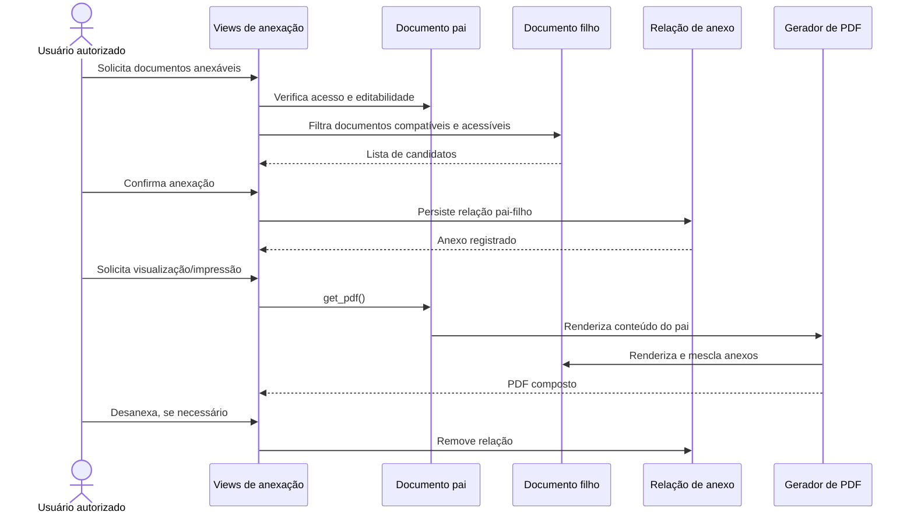

# Fluxo: anexar documentos

> Fluxo de associação de documentos textuais ou digitalizados a um documento pai e composição do arquivo de saída.

- **Ator:** usuário com permissão de edição/anexação.
- **Gatilho:** seleção de documentos na operação de anexação.
- **Pré-condições:** documento pai editável, anexos acessíveis e tipo/modelo permitindo anexação quando aplicável.
- **Pós-condições:** relação de anexo persistida; ao gerar arquivo, anexos podem ser incorporados ao PDF.
- **Depende de:** modelos de relação de anexo, acesso do documento pai, arquivos e gerador de PDF.
- **Habilita:** visualização/impressão do documento composto e operações de desanexação.
- **Entrada no código:** rotas de listar/anexar/desanexar, `DocumentoTextoAnexo*`, `DocumentoTexto.get_pdf()` e `utils.py`.

## Observações

- Há relações específicas para documento textual e digitalizado.
- Anexo simples digitalizado segue regras do documento pai e é tratado separadamente dos demais documentos.
- A geração de PDF pode incluir anexos e a conversão para PDF/A é assíncrona.
- ⚠️ REVISAR: o código contempla restrições adicionais ligadas a processo eletrônico; confirmar a matriz de quais tipos de documento podem ser anexados em cada contexto.

Gerado/atualizado via subagent `documentador` em 2026-09-09.
