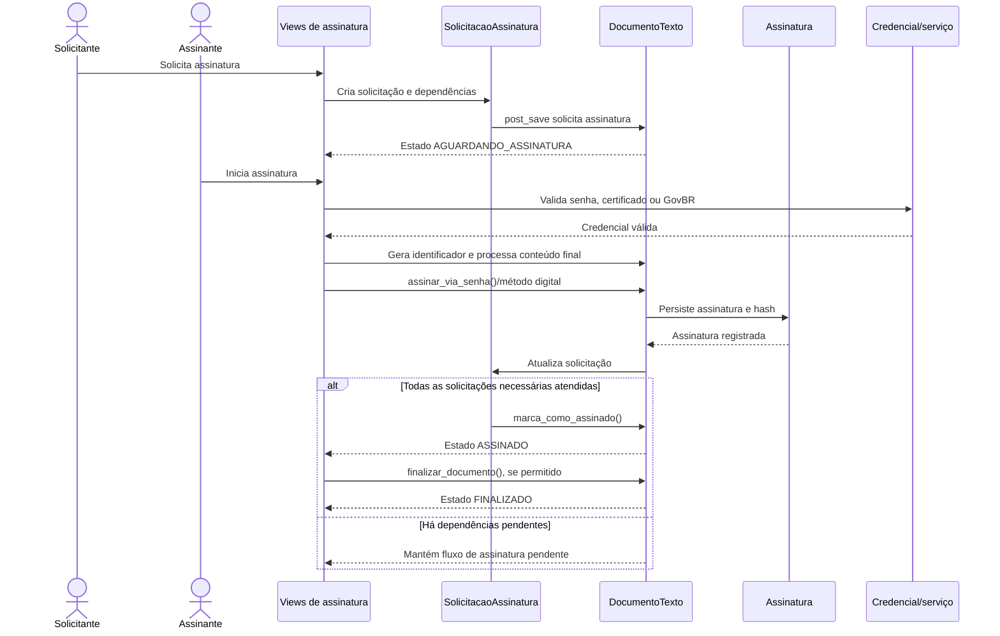

# Fluxo: solicitar assinatura e finalizar documento textual

> Fluxo de assinatura de documento textual por senha ou mecanismo digital disponível, seguido de finalização quando todas as condições forem atendidas.

- **Ator:** solicitante, assinante e operador autorizado.
- **Gatilho:** solicitação de assinatura ou acesso a uma rota de assinatura.
- **Pré-condições:** documento concluído/revisado, assinante autorizado e credencial válida.
- **Pós-condições:** assinatura persistida; documento `ASSINADO` e, quando permitido, `FINALIZADO`.
- **Depende de:** `SolicitacaoAssinatura`, `Assinatura`, vínculo, segredo e conteúdo do documento.
- **Habilita:** identificador definitivo, consulta de autenticidade e impressão final.
- **Entrada no código:** `assinar_documento.py`, views de assinatura, `DocumentoTexto.assinar_via_senha()`/transições e `signals.py`.

## Observações

- A assinatura por senha calcula/verifica HMAC a partir do hash do conteúdo e do segredo do vínculo/configuração.
- Existem portas para senha, certificado e GovBR; a disponibilidade depende de configuração e credencial.
- Solicitações condicionais obedecem dependências; a solicitação balizadora não possui condicionantes.
- Assinatura digital registra metadados de certificado, chave pública, CPF, série e validade quando aplicável.
- ⚠️ REVISAR: regras institucionais de validade de certificado e os critérios administrativos para finalização em lote não estão definidos apenas pelo módulo.

Gerado/atualizado via subagent `documentador` em 2026-09-09.
