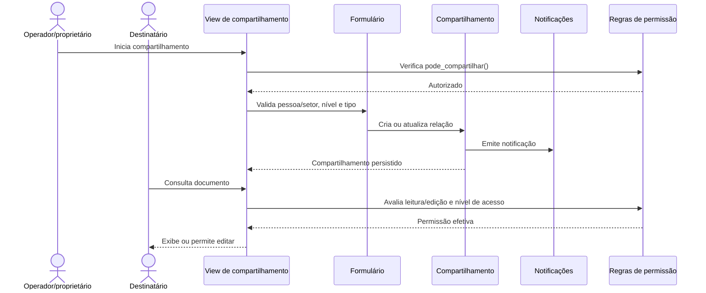

# Fluxo: compartilhar documento

> Fluxo de concessão de acesso direto a pessoa ou por setor, com permissão de leitura ou leitura e edição.

- **Ator:** proprietário, chefe/operador autorizado e pessoa ou setor destinatário.
- **Gatilho:** inclusão ou alteração de compartilhamento.
- **Pré-condições:** documento legível/compartilhável pelo ator, destinatário válido e nível de acesso compatível.
- **Pós-condições:** relação de compartilhamento persistida, notificação emitida e acesso efetivo recalculado.
- **Depende de:** `DocumentoTexto`/`DocumentoDigitalizado`, vínculo, setor, `NivelPermissao`, `TipoPermissao` e configurações.
- **Habilita:** leitura, edição ou revisão pelo destinatário, conforme a permissão.
- **Entrada no código:** views/forms de compartilhamento, métodos `pode_compartilhar` e modelos `Compartilhamento*`.

## Observações

- `LER` e `EDITAR` representam, respectivamente, leitura e leitura com edição.
- Compartilhamentos de texto e digitalizado usam modelos distintos; há também compartilhamento por setor/pessoa.
- Documentos sigilosos não são liberados por algumas consultas de setor, conforme os managers.
- Criação e remoção do compartilhamento podem gerar notificações e registros de ação.
- ⚠️ REVISAR: a precedência entre acesso direto, setor, processo e grupos sistêmicos deve ser documentada com a matriz de autorização institucional.

Gerado/atualizado via subagent `documentador` em 2026-09-09.
