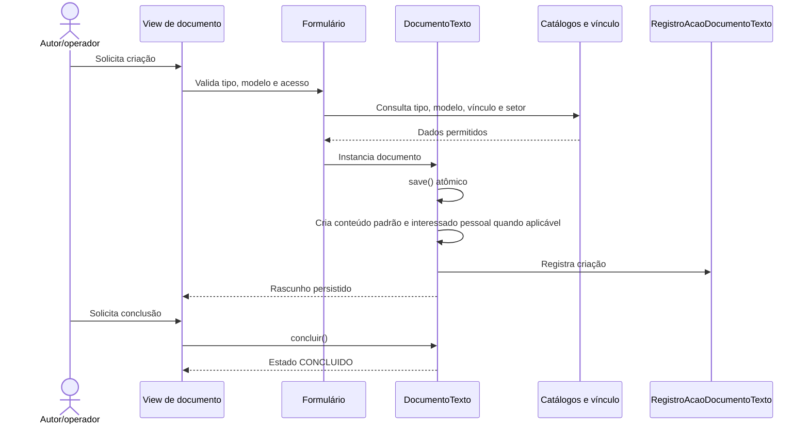

# Fluxo: criar e concluir documento textual

> Fluxo-base para produzir um documento textual a partir de um tipo/modelo e levá-lo de rascunho a concluído.

- **Ator:** servidor, operador ou outro consumidor autorizado.
- **Gatilho:** operação de criação e posterior conclusão do documento.
- **Pré-condições:** tipo/modelo ativo e permissão de criação; configurações de acesso compatíveis.
- **Pós-condições:** `DocumentoTexto` persistido e, após a transição, no estado `CONCLUIDO`.
- **Depende de:** `TipoDocumentoTexto`, `ModeloDocumento`, vínculo do usuário, setor e configurações.
- **Habilita:** revisão, solicitação de assinatura, compartilhamento e geração do documento.
- **Entrada no código:** `views.py`, `forms.py`, `DocumentoTexto.save()` e `DocumentoTexto.concluir()` em `models.py`.

## Observações

- O nível `restrito`/`sigiloso` exige hipótese legal; para nível público a hipótese é removida pela validação do documento.
- A numeração definitiva ainda não é atribuída apenas pela criação; ela é tratada no caminho de assinatura/finalização.
- O conteúdo fica sujeito a validação de concorrência pela data da última modificação.
- ⚠️ REVISAR: o código possui mais de uma porta de criação (admin, views consumidoras e integrações); confirmar quais são oficialmente suportadas para cada ator.

Gerado/atualizado via subagent `documentador` em 2026-09-09.
