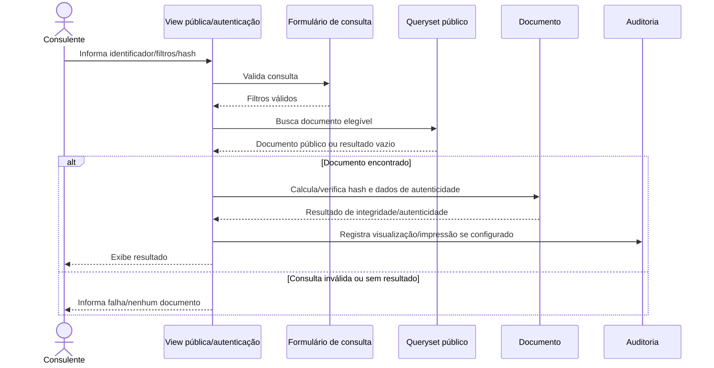

# Fluxo: publicar e autenticar documento

> Fluxo de consulta de documento público e verificação de autenticidade/integridade por identificador ou hash.

- **Ator:** usuário autenticado ou consulente externo, conforme a rota.
- **Gatilho:** consulta pública, autenticação de documento ou verificação de documento externo.
- **Pré-condições:** documento elegível para consulta; para autenticação, filtros/identificador válidos.
- **Pós-condições:** conteúdo/metadados de consulta exibidos ou resultado de autenticidade retornado.
- **Depende de:** estado do documento, nível público, hash, configurações de auditoria e eventual ReCaptcha.
- **Habilita:** impressão/validação pelo consulente e registro de ação quando configurado.
- **Entrada no código:** views/forms de consulta, managers de documentos públicos e métodos de hash/autenticação.

## Observações

- O manager de texto público filtra documentos assinados e públicos; os estados e filtros devem ser respeitados pela consulta.
- A busca pelo corpo depende de `documento_eletronico.permite_busca_corpo_conteudo`.
- A consulta pública exige ao menos um filtro e pode exigir ReCaptcha quando os parâmetros mudam.
- Hash SHA-512 é o padrão observado; há suporte a SHA-256 em chamadas que o solicitam.
- ⚠️ REVISAR: a equivalência funcional entre consulta pública, autenticação de documento e verificação de documento externo deve ser confirmada nas regras de publicação.

Gerado/atualizado via subagent `documentador` em 2026-09-09.
