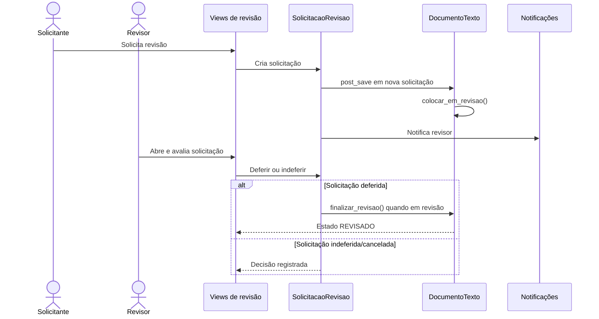

# Fluxo: solicitar e realizar revisão

> Fluxo de revisão de documento textual concluído, com solicitação, análise e transição do estado do documento.

- **Ator:** solicitante e revisor autorizado.
- **Gatilho:** solicitação de revisão de documento textual.
- **Pré-condições:** documento concluído, revisor/vínculo válido e permissão para solicitar ou revisar.
- **Pós-condições:** documento revisado, ou solicitação deferida/indeferida conforme a decisão.
- **Depende de:** `DocumentoTexto`, `SolicitacaoRevisao`, vínculo do solicitante/revisor e notificações.
- **Habilita:** edição posterior, assinatura ou nova operação conforme o estado resultante.
- **Entrada no código:** views de revisão, `SolicitacaoRevisao` em `models.py` e `signals.py`.

## Observações

- O sinal de criação da solicitação coloca o documento em `EM_REVISAO`.
- Quando a solicitação é salva novamente enquanto o documento está em revisão, o sinal finaliza a revisão e salva o documento.
- A solicitação possui solicitante, revisor e avaliador, além de status e datas.
- ⚠️ REVISAR: a semântica operacional de deferimento, indeferimento e cancelamento deve ser validada com a área, pois o sinal também reage a salvamentos subsequentes.

Gerado/atualizado via subagent `documentador` em 2026-09-09.
