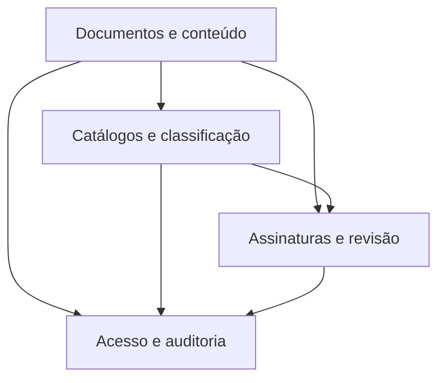

# Modelo de dados — índice

> O módulo possui 28 modelos concretos persistentes em um único `models.py`; o agrupamento abaixo é técnico e foi inferido por nomes, relações e responsabilidades. As classes abstratas e proxies são indicadas sem criar tabelas adicionais.

> ⚠️ REVISAR: a divisão em subdomínios é uma convenção documental; o código não declara esses limites como módulos separados.

| Subdomínio | Escopo | Entidades | Documento |
|---|---|---|---|
| Documentos e conteúdo | documentos textuais/digitalizados, interessados, conferência e anexos | 7 modelos | [documentos-e-conteudo.md](documentos-e-conteudo.md) |
| Catálogos e classificação | tipos, modelos, hipóteses, vínculos e classificação | 9 modelos | [catalogos-e-classificacao.md](catalogos-e-classificacao.md) |
| Assinaturas e revisão | solicitações, assinaturas e relações com documentos | 6 modelos | [assinaturas-e-revisoes.md](assinaturas-e-revisoes.md) |
| Acesso e auditoria | compartilhamentos, solicitações de acesso e logs | 6 modelos | [acesso-e-auditoria.md](acesso-e-auditoria.md) |

## Classes sem tabela própria

- `Documento`, `Solicitacao` e `RegistroAcaoDocumento` são classes abstratas de comportamento compartilhado.
- `DocumentoTextoPessoal`, `DocumentoDigitalizadoPessoal` e `DocumentoDigitalizadoAnexoSimples` são proxies dos modelos concretos.
- `NivelAcesso`, `NivelPermissao` e `TipoPermissao` são constantes/choices, não entidades persistentes.

Gerado/atualizado via subagent `documentador` em 2026-09-09.
