# Modelo de dados — acesso e auditoria

> Este subdomínio reúne concessões de acesso e registros de ações. Documentos e vínculos são entidades externas.

```mermaid
erDiagram
    COMPARTILHAMENTO_DOCUMENTO_PESSOA {
        int id PK
        int documento_texto_id FK
        int vinculo_id FK
        int nivel_permissao
        int tipo_permissao
        int solicitacao_assinatura_id FK
    }
    COMPARTILHAMENTO_DOCUMENTO_DIGITALIZADO_PESSOA {
        int id PK
        int documento_digitalizado_id FK
        int vinculo_id FK
        int nivel_permissao
        int tipo_permissao
    }
    SOLICITACAO_COMPARTILHAMENTO_DOCUMENTO_DIGITALIZADO_PESSOA {
        int id PK
        int documento_digitalizado_id FK
        int vinculo_solicitado_id FK
        int status
    }
    COMPARTILHAMENTO_SETOR_PESSOA {
        int id PK
        int setor_id FK
        int vinculo_id FK
        int nivel_permissao
    }
    REGISTRO_ACAO_DOCUMENTO_TEXTO {
        int id PK
        int documento_texto_id FK
        int tipo_acao
        int usuario_id FK
        datetime data
    }
    REGISTRO_ACAO_DOCUMENTO_DIGITALIZADO {
        int id PK
        int documento_digitalizado_id FK
        int tipo_acao
        int usuario_id FK
        datetime data
    }

    DOCUMENTO_TEXTO ||--o{ COMPARTILHAMENTO_DOCUMENTO_PESSOA : "compartilha"
    DOCUMENTO_DIGITALIZADO ||--o{ COMPARTILHAMENTO_DOCUMENTO_DIGITALIZADO_PESSOA : "compartilha"
    DOCUMENTO_DIGITALIZADO ||--o{ SOLICITACAO_COMPARTILHAMENTO_DOCUMENTO_DIGITALIZADO_PESSOA : "recebe pedido"
    SOLICITACAO_COMPARTILHAMENTO_DOCUMENTO_DIGITALIZADO_PESSOA }o--|| COMUM_VINCULO : "é para"
    COMPARTILHAMENTO_DOCUMENTO_PESSOA }o--|| COMUM_VINCULO : "concede a"
    COMPARTILHAMENTO_DOCUMENTO_DIGITALIZADO_PESSOA }o--|| COMUM_VINCULO : "concede a"
    COMPARTILHAMENTO_SETOR_PESSOA }o--|| RH_SETOR : "configura setor"
    COMPARTILHAMENTO_SETOR_PESSOA }o--|| COMUM_VINCULO : "configura pessoa"
    DOCUMENTO_TEXTO ||--o{ REGISTRO_ACAO_DOCUMENTO_TEXTO : "audita"
    DOCUMENTO_DIGITALIZADO ||--o{ REGISTRO_ACAO_DOCUMENTO_DIGITALIZADO : "audita"
    REGISTRO_ACAO_DOCUMENTO_TEXTO }o--|| COMUM_USER : "executada por"
    REGISTRO_ACAO_DOCUMENTO_DIGITALIZADO }o--|| COMUM_USER : "executada por"
```

## Entidades

| Entidade | Papel | Relações principais |
|---|---|---|
| `CompartilhamentoDocumentoPessoa` | permissão de pessoa sobre texto | texto, vínculo, nível/tipo de permissão e solicitação de assinatura opcional |
| `CompartilhamentoDocumentoDigitalizadoPessoa` | permissão de pessoa sobre digitalizado | digitalizado, vínculo e permissão |
| `SolicitacaoCompartilhamentoDocumentoDigitalizadoPessoa` | pedido de compartilhamento de digitalizado | digitalizado, vínculo destinatário e status |
| `CompartilhamentoSetorPessoa` | configuração de acesso entre setor e pessoa | setor, vínculo e nível de permissão |
| `RegistroAcaoDocumentoTexto` | auditoria de ações em texto | texto, tipo de ação e usuário |
| `RegistroAcaoDocumentoDigitalizado` | auditoria de ações em digitalizado | digitalizado, tipo de ação e usuário |

## Entidades externas referenciadas

| Entidade | Origem | Uso |
|---|---|---|
| `DOCUMENTO_TEXTO` | subdomínio documentos e conteúdo | alvo de compartilhamento/auditoria |
| `DOCUMENTO_DIGITALIZADO` | subdomínio documentos e conteúdo | alvo de compartilhamento/auditoria |
| `COMUM_VINCULO` / `COMUM_USER` | `comum` | destinatários e usuário da ação |
| `RH_SETOR` | `rh` | escopo setorial |

Gerado/atualizado via subagent `documentador` em 2026-09-09.
