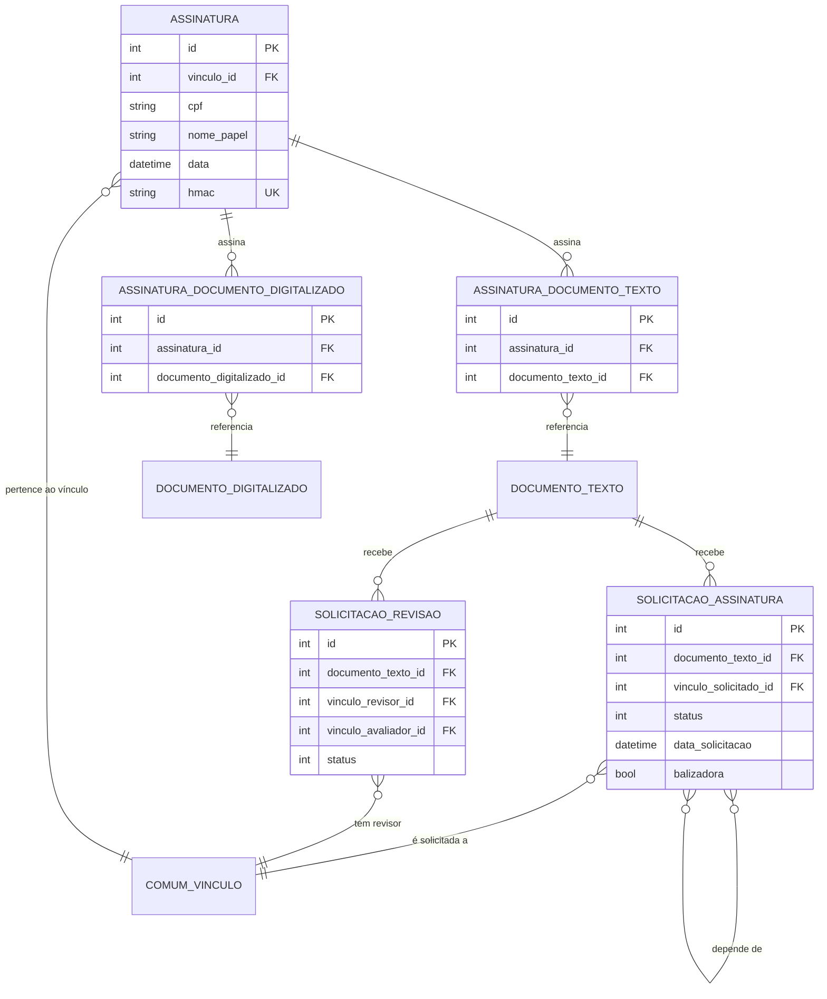

# Modelo de dados — assinaturas e revisões

> Este subdomínio modela solicitações e evidências de assinatura/revisão. Documentos e vínculos são entidades externas referenciadas.

## Entidades

| Entidade | Papel | Relações principais |
|---|---|---|
| `SolicitacaoAssinatura` | pedido de assinatura, com status e condicionantes | documento textual, vínculo solicitado e auto-relação de dependências |
| `SolicitacaoRevisao` | pedido e avaliação de revisão | documento textual, solicitante, revisor e avaliador |
| `Assinatura` | evidência de assinatura por vínculo/papel | vínculo e relações com documentos |
| `AssinaturaDocumentoTexto` | associação de assinatura a documento textual | assinatura ↔ texto |
| `AssinaturaDocumentoDigitalizado` | associação de assinatura a digitalizado | assinatura ↔ digitalizado |

## Entidades externas referenciadas

| Entidade | Origem | Uso |
|---|---|---|
| `DOCUMENTO_TEXTO` | subdomínio documentos e conteúdo | documento de revisão/assinatura |
| `DOCUMENTO_DIGITALIZADO` | subdomínio documentos e conteúdo | documento associado à assinatura |
| `COMUM_VINCULO` | `comum` | solicitante, revisor, avaliador e assinante |

Gerado/atualizado via subagent `documentador` em 2026-09-09.
