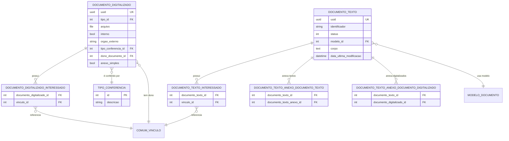

# Modelo de dados — documentos e conteúdo

> Este subdomínio reúne os documentos mantidos pelo módulo, seus interessados, tipos de conferência e relações de anexação. Pessoas, vínculos e setores são entidades externas.

## Entidades

| Entidade | Papel | Relações principais |
|---|---|---|
| `DocumentoTexto` | corpo, estado, identificador, cabeçalho/rodapé, favoritos e interessados | modelo, histórico de conteúdo, assinaturas, revisão, compartilhamento e anexos |
| `DocumentoDigitalizado` | arquivo digitalizado, tipo, conferência e proprietário | tipo, conferência, vínculo dono, interessados e anexação |
| `TipoConferencia` | catálogo do tipo de conferência do arquivo digitalizado | referenciado por `DocumentoDigitalizado` |
| `DocumentoTextoInteressado` | tabela intermediária de interessados do texto | texto ↔ `comum.Vinculo` |
| `DocumentoDigitalizadoInteressado` | tabela intermediária de interessados do digitalizado | digitalizado ↔ `comum.Vinculo` |
| `DocumentoTextoAnexoDocumentoTexto` | relação de anexação entre dois textos | texto pai ↔ texto filho |
| `DocumentoTextoAnexoDocumentoDigitalizado` | relação de anexação entre texto e digitalizado | texto pai ↔ digitalizado filho |

## Entidades externas referenciadas

| Entidade | Origem | Uso |
|---|---|---|
| `MODELO_DOCUMENTO` | `documento_eletronico` / catálogo | modelo usado pelo texto |
| `COMUM_VINCULO` | `comum` | interessado e dono do digitalizado |

Gerado/atualizado via subagent `documentador` em 2026-09-09.
