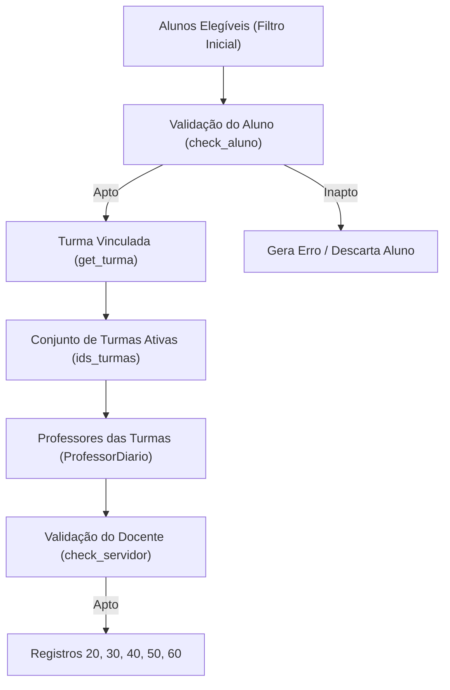

# Regras e Critérios de Exportação — Educacenso (Primeira Etapa)

Este documento especifica todas as regras de negócio, filtros de banco de dados, critérios de elegibilidade e fluxos de validação executados pelo SUAP para a exportação de dados do **Educacenso — Primeira Etapa** (`/edu/relatorio_educacenso/`).

O objetivo deste guia é servir como base analítica para operadores e **modelos de Inteligência Artificial** com acesso à interface web ou ao banco de dados do SUAP, permitindo diagnosticar com precisão a causa de qualquer aluno, turma, diário ou professor não ter sido exportado no arquivo do Censo Escolar (MEC/INEP).

---

## 1. Visão Geral da Arquitetura de Exportação

A geração do Educacenso (implementada em [`edu/educacenso.py`] na classe `Exportador`) é orientada ao **Aluno**. Não existe exportação independente de turmas ou professores:



> [!IMPORTANT]
> **Efeito cascata:**
> - Se um aluno é considerado inapto, sua turma pode ficar sem nenhum aluno válido.
> - Se uma turma não tiver alunos válidos ou não possuir diários com professor vinculado, **a turma não é exportada** (Registro 20).
> - Se uma turma não for exportada, os professores vinculados apenas a ela **não são exportados** (Registros 30 e 50).

---

## 2. Parâmetros do Formulário de Exportação (`/edu/relatorio_educacenso/`)

A view executada é `edu.views.censos.relatorio_educacenso`, baseada no formulário `RelatorioEducacensoForm` ([`edu/forms/censos.py`]):

| Campo no SUAP | Tipo | Descrição e Impacto no Processamento |
|---|---|---|
| **Campus** (`uo`) | Seleção (UO) | Restringe a extração aos cursos e turmas vinculados à Diretoria do Campus (`curso_campus__diretoria__setor__uo_id = uo.id`). |
| **Ano letivo** (`ano_letivo`) | Seleção (Ano) | Ano de referência do Censo. Utilizado para calcular a data de corte e filtrar o período letivo `1`. |
| **Inferir turma** (`inferir_turma`) | Booleano | Se `True`, caso o aluno não tenha `turma_id` em sua `MatriculaPeriodo`, o SUAP busca a turma do último diário cursado que tenha matriz curricular idêntica à do aluno (`diario__turma__matriz_id = aluno.matriz_id`). Se `False`, alunos sem turma explícita no período são rejeitados com erro `SEM TURMA`. |
| **Programa PartiuIF** (`partiu_if`) | Booleano | Se `True`, restringe a exportação exclusivamente para a modalidade **FIC** vinculada ao programa PartiuIF (`curso_campus__programa = 'PartiuIF'`). Se `False`, exporta as modalidades regulares de ensino técnico e integrado. |
| **Validar alunos** (`validar_alunos`) | Booleano | Se `True` e houver erros em alunos, o SUAP interrompe o fluxo antes de gerar turmas/professores e grava o arquivo de relatório de inconsistências `educacenso_validacao_aluno.txt`. |
| **Ignorar erros** (`ignorar_erros`) | Booleano | Se `True`, gera o arquivo `educacenso.txt` ignorando registros com inconsistência. Se `False` e houver erros acumulados, o arquivo final conterá o log de erros em vez do lote do censo. |
| **Ignorar matrículas** (`ignorar_matriculas`) | Área de texto | Lista de matrículas de alunos (uma por linha) a serem explicitamente excluídas do processamento. |
| **Filtrar matrículas** (`filtrar_matriculas`) | Área de texto | Se preenchido, a extração limita-se exclusivamente aos alunos constantes nesta lista. |

---

## 3. Regra Temporal Crítica: A Data de Corte do Censo

O Censo Escolar estabelece como data limite de referência a **última quarta-feira do mês de maio** do ano letivo:

```python
primeiro_dia_junho = datetime.datetime(ano, 6, 1)
data_corte = primeiro_dia_junho - datetime.timedelta(days=1)
while data_corte.weekday() != 2:  # 2 = Quarta-feira
    data_corte -= datetime.timedelta(days=1)
```

### Impactos Diretos da Data de Corte:
1. **Data de Ingresso do Aluno:**
   - Alunos com `aluno.data_matricula > data_corte.date()` são **automaticamente descartados**.
2. **Conclusão de Curso:**
   - Alunos nas situações `Concluído` (6) ou `Formado` (13) cuja data de conclusão (`aluno.dt_conclusao_curso`) seja anterior à data de corte (`< data_corte.date()`) são **descartados**.
3. **Inativações e Trancamentos Anteriores:**
   - Alunos que estiverem em situação inativa (Jubilado, Evasão, Cancelado, Transferido Externo, Trancado, Trancado Voluntariamente, Vínculo Institucional, Integralizado Ensino Médio, etc.) cujo procedimento acadêmico mais recente no período de referência tenha ocorrido **antes da data de corte** são **descartados**.
   - Método consultado: `aluno.get_data_ultimo_procedimento_periodo_referencia() < data_corte.date()`.

---

## 4. Modalidades de Ensino Elegíveis

O SUAP filtra a exportação pelas modalidades declaradas em `MODALIDADES` ([`edu/educacenso.py`]):

- **Modalidades Padrão (`partiu_if=False`):**
  - `Modalidade.INTEGRADO` (Id 1)
  - `Modalidade.SUBSEQUENTE` (Id 13)
  - `Modalidade.INTEGRADO_EJA` (Id 2)
  - `Modalidade.FIC_INTEGRADO_EJA` (Id 12)
  - `Modalidade.PROEJA_FIC_FUNDAMENTAL` (Id 20)
  - `Modalidade.CONCOMITANTE` (Id 21)
- **Modalidade PartiuIF (`partiu_if=True`):**
  - `Modalidade.FIC` (Id 6), exigindo `curso_campus.programa == 'PartiuIF'`.

> [!WARNING]
> Cursos superiores (Graduação/Tecnologia), pós-graduações e cursos FIC convencionais (que não sejam do programa PartiuIF nem integrados à EJA) **não entram** no Educacenso. O ensino superior é exportado no Censup (`/edu/censup/`).

---

## 5. Critérios de Elegibilidade e Validação do Aluno

O SUAP busca alunos via `Aluno.objects.filter(...)` e executa as validações do método `check_aluno(aluno)`.

### 5.1. Filtros Preliminares de Banco de Dados
Para ser processado, o aluno deve atender cumulativamente:
1. `curso_campus.modalidade_id` deve estar na lista de modalidades permitidas.
2. Possuir registro em `MatriculaPeriodo` onde:
   - `ano_letivo.ano == ano` (ano selecionado no form);
   - `periodo_letivo == 1` (**OBRIGATÓRIO: Apenas o 1º período do ano é enviado na 1ª Etapa do Educacenso**).
3. Pertencer ao Campus informado: `curso_campus.diretoria.setor.uo_id == uo.id`.
4. Não ser `Transferido Interno` (`SituacaoMatricula.TRANSFERIDO_INTERNO`).
5. Não estar na lista de `ignorar_matriculas`.

---

### 5.2. Validações de Negócio (`check_aluno`)

Ao iterar sobre cada aluno, o método `check_aluno(aluno)` valida os seguintes pontos:

#### A. Vínculo com Turma (`get_turma`)
- O aluno precisa ter uma turma associada em `matricula_periodo.turma`.
- Caso `matricula_periodo.turma` seja nula:
  - Se a opção `inferir_turma` estiver marcada no formulário, o sistema tenta inferir pela matrícula nos diários (`matricula_periodo.matriculadiario_set.filter(diario__turma__matriz_id=aluno.matriz_id).first().diario.turma`).
  - Se ainda assim não houver turma:
    - **Status:** Inapto (`apto = False`).
    - **Log gerado:** `[Matrícula] [CPF] SEM TURMA [Sigla UO] [Diretoria] [Situação] [Último Tipo Procedimento] [Data Procedimento] [Curso]`.

#### B. Existência de Diários Válidos na Turma (`get_diarios_turma`)
A turma vinculada ao aluno deve possuir diários que atendam aos requisitos do Educacenso:
- O diário **deve possuir professor/docente vinculado** (`professordiario` preenchido / não nulo).
- Se a modalidade for Subsequente, Concomitante, ProEJA FIC Fundamental ou FIC:
  - O componente curricular **não pode pertencer ao núcleo 'Fundamental'** (`componente_curricular.nucleo.descricao != 'Fundamental'`).
- Caso a turma não possua nenhum diário válido com professor:
  - **Status:** Inapto (`apto = False`).
  - **Log gerado:** `[Matrícula] [CPF] CODIGO TURMA [Sigla UO] [Diretoria] [Situação] [Curso]`.

#### C. Matrícula do Aluno em Diários da Turma
- O aluno precisa estar matriculado (`matricula_periodo.matriculadiario_set`) em pelo menos um diário que:
  - Tenha professor vinculado (`professordiario__isnull=False`);
  - Não seja componente de núcleo 'Fundamental' nas modalidades não-integradas.
- Caso o aluno não esteja matriculado em nenhum diário com professor:
  - **Status:** Inapto (`apto = False` silencioso — o aluno é descartado).

#### D. Nacionalidade e Naturalidade
- **Aluno Brasileiro nato:**
  - O campo `aluno.naturalidade` (Município) é **obrigatório**.
  - Se não informado: **Log gerado:** `[Matrícula] [CPF] SEM NATURALIDADE [Sigla UO] [Curso]`.
- **Aluno Estrangeiro:**
  - O país de origem (`aluno.pais_origem`) deve possuir código INEP/Educacenso cadastrado (`pais.codigo_educacenso`).
  - Se não informado: **Log gerado:** `[Matrícula] [CPF] SEM CODIGO PAIS [Sigla UO] [Diretoria] [Situação] [Curso]`.

#### E. Etnia e Povo Indígena
- Se `aluno.raca` for indígena (`aluno.raca.is_indigena() == True`):
  - O campo `aluno.povo_indigena` é **obrigatório**.
  - Se nulo: **Log gerado:** `[Matrícula] [CPF] SEM POVO INDIGENA [Sigla UO] [Curso]`.

---

## 6. Critérios de Elegibilidade e Validação de Turmas (Registro 20)

As turmas exportadas no Registro 20 são extraídas diretamente dos alunos aptos:
```python
turmas = Turma.objects.filter(id__in=ids_turmas)
```

Para cada turma em `turmas`:
1. **Diários Ativos (`get_diarios_turma`):**
   - A turma é checada novamente com `self.get_diarios_turma(turma).exists()`. Se não houver diários com docentes associados, a turma é ignorada.
2. **Código INEP do Curso Técnico:**
   - Cursos técnicos com etapa 39, 40, 64, 74 ou etapa agregada 304, 305 exigem vínculo com o catálogo de cursos técnicos do INEP (`curso_campus.curso_tecnico.codigo_inep`).
   - Se `curso_campus.curso_tecnico is None`:
     - **Log gerado:** `[Código Curso] [Descrição Curso] SEM CURSO TÉCNICO`.
     - A turma **não é exportada**.
3. **Eixo Tecnológico (Etapa 68 — Qualificação Profissional / FIC):**
   - Se a turma for de curso PROEJA FIC ou FIC (etapa 68), o curso deve possuir eixo tecnológico com código INEP (`curso_campus.eixo.codigo_inep`).
   - Se `curso_campus.eixo is None`:
     - **Log gerado:** `[Código Curso] [Descrição Curso] SEM EIXO TECNOLÓGICO`.
     - A turma **não é exportada**.
4. **Horário de Funcionamento:**
   - Para turmas presenciais, o SUAP busca os horários de início e término na grade de horários do campus (`horario_campus.horarioaula_set.filter(turno=turma.turno)`). Se não houver horários cadastrados, usa como valor padrão `'00:00-00:00'`.

---

## 7. Critérios de Elegibilidade e Validação de Docentes (Registros 30 e 50)

Os professores aptos são extraídos a partir dos diários das turmas que entraram no Registro 20:

```python
ids_servidores = ProfessorDiario.objects.filter(
    diario__turma_id__in=ids_turmas,
    diario__matriculadiario__isnull=False,
    professor__vinculo__tipo_relacionamento__model='servidor',
).values_list('professor__vinculo__id_relacionamento', flat=True)
```

Para cada docente (`Servidor`):

### 7.1. Validação Cadastral (`check_servidor`)
1. **Brasileiro Nato (`nacionalidade == 1`):**
   - Deve possuir município de nascimento (`servidor.nascimento_municipio_id`) com UF preenchida.
   - O município deve constar na tabela `Cidade` (IBGE). O SUAP tenta buscar pelo nome e UF ou via consulta aos dados da Receita Federal.
   - Erros possíveis:
     - `[Matrícula] BRASILEIRO SEM NATURALIDADE`
     - `[Matrícula] BRASILEIRO SEM UF`
     - `[Matrícula] CODIGO DA NATURALIDADE ERRADO (...)`
2. **Estrangeiro:**
   - Deve possuir país de origem (`servidor.pais_origem`) com `codigo_educacenso` preenchido.
   - Se faltar: **Log gerado:** `[Matrícula] SEM CODIGO PAIS`.

### 7.2. Validação Acadêmica e Funcional (`exportar_registros_30`)
1. **Objeto Professor:**
   - O servidor deve ter vínculo de professor ativo (`Professor.objects.filter(vinculo=servidor.get_vinculo())`). Se não houver:
     - **Log gerado:** `[Matrícula] SEM PROFESSOR VINCULADO`.
2. **Curso Superior com Código INEP Ativo:**
   - Exceto para docentes estrangeiros, o professor **deve ter uma graduação/curso superior cadastrado** (`professor.curso_superior`) cujo código INEP exista e esteja ativo (`professor.curso_superior.ativo == True`).
   - Se faltar: **Log gerado:** `[Matrícula] SEM CODIGO CURSO SUPERIOR ATIVO`.
3. **Povo Indígena:**
   - Se a raça for indígena, `servidor.povo_indigena` é obrigatório.
   - Se faltar: **Log gerado:** `[Matrícula] SEM POVO INDIGENA`.
4. **Vínculo com Turma:**
   - O docente deve lecionar em pelo menos uma turma exportada com alunos matriculados (`get_turmas_professor`).

---

## 8. Estrutura dos Registros Gerados no Arquivo `educacenso.txt`

O arquivo exportado segue o layout posicional/delimitado por pipe (`|`) padrão INEP:

| Registro | Finalidade | Fontes de Dados no SUAP |
|---|---|---|
| **00** | Identificação da Escola / Campus | `UnidadeOrganizacional`, `Diretoria`, `CalendarioAcademico`. |
| **10** | Questionário da Escola | Respostas gravadas em `RespostaEducacenso` vinculadas a `RegistroEducacenso` do ano. |
| **20** | Turmas | `Turma`, `CursoCampus`, `Matriz`, `HorarioAula`, `Diario`. |
| **30 (Docente)** | Dados Pessoais do Professor | `Servidor`, `PessoaFisica`, `Professor`, `CursoSuperior`. |
| **30 (Aluno)** | Dados Pessoais do Aluno | `Aluno`, `PessoaFisica`, NEEs (`Deficiencia`, `TipoNEE`), `PovoIndigena`. |
| **40** | Gestor Escolar | Diretor-Geral e Diretor Acadêmico cadastrados na `Diretoria` do Campus. |
| **50** | Vínculo Docente-Turma | Associação entre o `Professor` e a `Turma`, mapeando as disciplinas lecionadas. |
| **60** | Vínculo Aluno-Turma | Matrícula do `Aluno` na `Turma`, transporte escolar, carga horária cumprida. |
| **99** | Fechamento do Arquivo | Delimitador final obrigatório (`99\|`). |

---

## 9. Guia de Diagnóstico para Modelos de IA (Interface Web)

Ao analisar por que um registro (Aluno, Turma ou Docente) não foi exportado pelo SUAP, siga a árvore de decisão abaixo consultando as rotas da interface web:

```
[Início do Diagnóstico]
   │
   ├─► 1. É uma Turma?
   │     ├─ Acesse: /edu/turma/<id>/
   │     ├─ O período letivo é do ano do censo no período 1 (ex: 2026.1)?
   │     │    └─ NÃO: Turmas de período 2 ou outros anos NÃO entram na 1ª etapa.
   │     ├─ A modalidade do curso é Técnico/Integrado/EJA (ou FIC PartiuIF)?
   │     │    └─ NÃO: Superiores e pós-graduações não entram no Educacenso.
   │     ├─ Existem diários na turma com PROFESSOR VINCULADO?
   │     │    └─ NÃO: Diários sem docente desqualificam a turma (erro CODIGO TURMA).
   │     ├─ O curso possui código INEP do Curso Técnico preenchido em /edu/cursocampus/<id>/ ?
   │     │    └─ NÃO: A turma é barrada com o erro SEM CURSO TÉCNICO.
   │     └─ Existem alunos matriculados e aptos na turma?
   │          └─ NÃO: Se nenhum aluno for apto, a turma é sumariamente descartada.
   │
   ├─► 2. É um Aluno?
   │     ├─ Acesse: /edu/aluno/<matricula>/
   │     ├─ Aba 'Matrículas / Períodos': Tem matrícula no período 1 do ano do Censo?
   │     │    └─ NÃO: Alunos sem matrícula ativa no período 1 do ano são excluídos.
   │     ├─ Data de matrícula: Foi após a última quarta-feira de maio?
   │     │    └─ SIM: Matrícula posterior à data de corte é excluída.
   │     ├─ Situação da matrícula: Foi concluído/inativado antes da data de corte?
   │     │    └─ SIM: Conclusões ou procedimentos anteriores à data de corte são excluídos.
   │     ├─ O aluno tem turma vinculada no período letivo 1?
   │     │    └─ NÃO: Se a opção 'Inferir turma' não foi usada ou não achou diário da matriz, gera SEM TURMA.
   │     ├─ A turma do aluno possui professor vinculado aos diários?
   │     │    └─ NÃO: Gera o erro CODIGO TURMA.
   │     ├─ Dados Pessoais:
   │     │    ├─ Brasileiro sem Naturalidade? -> Gera SEM NATURALIDADE.
   │     │    ├─ Estrangeiro com País sem código INEP? -> Gera SEM CODIGO PAIS.
   │     │    └─ Indígena sem Povo Indígena cadastrado? -> Gera SEM POVO INDIGENA.
   │
   └─► 3. É um Professor?
         ├─ Acesse: /edu/professor/<id>/ ou /rh/servidor/<matricula>/
         ├─ Está vinculado a algum diário de turma exportada no período 1?
         │    └─ NÃO: O docente só entra se tiver aula em turma com alunos no Censo.
         ├─ O professor possui Graduação cadastrada com Código INEP e Status Ativo?
         │    └─ NÃO: Gera o erro SEM CODIGO CURSO SUPERIOR ATIVO.
         └─ Dados Pessoais:
              ├─ Brasileiro sem Município/UF de nascimento? -> Gera BRASILEIRO SEM NATURALIDADE/UF.
              └─ Município com divergência de nome/código IBGE? -> Gera CODIGO DA NATURALIDADE ERRADO.
```

---

## 10. Tabela de Mensagens de Erro do SUAP e Ações Corretivas

| Mensagem no Log de Erros | Causa Raiz | Onde Corrigir no SUAP (Web) |
|---|---|---|
| `SEM TURMA` | A `MatriculaPeriodo` do aluno no período 1 não aponta para nenhuma turma e não foi possível inferir. | `/edu/aluno/<matricula>/` $\rightarrow$ Aba Matrículas / Períodos $\rightarrow$ Editar matrícula do período $\rightarrow$ Selecionar a Turma. |
| `CODIGO TURMA` | A turma vinculada ao aluno não possui nenhum diário com professor cadastrado (ou os diários são de núcleo fundamental). | `/edu/turma/<id>/` $\rightarrow$ Entrar no diário `/edu/diario/<id>/` $\rightarrow$ Vincular um Professor Docente ao diário. |
| `SEM NATURALIDADE` | Aluno brasileiro sem município de naturalidade preenchido. | `/edu/aluno/<matricula>/` $\rightarrow$ Editar Aluno $\rightarrow$ Informar Cidade/UF de Nascimento. |
| `SEM CODIGO PAIS` | Aluno ou servidor estrangeiro cujo país de origem não possui código INEP. | `/admin/comum/pais/` $\rightarrow$ Localizar o país $\rightarrow$ Preencher o campo `Código EDUCACENSO`. |
| `SEM POVO INDIGENA` | Aluno ou docente de raça indígena sem o povo indígena associado. | `/edu/aluno/<matricula>/` ou `/rh/servidor/<matricula>/` $\rightarrow$ Editar Dados Pessoais $\rightarrow$ Informar o Povo Indígena. |
| `SEM CURSO TÉCNICO` | Curso técnico no campus não possui amarração com o código do curso do INEP. | `/edu/cursocampus/<id>/` $\rightarrow$ Editar Curso no Campus $\rightarrow$ Preencher campo `Curso Técnico` (INEP). |
| `SEM EIXO TECNOLÓGICO` | Curso FIC/PROEJA (etapa 68) sem eixo tecnológico INEP. | `/edu/cursocampus/<id>/` $\rightarrow$ Editar Curso no Campus $\rightarrow$ Informar o `Eixo Tecnológico`. |
| `SEM PROFESSOR VINCULADO` | Servidor docente sem objeto `Professor` cadastrado para o vínculo. | `/edu/professores/` $\rightarrow$ Cadastrar/ativar o servidor como docente de ensino. |
| `SEM CODIGO CURSO SUPERIOR ATIVO` | Docente sem graduação informada ou vinculada a curso superior inativo/sem código INEP. | `/edu/professor/<id>/` $\rightarrow$ Formação Acadêmica $\rightarrow$ Cadastrar graduação com curso superior válido no INEP. |
| `BRASILEIRO SEM NATURALIDADE` / `SEM UF` | Servidor brasileiro com dados de nascimento incompletos no RH. | `/rh/servidor/<matricula>/` $\rightarrow$ Editar Servidor $\rightarrow$ Preencher Município e UF de Nascimento. |
| `CODIGO DA NATURALIDADE ERRADO` | Nome do município de nascimento do servidor não casa com a base de cidades IBGE. | `/rh/servidor/<matricula>/` $\rightarrow$ Ajustar o município de nascimento para o nome oficial IBGE. |
| `DIRETORIA NÃO LOCALIZADA` | UO sem Diretoria de Ensino ou Diretoria Acadêmica cadastrada. | `/admin/edu/diretoria/` $\rightarrow$ Vincular a Diretoria de Ensino correspondente ao Campus. |
