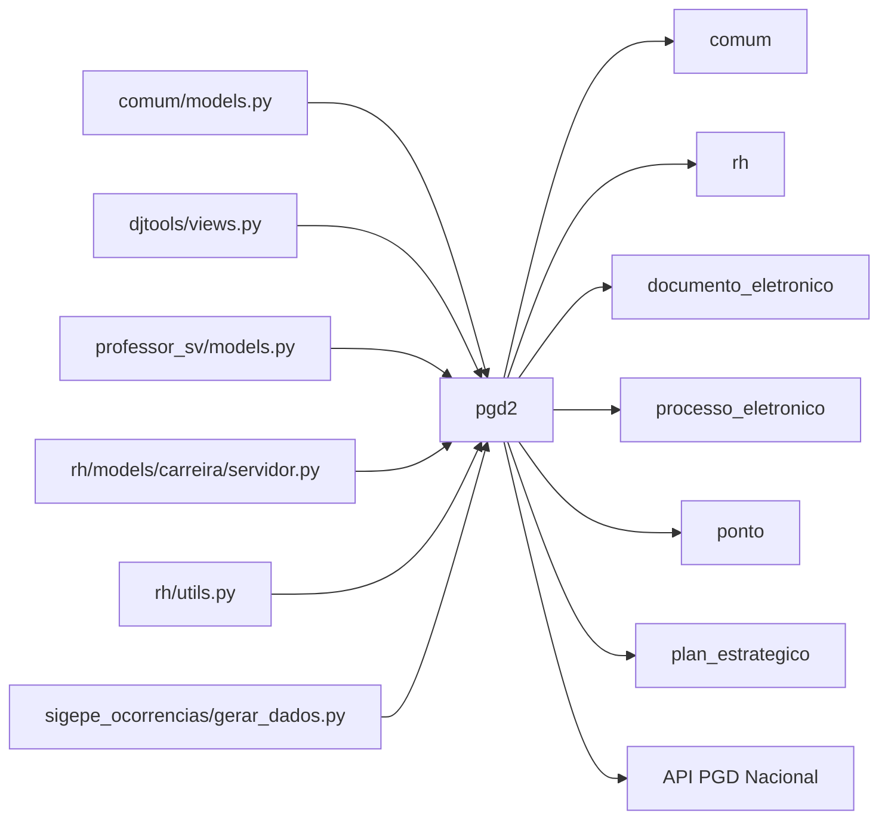

# Fronteiras — pgd2

> Superfície do módulo: o que entra, o que sai e os contratos com o resto do SUAP.
> Complementa o [HLA.md](HLA.md) (§1 contexto, §5 integrações).

## Mapa

## Dependências de entrada (inbound)

Módulos que importam/usam este. Derive de
`grep -rl "import pgd2\|from pgd2" . --include=*.py` (excluindo o próprio
módulo e `migrations/`).

| Módulo consumidor | O que consome | Acoplamento |
|---|---|---|
| `comum/models.py` | `ComissaoPGD` | Fraco (import lazy no método `get_choices`) |
| `djtools/views.py` | `PlanoIndividualTrabalho`, `PlanoIndividualTrabalhoAtendimento` | Fraco (import lazy) |
| `professor_sv/models.py` | `setores_que_sou_chefe_direto_hoje` (utils) | Forte (import direto) |
| `rh/models/carreira/servidor.py` | `PlanoIndividualTrabalho`, `PlanoIndividualTrabalhoAtendimento` | Fraco (import lazy) |
| `rh/utils.py` | `SolicitacaoAdesaoServidor` | Fraco (import lazy) |
| `sigepe_ocorrencias/gerar_dados.py` | `PlanoIndividualTrabalho`, `SolicitacaoAdesaoServidor` | Forte (import direto) |

> ⚠️ REVISAR: verificar se há mais dependências inbound em apps não listados
> (ex.: `plan_estrategico`, `ponto`).

## Dependências de saída (outbound)

Confira contra `module_dependencies.json`.

| Depende de | O quê | Tipo |
|---|---|---|
| `comum` | `ModelPlus` (via `djtools`), `Configuracao.get_valor_por_chave`, models diversos, templates | Módulo interno (framework SUAP) |
| `rh` | Models `Servidor`, `Setor`, `MembroSetor`, funções de chefe | Módulo interno |
| `djtools` | `ModelPlus`, `FormPlus`, `ModelFormPlus`, `assincrono`, utils, decorators | Framework SUAP |
| `documento_eletronico` | Geração/modelos de documento (condicional) | Integração condicional (`in INSTALLED_APPS`) |
| `processo_eletronico` | Abertura de processo (condicional) | Integração condicional (`in INSTALLED_APPS`) |
| `ponto` | Model `MarcacaoPontoPonto` (consulta de frequência) | Módulo interno |
| `plan_estrategico` | Model `MetasPorUnidade` (consulta) | Módulo interno |

## Contratos publicados

O que outros módulos podem acoplar a este (mude com cuidado):

- **Signals emitidos/ouvidos:** _N/A — não identificado signals próprios_
- **Models reusados por outros módulos:**
  - `PlanoIndividualTrabalho` — usado por `djtools/views.py`, `rh/models/carreira/servidor.py`, `sigepe_ocorrencias/gerar_dados.py`
  - `PlanoIndividualTrabalhoAtendimento` — usado por `djtools/views.py`, `rh/models/carreira/servidor.py`
  - `SolicitacaoAdesaoServidor` — usado por `rh/utils.py`, `sigepe_ocorrencias/gerar_dados.py`
  - `ComissaoPGD` — usado por `comum/models.py`
- **Funções / services / templates públicos:**
  - `pgd2.utils.setores_que_sou_chefe_direto_hoje` — usado por `professor_sv/models.py`
- **Tasks/agendamento que outros dependem:** _N/A — tasks só internas_

> ⚠️ REVISAR: `setores_que_sou_chefe_direto_hoje` em `utils.py` é função de
> utilidade pública — qualquer mudança impacta `professor_sv`.

---
_Gerado/atualizado via subagent `documentador` em 2026-06-04.
