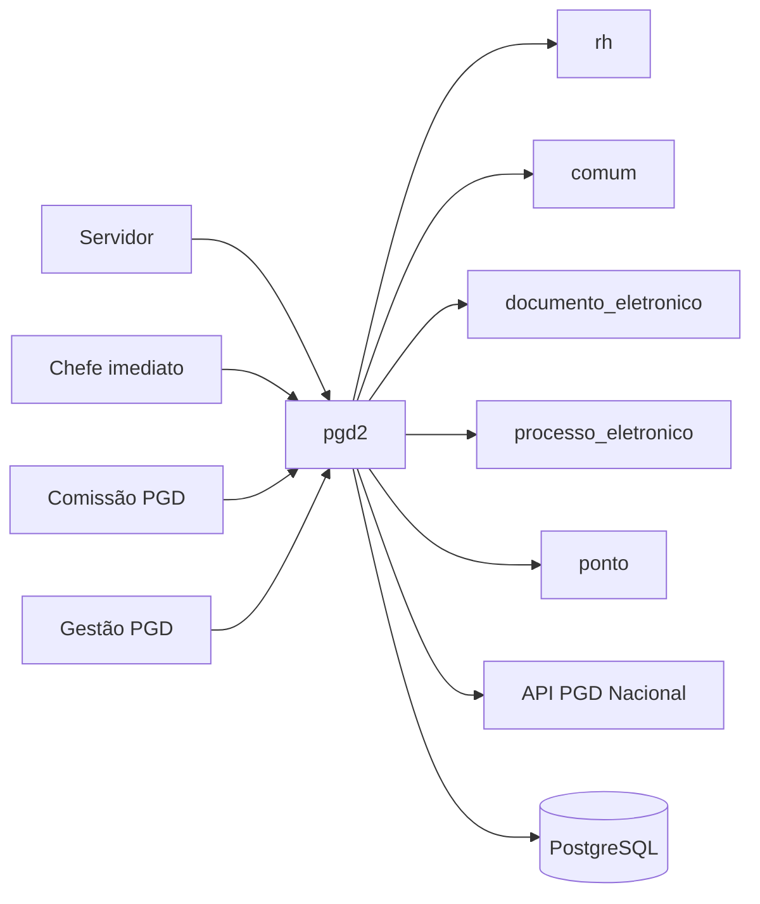
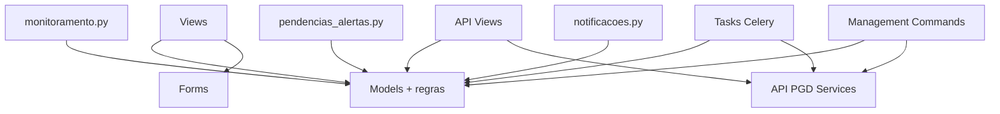
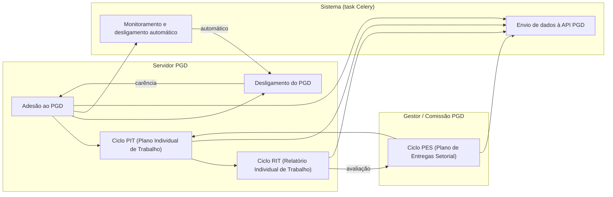

# HLA — pgd2

> High Level Architecture. Complementa o [README.md](README.md). Foco em contexto, blocos, fluxo e riscos. Baseado em arc42 (enxuto) + C4 + Mermaid.

## 1. Contexto e escopo

Módulo central do PGD no SUAP. Serve servidores (criam PIT/RIT), chefes (aprovam/homologam),
comissão PGD (gestão) e a API externa do governo federal (envio de dados consolidados).
Troca dados com `rh` (servidores, setores), `comum` (configurações, templates),
`documento_eletronico`/`processo_eletronico` (geração de documentos/processos) e
`ponto` (consulta de frequência).

> Atores definidos em [README.md → Atores e papéis](README.md#atores-e-papéis).

## 2. Estratégia de solução

| Decisão | Escolha | Motivo |
|---|---|---|
| Persistência | `ModelPlus` / PostgreSQL | Padrão SUAP; herança com auditoria `LogModel` |
| Processamento assíncrono | Celery (`@shared_task`) + Beat | Envio API, monitoramento, notificações e sincronização em horários fixos |
| Regras de negócio | Fat models + `utils.py` | Métodos nos models (`pode_*`, `clean`, transições de estado); validações em `forms.py` |
| API externa | `api_pgd2_v2.py` com `APIExternaService` + `concurrent.futures` | Concorrência no envio em lote; fallback para v1 legada |
| Controle de acesso | Grupos (`permissions.yaml`) + papéis relacionais | Chefia derivada de cargo no `rh`; comissão via grupo explícito |

## 3. Blocos de construção (componentes internos)

| Componente | Responsabilidade |
|---|---|
| Views | ≈100+ funções: CRUD PES/PIT/RIT, adesão, relatórios, monitoramento |
| API Views (`api_pgd2.py`, `api_pgd2_v2.py`) | Endpoints Django-Ninja para consulta/envio à API PGD nacional |
| Models (fat) | ≈46 entidades + regras de negócio + máquinas de estado (situação PES/PIT/RIT) |
| Forms | `ModelFormPlus` para validação de entrada nos formulários de PES/PIT/RIT |
| Tasks | Envio periódico de dados à API, notificações, monitoramento, sincronização |
| `monitoramento.py` | Motor de verificação de pendências e desligamento automático |
| `pendencias_alertas.py` | Cálculo de pendências por servidor/setor |
| `notificacoes.py` | Disparo de notificações para chefes e servidores |
| Management Commands | 11 comandos: operações manuais de sincronização, correção, importação |

Modelo de dados (ERD): ver [modelo-de-dados/](modelo-de-dados/).

## 4. Fluxos principais

Cada fluxo feliz importante é documentado em um arquivo próprio sob
`docs/fluxos/`. Lista os mais centrais primeiro.

| Fluxo | Ator | Gatilho | Doc |
|---|---|---|---|
| Adesão ao PGD | Servidor | Acessar `/pgd2/solicitar_adesao/` | [fluxos/adesao-pgd.md](fluxos/adesao-pgd.md) |
| Ciclo PES (criação → aprovação) | Gestor/Comissão | Acessar `/pgd2/visualizar_pes/` | [fluxos/ciclo-pes.md](fluxos/ciclo-pes.md) |
| Ciclo PIT (criação → homologação) | Servidor | Acessar `meu_pgd` → criar PIT | [fluxos/ciclo-pit.md](fluxos/ciclo-pit.md) |
| Ciclo RIT (elaboração → homologação) | Servidor | Acessar `meu_pgd` → elaborar RIT | [fluxos/ciclo-rit.md](fluxos/ciclo-rit.md) |
| Desligamento do PGD | Servidor/Gestão | Solicitar no `meu_pgd` | [fluxos/desligamento-pgd.md](fluxos/desligamento-pgd.md) |
| Monitoramento e desligamento automático | Sistema | Agendamento Beat (02:02) | [fluxos/monitoramento.md](fluxos/monitoramento.md) |
| Envio de dados à API PGD | Sistema | Agendamento Beat (02:27) | [fluxos/envio-api-pgd.md](fluxos/envio-api-pgd.md) |

### Mapa de fluxos (raias por ator)

Visão integrada do encadeamento. Raias (`subgraph`) = ator que inicia o fluxo; nós =
fluxos; setas = dependência (derivada dos campos `Depende de`/`Habilita` de cada arquivo
acima). Há dois ciclos legítimos: `RIT --|avaliação|--> PES` (o PES só é avaliado após o
RIT homologado) e `Desligamento --|carência|--> Adesão` (nova adesão só após o fim da
carência) — não são deadlocks, são etapas distintas de ciclos plurianuais.

## 5. Integrações

| Integração | Direção | Como | Onde |
|---|---|---|---|
| API PGD Nacional | out | HTTP via `APIExternaService` (djtools) + token | `api_pgd2_v2.py` |
| documento_eletronico | out | Model reusado (condicional) | `models.py` / `admin.py` |
| processo_eletronico | out | Abertura de processo (condicional) | `views.py` |
| rh (Servidor, Setor) | out | FK direta + queries | `models.py`, `utils.py` |
| comum (Configuracao) | out | `Configuracao.get_valor_por_chave` | Vários |
| ponto | out | FK/consulta de marcações | `models.py` |

Mapa completo de fronteira (dependências inbound/outbound + contratos): ver
[FRONTEIRA.md](FRONTEIRA.md).

## 6. Conceitos transversais

- **Transações:** `transaction.atomic()` em views de PES/PIT/RIT (operações que criam múltiplos registros)
- **Locks / concorrência:** Sem lock distribuído explícito; envio API v2 usa `concurrent.futures.ThreadPoolExecutor` para paralelismo local
- **Storage:** MinIO não identificado; documentos (ADE/PAD) gerados via `documento_eletronico`
- **Permissões:** 3 grupos (`gestao_pgd2`, `gestao_pgd2_comissao_sistemica`, `gestao_pgd2_comissao_local`) + papel de chefe relacional
- **Auditoria:** `RegistroAcaoPGD` e subtipos registram ações em PES/PIT/RIT/adesão; `LogModel` via `ModelPlus`

## 7. Riscos e débito técnico

- `models.py` com ≈9600 linhas (46 modelos) — candidato forte a refatoração em pacote `models/`
- API v1 (`api_pgd2.py`) e v2 (`api_pgd2_v2.py`) coexistem; v1 pode estar obsoleta
- Lazy imports frequentes nos consumidores (inbound) indicam risco de circular import se estrutura mudar
- `monitoramento.py` contém lógica de desligamento automático que afeta servidores — testar exaustivamente
- ⚠️ REVISAR: validar se a API v1 ainda está em uso ou pode ser removida

## 8. Glossário

Linguagem ubíqua, siglas e mapa entidade↔negócio: ver [GLOSSARIO.md](GLOSSARIO.md).

---
_Gerado/atualizado via subagent `documentador` em 2026-06-04.
