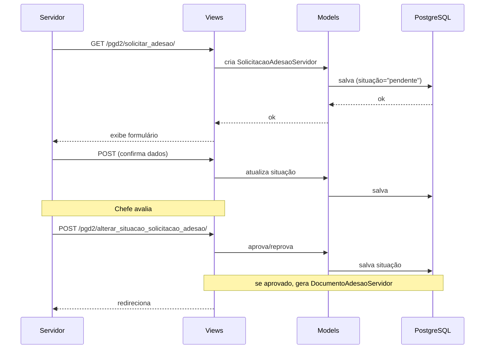

# Fluxo: Adesão ao PGD

> Servidor solicita adesão ao Programa de Gestão, chefe aprova, documento de adesão é gerado.

- **Ator(es):** Servidor, Chefe imediato — ver [README → Atores e papéis](../README.md#atores-e-papéis)
- **Gatilho:** Servidor acessa `/pgd2/solicitar_adesao/`
- **Pré-condições:** Servidor ativo no `rh`, não possui adesão vigente ao PGD
- **Pós-condições:** `SolicitacaoAdesaoServidor` com situação "aprovada", `DocumentoAdesaoServidor` gerado
- **Depende de:** _nenhum_ (ponto de entrada do servidor no PGD). Após desligamento, depende do fim da carência — ver [Desligamento do PGD](desligamento-pgd.md)
- **Habilita:** [Ciclo PIT](ciclo-pit.md) (PIT é vinculado a uma adesão vigente), [Desligamento do PGD](desligamento-pgd.md), [Monitoramento e desligamento automático](monitoramento.md) e [Envio de dados à API PGD](envio-api-pgd.md) (gera o `ParticipantePgd`)
- **Entrada no código:** `views.solicitar_adesao` + `views.alterar_situacao_solicitacao_adesao`

## Sequência

## Observações

- Solicitação de adesão pode ser migrada do PGD1 (legado) via `importar_adesoes_pg1_para_pgd2`
- Aprovação do chefe gera documento de adesão (ADE) vinculado
- Após adesão, servidor pode criar PIT e participar de PES do setor
- ⚠️ REVISAR: fluxo exato de geração do documento de adesão (se via `documento_eletronico` ou não)

---
_Gerado/atualizado via subagent `documentador` em 2026-06-04.
