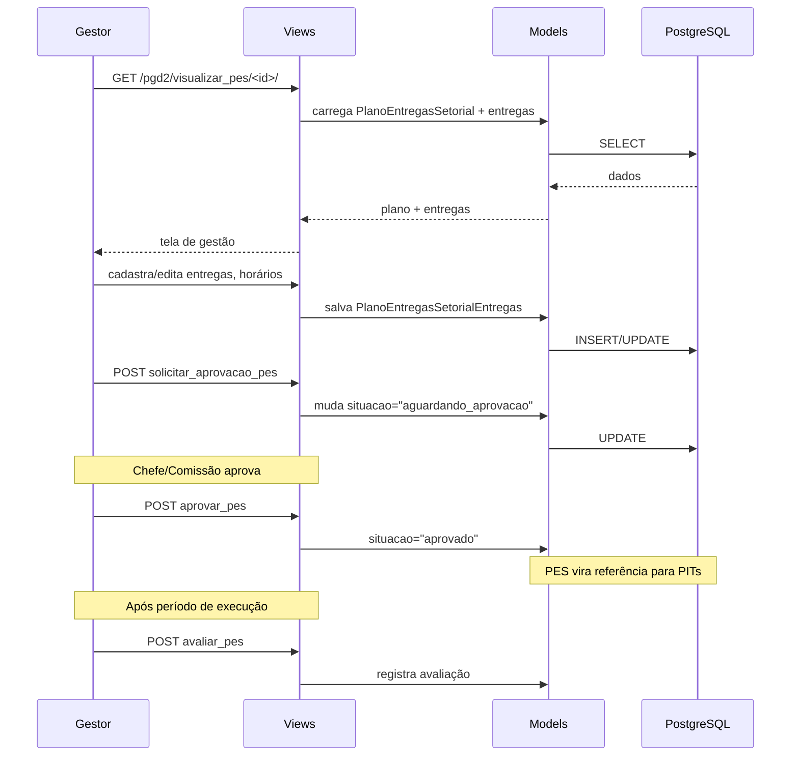

# Fluxo: Ciclo PES (Plano de Entregas Setorial)

> Gestor/comissão cria o Plano de Entregas Setorial, define entregas e horários, submete para aprovação e, após uso no PIT/RIT, recebe avaliação.

- **Ator(es):** Gestor/Comissão PGD — ver [README → Atores e papéis](../README.md#atores-e-papéis)
- **Gatilho:** Acessar `/pgd2/visualizar_pes/<pes_id>/`
- **Pré-condições:** `PeriodoPes` vigente, setor habilitado para PGD
- **Pós-condições:** PES aprovado, entregas vinculadas a PITs, avaliação registrada
- **Depende de:** _nenhum_ na criação/aprovação. A etapa de **avaliação/análise da execução** depende do [Ciclo RIT](ciclo-rit.md) (a view checa `tem_servidor_sem_rit_homologado` antes de avaliar o PES)
- **Habilita:** [Ciclo PIT](ciclo-pit.md) (entregas do PES aprovado viram referência das entregas do PIT) e [Envio de dados à API PGD](envio-api-pgd.md) (PES é enviado junto com os PITs)
- **Entrada no código:** `views.visualizar_pes`, `views.cadastrar_entrega_pes`, `views.solicitar_aprovacao_pes`, `views.aprovar_pes`, `views.analisar_pes`, `views.avaliar_pes`

## Sequência

## Observações

- PES tem subtipos: `PlanoEntregasSetorialAprovacao` (proxy de aprovação), `PlanoEntregasSetorialAvaliacao` (proxy de avaliação), `PlanoEntregasSetorialConsulta` (proxy de consulta)
- Entregas do PES podem ser vinculadas a entregas do PIT (`PlanoIndividualTrabalhoEntregas.entrega_pes`)
- Horários de funcionamento e planejamento são registrados separadamente
- ⚠️ REVISAR: transição exata de situações (rascunho → aguardando_aprovacao → aprovado → em_execucao → avaliado)

---
_Gerado/atualizado via subagent `documentador` em 2026-06-04.
