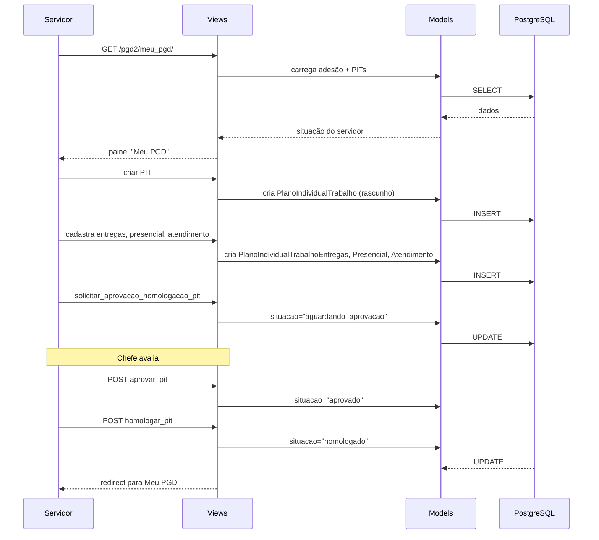

# Fluxo: Ciclo PIT (Plano Individual de Trabalho)

> Servidor cria seu PIT com entregas, trabalho presencial e atendimento de teletrabalho, submete para aprovação e homologação do chefe.

- **Ator(es):** Servidor, Chefe imediato — ver [README → Atores e papéis](../README.md#atores-e-papéis)
- **Gatilho:** Servidor acessa "Meu PGD" (`/pgd2/meu_pgd/`) → criar PIT
- **Pré-condições:** Servidor com adesão ativa, PES do setor vigente
- **Pós-condições:** PIT homologado, entregas definidas
- **Depende de:** [Adesão ao PGD](adesao-pgd.md) (o PIT é vinculado a uma `adesao_pgd` vigente ou desligado na carência) e [Ciclo PES](ciclo-pes.md) (entregas do PES aprovado são referência das entregas do PIT)
- **Habilita:** [Ciclo RIT](ciclo-rit.md) (RIT só após PIT homologado — `situacao_rit` no mesmo `PlanoIndividualTrabalho`) e [Envio de dados à API PGD](envio-api-pgd.md) (PIT homologado é marcado `deve_enviar_pela_api`)
- **Entrada no código:** `views.cadastrar_pit`, `views.visualizar_pit`, `views.aprovar_pit`, `views.homologar_pit`

## Sequência

## Observações

- PIT pode ser copiado de período anterior (`copiar_pit`)
- Entrega do PIT pode (ou não) estar vinculada a uma entrega do PES
- Trabalho presencial (`PlanoIndividualTrabalhoPresencial`) e atendimento de teletrabalho (`PlanoIndividualTrabalhoAtendimento`) são registros separados por dia/turno
- Homologação é a etapa final; após homologado, o servidor pode elaborar o RIT
- Views específicas para listagem de PITs que o chefe precisa aprovar/homologar: `listar_pits_chefe_deve_aprova_homologa`, `listar_pits_chefe_pode_aprova_homologa`

---
_Gerado/atualizado via subagent `documentador` em 2026-06-04.
