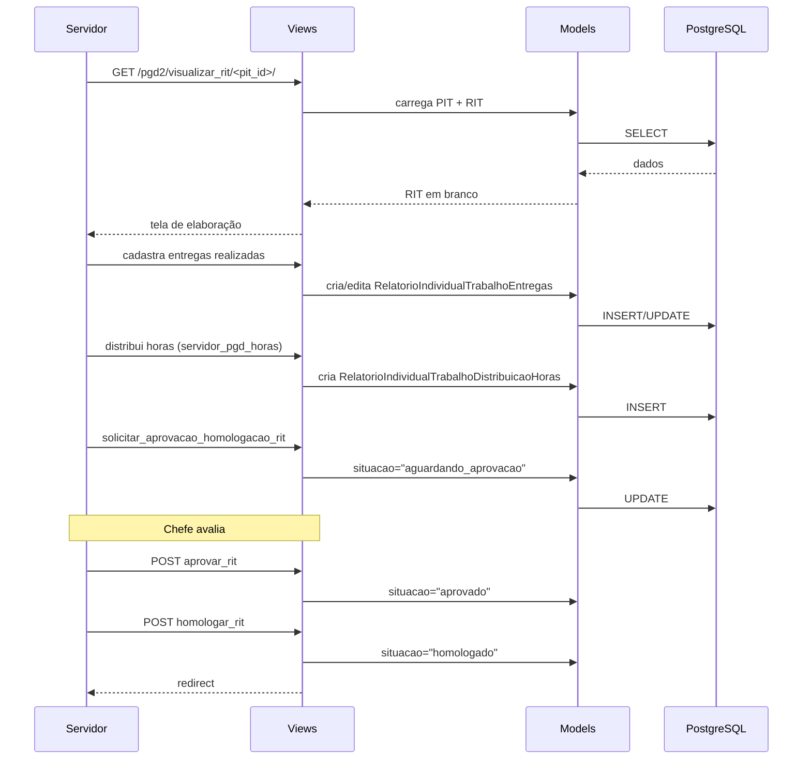

# Fluxo: Ciclo RIT (Relatório Individual de Trabalho)

> Servidor elabora o relatório de execução do PIT, registra entregas realizadas e distribuição de horas, submete para aprovação e homologação do chefe.

- **Ator(es):** Servidor, Chefe imediato — ver [README → Atores e papéis](../README.md#atores-e-papéis)
- **Gatilho:** Servidor acessa "Meu PGD" → PIT homologado → elaborar RIT
- **Pré-condições:** PIT homologado, RIT ainda não elaborado para o período
- **Pós-condições:** RIT homologado, distribuição de horas registrada
- **Depende de:** [Ciclo PIT](ciclo-pit.md) (RIT só pode ser elaborado com PIT `HOMOLOGADO`; é `situacao_rit` no mesmo `PlanoIndividualTrabalho`)
- **Habilita:** [Ciclo PES](ciclo-pes.md) (RIT homologado libera a avaliação da execução do PES) e [Envio de dados à API PGD](envio-api-pgd.md) (avaliação e registros de execução do RIT compõem o payload do plano)
- **Entrada no código:** `views.visualizar_rit`, `views.cadastrar_entrega_rit`, `views.aprovar_rit`, `views.homologar_rit`

## Sequência

## Observações

- Distribuição de horas é feita por tipo de atividade (presencial/teletrabalho)
- RIT pode ser reaberto após homologação (somente por quem tem permissão)
- Questionário opcional pode ser preenchido junto ao RIT
- ⚠️ REVISAR: distribuição de horas tem validação contra carga horária do servidor no `rh`; confirmar se consulta `ponto` para frequência real

---
_Gerado/atualizado via subagent `documentador` em 2026-06-04.
