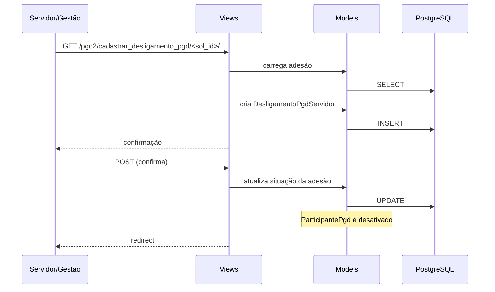

# Fluxo: Desligamento do PGD

> Servidor solicita desligamento do PGD (voluntário) ou gestão realiza desligamento, com justificativa.

- **Ator(es):** Servidor, Gestão PGD — ver [README → Atores e papéis](../README.md#atores-e-papéis)
- **Gatilho:** Servidor acessa "Meu PGD" → solicitar desligamento; ou Gestão via `/pgd2/desligamento/`
- **Pré-condições:** Adesão ativa
- **Pós-condições:** `DesligamentoPgdServidor` criado, adesão encerrada, participante desativado
- **Depende de:** [Adesão ao PGD](adesao-pgd.md) (só há o que desligar se houver adesão ativa). O desligamento automático é disparado pelo [Monitoramento e desligamento automático](monitoramento.md)
- **Habilita:** [Adesão ao PGD](adesao-pgd.md) — após o fim da carência (`data_desligamento_carencia_ate` / `carencia_nova_adesao_ate`) o servidor pode aderir novamente
- **Entrada no código:** `views.cadastrar_desligamento_pgd`, `views.cancelar_desligamento_pgd`, `views.cadastrar_desligamento_pgd_gestao`, `views.desligamento`

## Sequência

## Observações

- Desligamento voluntário: servidor inicia; gestão pode cancelar
- Desligamento por gestão: disponível para grupo `gestao_pgd2`
- Justificativa obrigatória (do catálogo `JustificativaDesligamentoPgd`)
- Após desligamento, servidor não pode criar PIT/RIT até nova adesão

---
_Gerado/atualizado via subagent `documentador` em 2026-06-04.
