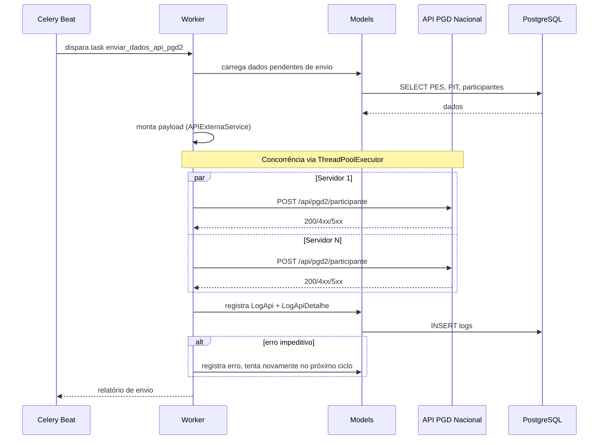

# Fluxo: Envio de Dados à API PGD Nacional

> Sistema envia periodicamente dados consolidados de PES, PIT, RIT e participantes para a API externa do governo federal.

- **Ator(es):** Sistema (task Celery) — ver [README → Atores e papéis](../README.md#atores-e-papéis)
- **Gatilho:** Agendamento Beat (`enviar_dados_api_pgd2` às 02:27 BRT)
- **Pré-condições:** Dados de PES/PIT/RIT consolidados, token de API configurado
- **Pós-condições:** `LogApi` registrado com status de cada envio
- **Depende de:** [Adesão ao PGD](adesao-pgd.md) (gera o `ParticipantePgd` enviado), [Ciclo PES](ciclo-pes.md), [Ciclo PIT](ciclo-pit.md) (somente PITs homologados/cancelados, `deve_enviar_pela_api`) e [Ciclo RIT](ciclo-rit.md) (avaliação/registros de execução do RIT)
- **Habilita:** _nenhum_ (etapa terminal; resultado é o consumo da API nacional)
- **Entrada no código:** `management/commands/enviar_dados_api_pgd2.py`, `api_pgd2_v2.py` (ou `api_pgd2.py` legado)

## Sequência

## Observações

- Versão ativa: `api_pgd2_v2.py` (com `APIExternaService`, concorrência, Session reutilizável)
- Versão legada: `api_pgd2.py` pode estar obsoleta
- Logging detalhado por servidor, PES e PIT em tabelas separadas (`LogApiPesEnvio`, `LogApiParticipanteEnvio`, `LogApiPitEnvio`)
- Comando `resetar_envio_dados_exceto_log_pgd2` permite reenviar dados já enviados (útil para correção)
- ⚠️ REVISAR: confirmar se API v1 ainda tem endpoints em uso ou se pode ser removida

---
_Gerado/atualizado via subagent `documentador` em 2026-06-04.
