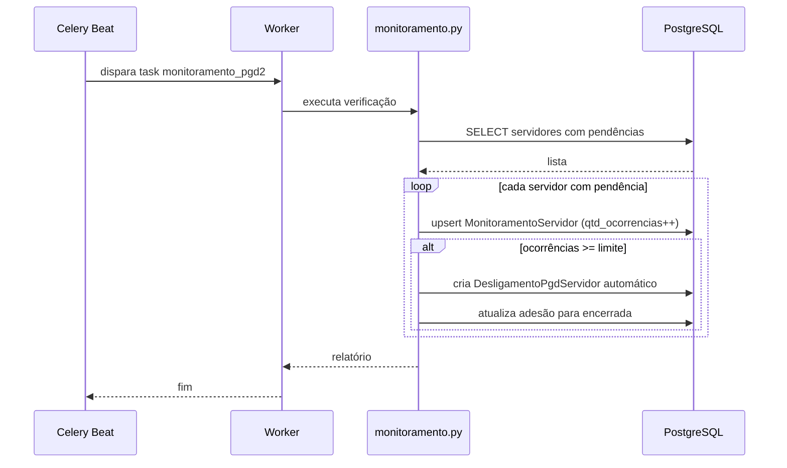

# Fluxo: Monitoramento e Desligamento Automático

> Sistema verifica periodicamente servidores com pendências (PIT/RIT atrasados) e pode acionar desligamento automático conforme regras.

- **Ator(es):** Sistema (task Celery) — ver [README → Atores e papéis](../README.md#atores-e-papéis)
- **Gatilho:** Agendamento Beat (`monitoramento_pgd2` às 02:02 BRT)
- **Pré-condições:** Servidores com adesão ativa e pendências
- **Pós-condições:** `MonitoramentoServidor` atualizado; se regra excedida, desligamento automático
- **Depende de:** [Adesão ao PGD](adesao-pgd.md) (itera servidores com adesão ativa). Não depende do PIT/RIT: a pendência é detectada justamente pela **ausência** de PIT/RIT
- **Habilita:** [Desligamento do PGD](desligamento-pgd.md) — quando a regra é excedida, `desligamento_automatico_servidores()` cria o `DesligamentoPgdServidor`
- **Entrada no código:** `management/commands/monitoramento_pgd2.py`, `monitoramento.py`

## Sequência

## Observações

- Pendências detectadas: PIT não preenchido, RIT não entregue, atraso na homologação
- Limite de ocorrências configurável via `Configuracao` ou env
- Monitoramento também gera notificações para chefes (`notificacoes.py`)
- ⚠️ REVISAR: confirmar exatamente quais regras de monitoramento existem no código (`MonitoramentoServidor.regra`)

---
_Gerado/atualizado via subagent `documentador` em 2026-06-04.
