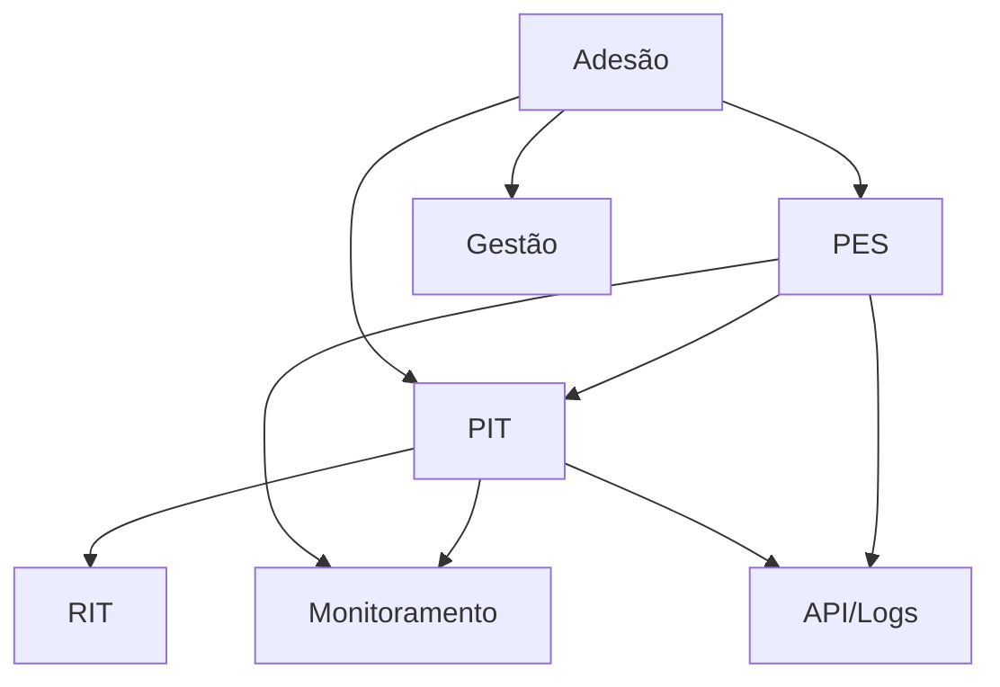

# Modelo de dados — pgd2

> Módulo grande: o modelo está particionado por **subdomínio**.
> Como o módulo tem um único `models.py` (não pacote), os subdomínios foram agrupados por
> **clusters de nome/relação** (inferência — marque `⚠️ REVISAR`).
>
> Cada sub-área tem seu próprio ERD; este índice dá a visão macro e como as áreas
> se conectam.

## Subdomínios

| Subdomínio | Entidades principais | ERD |
|---|---|---|
| Adesão | SolicitacaoAdesaoServidor, DocumentoAdesaoServidor, DesligamentoPgdServidor, PGDExterior, ConfiguracaoPerfilServidor, RegistroAcaoSolicitacaoAdesaoServidor | [adesao.md](adesao.md) |
| PES | PeriodoPes, PlanoEntregasSetorial, PlanoEntregasSetorialAprovacao, PlanoEntregasSetorialAvaliacao, PlanoEntregasSetorialConsulta, PlanoEntregasSetorialHorarioFuncionamentoSetor, PlanoEntregasSetorialHorarioPlanejamentoSetor, PlanoEntregasSetorialEntregas, ConfiguracaoOrientacaoPlanoEntregasSetorial, RegistroAcaoPES | [pes.md](pes.md) |
| PIT | PeriodoPitRit, PlanoIndividualTrabalho, PlanoIndividualTrabalhoCopia, PlanoIndividualTrabalhoPresencial, PlanoIndividualTrabalhoAtendimento, PlanoIndividualTrabalhoEntregas, PitSetores, PitSolicitacaoAnalise, PitSolicitacaoAnaliseSetor, ConfiguracaoOrientacaoPit, RegistroAcaoPlanoIndividualTrabalho | [pit.md](pit.md) |
| RIT | RelatorioIndividualTrabalho, RelatorioIndividualTrabalhoQuestionario, RelatorioIndividualTrabalhoDistribuicaoHoras | [rit.md](rit.md) |
| Gestão/Comissão | ComissaoPGD, ParticipantePgd, SetorHabilitacao, JustificativaDesligamentoPgd, ControleRecorrenciaPGD | [gestao.md](gestao.md) |
| Monitoramento | MonitoramentoServidor | [monitoramento.md](monitoramento.md) |
| API/Integração | LogApi, LogApiDetalhe, LogApiPesEnvio, LogApiParticipanteEnvio, LogApiPitEnvio, SetorPgdApi | [api-logs.md](api-logs.md) |

> ⚠️ REVISAR: agrupamento inferido porque `models.py` é único (não pacote `models/`).
> `RegistroAcaoPGD` (base de auditoria) não foi incluído como subdomínio separado
> porque é classe base compartilhada; aparece nos ERDs como herança.

---
_Gerado/atualizado via subagent `documentador` em 2026-06-04.
