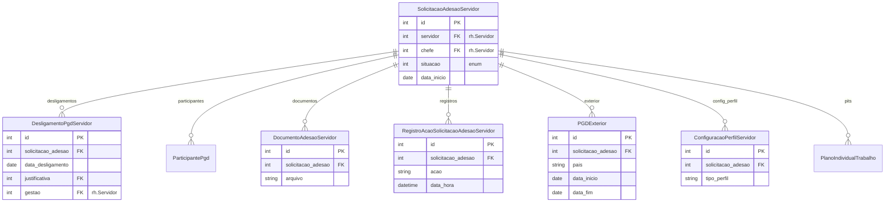

# Modelo de dados — Adesão

> ERD das entidades de adesão ao PGD (models herdam `ModelPlus` de `djtools.db`).
> FKs para entidades de outras áreas aparecem como **externas**.
> Termos: ver [Glossário](../GLOSSARIO.md).

## Entidades

| Entidade | Descrição | Relações-chave |
|---|---|---|
| `SolicitacaoAdesaoServidor` | Pedido de adesão do servidor ao PGD | FK `servidor`, `chefe` (rh); 1:N com desligamento, documentos, PITs |
| `DesligamentoPgdServidor` | Registro de desligamento do PGD | FK `solicitacao_adesao`; FK `justificativa` (JustificativaDesligamentoPgd) |
| `DocumentoAdesaoServidor` | Documento de adesão (termo/ADE) | FK `solicitacao_adesao` |
| `PGDExterior` | Servidor em exercício no exterior | FK `solicitacao_adesao` |
| `RegistroAcaoSolicitacaoAdesaoServidor` | Log de ações na solicitação de adesão | Herda `RegistroAcaoPGD`; FK `solicitacao_adesao` |
| `ConfiguracaoPerfilServidor` | Perfil/configuração do servidor no PGD | FK `solicitacao_adesao` |

## Entidades externas referenciadas

| Entidade | Módulo/área de origem |
|---|---|
| `Servidor` | `rh` |
| `JustificativaDesligamentoPgd` | Gestão/Comissão (mesmo módulo) |
| `ParticipantePgd` | Gestão/Comissão (mesmo módulo) |
| `PlanoIndividualTrabalho` | PIT (mesmo módulo) |

---
_Gerado/atualizado via subagent `documentador` em 2026-06-04.
