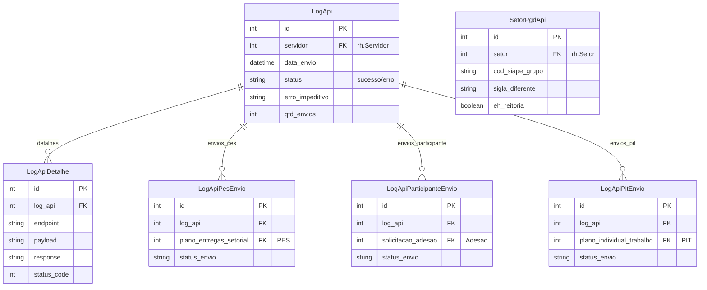

# Modelo de dados — API/Integração e Logs

> ERD das entidades de integração com API PGD e logs (models herdam `ModelPlus` de `djtools.db`).
> FKs para entidades de outras áreas aparecem como **externas**.
> Termos: ver [Glossário](../GLOSSARIO.md).

## Entidades

| Entidade | Descrição | Relações-chave |
|---|---|---|
| `LogApi` | Registro de envio de dados à API PGD | FK `servidor` (rh); 1:N com detalhes e envios específicos |
| `LogApiDetalhe` | Detalhe por chamada HTTP ao endpoint da API | FK `log_api` |
| `LogApiPesEnvio` | Status de envio de PES específico | FK `log_api`, FK `plano_entregas_setorial` |
| `LogApiParticipanteEnvio` | Status de envio de participante específico | FK `log_api`, FK `solicitacao_adesao` |
| `LogApiPitEnvio` | Status de envio de PIT específico | FK `log_api`, FK `plano_individual_trabalho` |
| `SetorPgdApi` | Mapeamento de setor SUAP para API PGD (códigos SIAPE, siglas) | FK `setor` (rh) |

## Entidades externas referenciadas

| Entidade | Módulo/área de origem |
|---|---|
| `Servidor` | `rh` |
| `Setor` | `rh` |
| `PlanoEntregasSetorial` | PES (mesmo módulo) |
| `SolicitacaoAdesaoServidor` | Adesão (mesmo módulo) |
| `PlanoIndividualTrabalho` | PIT (mesmo módulo) |

---
_Gerado/atualizado via subagent `documentador` em 2026-06-04.
